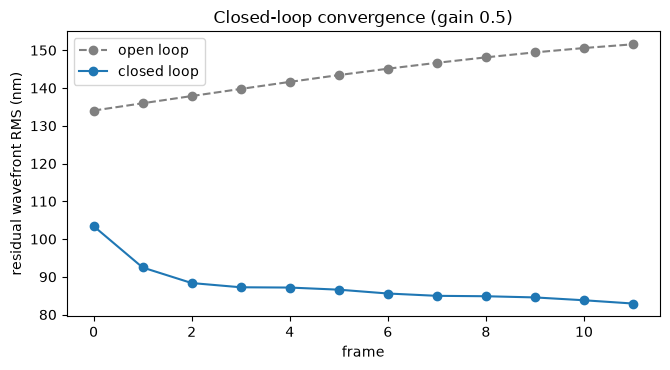
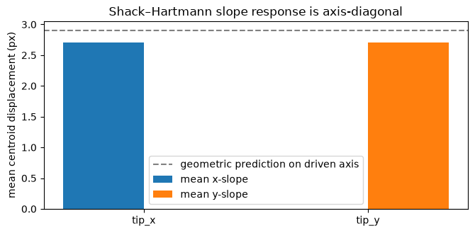
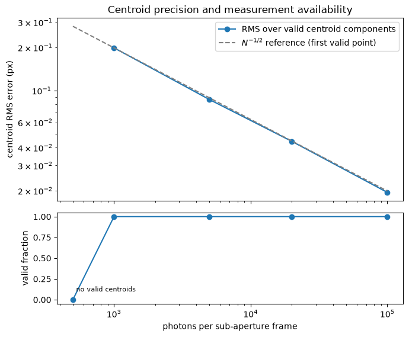
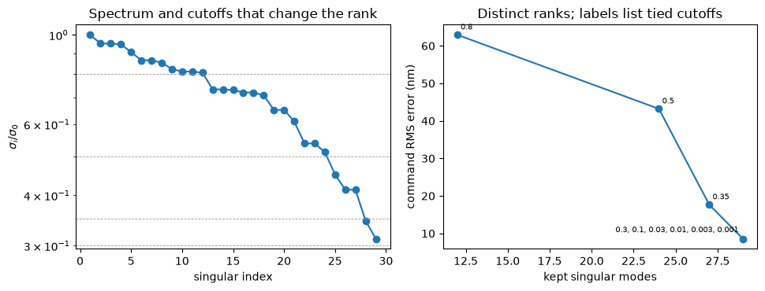
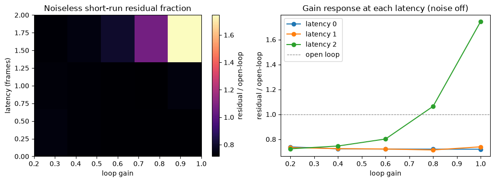
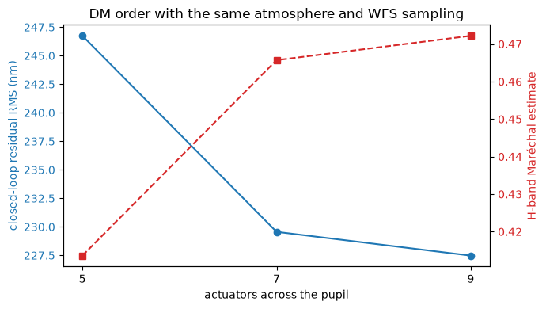
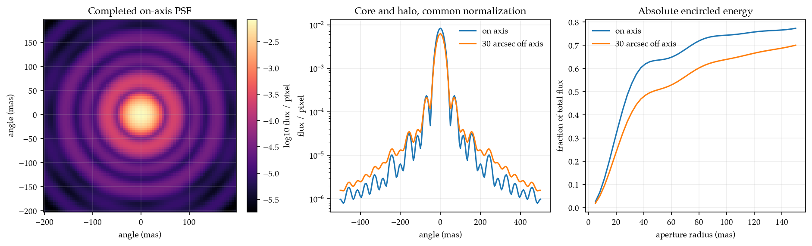
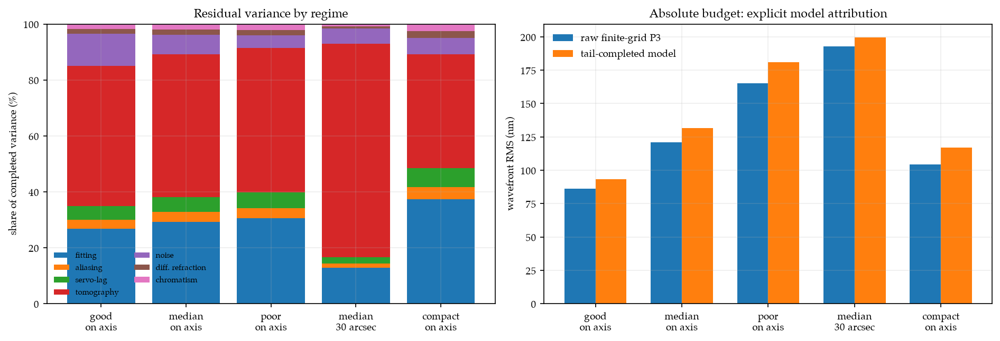
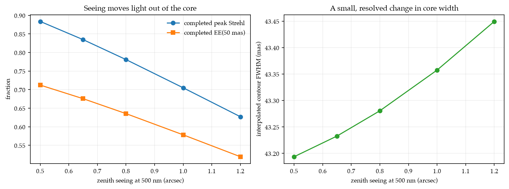
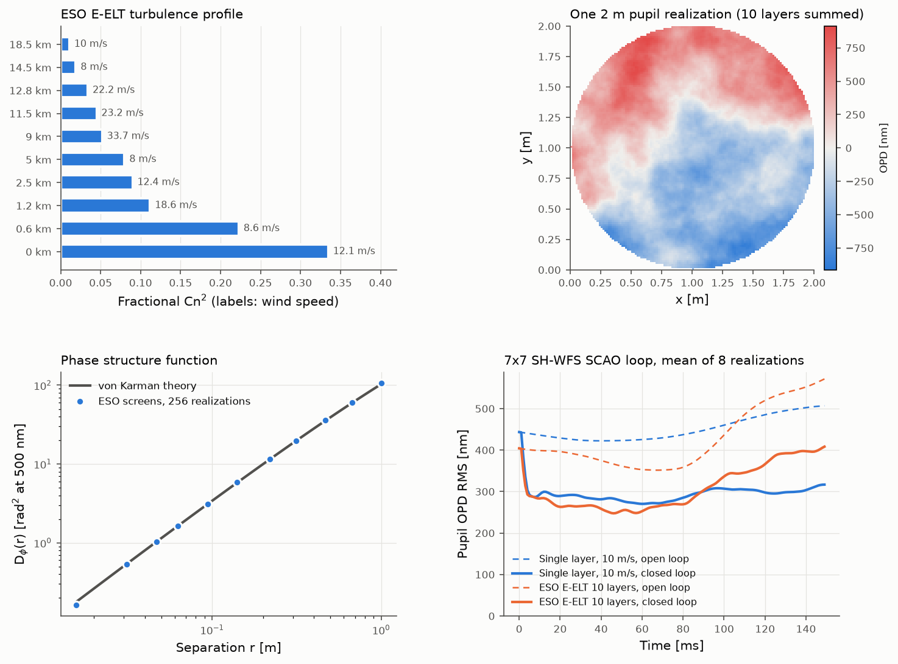

# Shack-Hartmann Wavefront Sensing & Adaptive Optics

[](https://github.com/xhvoid/Shack-Hartmann-AO-Simulation/actions/workflows/ci.yml)
[](pyproject.toml)
[](LICENSE)

**An optical engineering project connecting wavefronts, detector images,
calibrated reconstruction, feedback control and science-image quality.**

A modular Shack-Hartmann SCAO simulation framework with native and HCIPy
optical backends, custom detector and real-time-control modelling,
science-facing PSF diagnostics, and cross-backend physical validation.

The central question is how an optical disturbance becomes a measurement,
how that measurement becomes a mirror command, and how the remaining error
appears in an astronomical image. The project follows that chain in Python
and uses controlled experiments to distinguish physical effects from noise,
calibration choices and numerical sampling.

The native model uses single-conjugate adaptive optics (SCAO). Wavefronts are
represented as optical path difference (OPD), and the point spread function
(PSF) connects residual aberrations to image quality.

In the introductory closed-loop experiment, matched final-half wavefront RMS
falls from **148.6 to 84.4 nm**, a **43.2% reduction**. A complementary
system-level study shows why residual RMS alone is insufficient: worsening
seeing reduces energy inside a fixed science aperture by **27.1%**, while
the measured PSF core width changes only slightly. These are results of the
specified synthetic experiments below.



*Figure 1 — A 1 m, 500 Hz, 12-frame native SCAO example, with gain 0.5,
zero frame delay and detector noise disabled. Open and corrected RMS use the
same atmospheric trajectory and final six frames. This short experiment
demonstrates correction and transients; longer runs and multiple seeds are
needed to assess sustained performance. [Executed notebook](notebooks/tutorials/04_closed_loop_control.ipynb).*

**A short review route:**
[sensor and detector analysis](#sensor-and-detector-analysis) →
[reconstruction and control](#reconstruction-and-control) →
[PSFs and error budgets](#psfs-and-error-budgets) →
[ESO E-ELT turbulence](#eso-e-elt-turbulence-model) →
[detector-level camera model](#detector-level-camera-model) →
[HCIPy lenslet-axis correction](#hcipy-lenslet-axis-correction) →
[validation evidence](#validation-evidence).
For execution, see [Run the project](#run-the-project).
The [technical reference](docs/technical_reference.md) explains the whole
implementation in one document: models, modes, selection, evidence and
costs. Open questions are in the [roadmap](docs/roadmap.md), and known
boundaries in the [limitations register](docs/current_limitations.md).

## What the project demonstrates

| Engineering task | Implementation | Evidence to inspect |
| --- | --- | --- |
| Connect optics to measurements | OPD/phase conversion, von Kármán frozen-flow turbulence (including ESO's ten-layer E-ELT profile), lenslet propagation and detector sampling | [Wavefront tutorial](notebooks/tutorials/00_wavefront_and_atmosphere.ipynb), [sensor calibration](notebooks/tutorials/01_geometric_shwfs.ipynb), [ESO turbulence model](docs/eso_elt_turbulence_model.md) |
| Extract reliable measurements from images | Photon/read noise, detector response, reference centroids, quality masks and explicit invalid measurements | [Detector tutorial](notebooks/tutorials/02_detector_centroiding.ipynb), [detector-level SCAO](notebooks/studies/detector_level_2m.ipynb) |
| Calibrate and solve an inverse problem | Actuator/modal interaction matrices, singular-spectrum diagnostics, least squares, TSVD and Tikhonov reconstruction | [Reconstruction tutorial](notebooks/tutorials/03_tsvd_regularization.ipynb), [calibration API](src/shwfs_ao/calibration) |
| Test feedback under practical constraints | Leaky integration, frame latency, actuator stroke/fault policies and feedback of the applied command | [Control tutorial](notebooks/tutorials/04_closed_loop_control.ipynb), [gain/delay study](notebooks/studies/noise_latency_gain.ipynb) |
| Relate optical errors to science images | Fourier PSFs, peak Strehl, FWHM, encircled energy and atmospheric/guide-star sensitivity | [TIPTOP study](notebooks/studies/12_TIPTOP_performance_modelling.ipynb), [science API](src/shwfs_ao/science) |
| Make numerical conclusions reviewable | Analytic references, sampling checks, backend comparisons, seeded artifacts and automated execution | [Numerical verification](docs/numerical_accuracy_fixes.md), [validation policy](docs/validation.md) |

The native NumPy/SciPy implementation makes the numerical chain inspectable.
Optional **HCIPy** adapters provide independently implemented optical
components through the same interfaces. A separate **TIPTOP/P3 and MASTSEL**
study adds analytical multi-guide-star sensitivity modelling. The time-domain
and analytical studies answer different questions and retain their own
configurations and validation limits.

## Sensor and detector analysis

### Calibrate the response before reconstructing the wavefront

The [Shack-Hartmann calibration tutorial](notebooks/tutorials/01_geometric_shwfs.ipynb)
uses a 1 m pupil, 8×8 lenslet geometry, 52 illuminated sub-apertures and a
700 nm sensing wavelength. Independent **2 µrad** x and y tilts test response
sign, scale and cross-axis coupling.

| Quantity | Recorded value |
| --- | --- |
| Geometric displacement on the driven axis | 2.902 px |
| Measured mean centroid displacement | 2.701 px |
| Measured/geometric response gain | **0.9305** |

The finite sampled spot window produces a response below the simple geometric
prediction. This motivates measuring the response of the complete optical and
detector chain rather than using geometry alone as the reconstruction scale.

<details>
<summary><strong>View the two-axis calibration figure</strong></summary>



*Figure 2 — The driven-axis responses agree, while the orthogonal response is
negligible in this symmetric synthetic configuration. The dashed line is the
geometric prediction. [Source notebook](notebooks/tutorials/01_geometric_shwfs.ipynb).*

</details>

### Report precision and measurement availability together

The [detector experiment](notebooks/tutorials/02_detector_centroiding.ipynb)
holds one static aberration fixed and varies photons per sub-aperture per
frame. It pools centroid errors over valid components from **12 realizations**,
relative to a noise-free reference. Photon noise, configured read noise and
centroid-quality cuts remain part of the measurement chain.



*Figure 3 — Valid-component centroid RMS decreases from **0.1987 px at
1,000 photons** to **0.01944 px at 100,000 photons**. The dashed inverse-square-root
reference is anchored to the first valid point. At 500 photons, this
configuration yields **no valid centroids**; its measured RMS is NaN.*

The two panels carry different information: precision describes the accepted
measurements, while availability describes how much data survived the quality
policy. Treating an invalid centroid as zero would hide the low-flux failure.
The trend is consistent with the reference over the valid points, but this
small experiment does not establish a universal shot-noise law.

## Reconstruction and control

### Inspect which modes the measurement can support

The [TSVD tutorial](notebooks/tutorials/03_tsvd_regularization.ipynb)
calibrates an actuator interaction matrix and reconstructs one known command
from a noisy detector measurement. The cutoff scan crosses the measured
singular spectrum, so different settings actually retain different ranks.

| Retained singular modes | Command RMS error |
| --- | --- |
| 12 | 62.94 nm |
| 24 | 43.22 nm |
| 27 | 17.66 nm |
| 29 | **8.58 nm** |



*Figure 4 — In this realization, discarding sensed modes increases the command
error. All cutoffs retaining the full calibrated rank of 29 give the same
result. The reconstruction-error scan is distinct from an L-curve.*

The useful diagnostic is the retained information and its effect on recovery,
not the cutoff value by itself. Choosing a regularization parameter for a
real sensor would require an ensemble of commands and noise realizations,
alongside the calibration uncertainty and optical nonlinearity.

### Separate controller tuning from delay and actuator count

The [gain/delay study](notebooks/studies/noise_latency_gain.ipynb) compares
15 combinations of gain and latency on the same frozen-flow trajectory:
a 1 m pupil, 1 kHz loop and 16 frames, with detector noise disabled. Its metric
is mean corrected RMS divided by mean open-loop RMS over the final half.



*Figure 5 — With two frames of delay, the ratio rises from **0.723 at gain 0.2**
to **1.746 at gain 1.0**; values above one show disturbance amplification in
this run. Zero- and one-frame cases behave differently. The scan demonstrates
delay sensitivity, without establishing a general stability boundary.*

A separate [correction-order study](notebooks/studies/high_order_scao.ipynb)
holds the atmosphere, pupil sampling, 10×10 lenslet geometry and controller
settings fixed while changing the synthetic DM grid. The 1.5 m, 1 kHz,
14-frame experiment uses gain 0.5 and one frame of delay, with noise disabled.

| DM grid | Active actuators | Matched open-loop RMS | Corrected RMS |
| --- | --- | --- | --- |
| 5×5 | 13 | 256.3 nm | 246.7 nm |
| 7×7 | 29 | 256.3 nm | 229.6 nm |
| 9×9 | 49 | 256.3 nm | 227.5 nm |

<details>
<summary><strong>View the correction-order comparison</strong></summary>



*Figure 6 — Increasing actuator count improves this particular configuration,
with a smaller change between the final two grids. The H-band curve is a
Maréchal estimate calculated from residual RMS, not a measured image Strehl.
The Gaussian influence width is 0.35 times actuator pitch; this is a declared
synthetic mirror basis. [Source notebook](notebooks/studies/high_order_scao.ipynb).*

</details>

These matched comparisons help isolate a changed parameter. Their residuals
still combine mirror-basis limitations, sensing, reconstruction and temporal
tracking. A short actuator-count scan alone cannot assign the residual to
classical fitting error. The separate
[2 m detector-level study](notebooks/studies/detector_level_2m.ipynb) includes
detector noise and records **394.2 → 354.6 nm** matched RMS for its own setup.

## PSFs and error budgets

### From residual wavefronts to image-quality diagnostics

The project evaluates several complementary metrics:

- **Peak Strehl:** peak intensity relative to the matching diffraction
  reference, with consistent flux normalization.
- **FWHM:** the PSF core width, with an explicit estimator and sampling checks.
- **Encircled energy:** flux inside a specified angular radius, retaining the
  full computational-field denominator after a science-image crop.

These diagnostics are relevant to comparing optical configurations and image
analysis methods: a sharper or nearly unchanged core does not necessarily
mean that the same amount of light remains in a useful science aperture.

### A complementary analytical MCAO study

[Notebook 12](notebooks/studies/12_TIPTOP_performance_modelling.ipynb)
studies a representative **8 m-class telescope, eight laser guide stars and
three deformable mirrors**, at **1.65 µm** across seven science directions
spanning **0–30 arcsec**. The configuration is adapted from the distributed
TIPTOP `MavisMCAO.ini` example. It explores seeing, outer scale, turbulence
altitude distribution and guide-star geometry.

This multi-conjugate adaptive optics (MCAO) baseline uses **0.8 arcsec zenith
seeing at 500 nm**. The quoted baseline quantities refer to its on-axis
science direction.

The local adapter combines P3's sampled correction-band residual spectrum
with an explicit continuous von Kármán fitting tail, then propagates the result
with MASTSEL. Raw upstream outputs remain available alongside the completed
model. These results are representative sensitivity experiments, rather than
an official instrument design or an unmodified TIPTOP prediction.

| Completed on-axis baseline quantity | Result |
| --- | --- |
| Total residual wavefront RMS | **131.7 nm** |
| Peak Strehl | **0.781** |
| Encircled energy within a **50 mas radius** | **0.635** |
| Tomographic error contribution | 94.0 nm; **50.9% of residual variance** |
| Fitting error contribution | 71.3 nm; **29.3% of residual variance** |



*Figure 7 — Core, halo and aperture energy use common normalization. The
baseline science crop contains about **95.18%** of the computational-field
flux and is not renormalized, so the encircled-energy curve retains losses
outside that crop.*

### Identify numerical coverage before interpreting the budget

A key finding is that the raw finite-grid fitting estimate depends on frequency
coverage: it is **47.90 nm** on the original P3 grid and **64.92 nm** after
doubling the native image field. Integrating the same atmospheric PSD above
the circular correction cutoff to infinity gives **71.30 nm**. The completion
replaces the finite fitting term; it is kept separate from the retained
correction-band terms to avoid double-counting.



*Figure 8 — The left panel compares shares of completed residual variance;
the right panel retains both raw finite-grid P3 and tail-completed totals.
The baseline total changes from **120.8 to 131.7 nm**. Budget closure checks
verify consistent bookkeeping, while separate convergence tests examine
numerical sampling.*

### Compare the science consequences of atmospheric changes

Across the **0.5–1.2 arcsec** seeing sweep, energy within a 50 mas radius falls
by **27.1%** relative to its good-seeing value. At the same 5 mas focal-pixel
scale, measured core FWHM changes from **43.19 to 43.45 mas**. Redistributing
turbulence in altitude at fixed integrated seeing changes on-axis peak Strehl
by **0.07766** in the tested profiles, while preserving `r0` and fitting error.



*Figure 9 — The fixed-aperture metric reveals degradation that a nearly stable
core width alone would understate. Input seeing is defined at zenith and
500 nm. FWHM values are sampled estimates; their small differential change
does not establish equally small absolute uncertainty.*

The recorded study contains **15 model evaluations and 105 completed
science-direction PSFs**, including a repeated baseline. Its validation
separately changes tail quadrature, computational OTF extent and focal-pixel
scale. For example, halving baseline pixels from 5 to 2.5 mas changes FWHM
by up to **0.371%** across the seven directions. An independent annular Airy
reference exposes estimator biases of **−0.497%** and **−0.123%** at those
two scales. Computational-grid convergence alone would miss that bias.

See the [method, convergence evidence and supported scope](docs/notebook12_tiptop_portfolio_notes.md)
and [machine-readable numerical checks](notebooks/studies/tiptop_validation.json).
The validated adapter is CPU, single-wavelength and high-order-only, using a
generated annular pupil and circular correction cutoff.

## ESO E-ELT turbulence model

The time-domain simulation can run under the atmosphere ESO used for its
E-ELT Design Reference Mission end-to-end AO simulations (OCTOPUS). ESO's
[technical-data page](https://www.eso.org/sci/facilities/eelt/science/drm/tech_data/ao/)
specifies a von Kármán spectrum with **r0 = 0.13 m at 500 nm**,
**L0 = 25 m** and **ten layers from 0 to 18.5 km**. Each layer has a
published Cn² fraction and wind speed (8.0–33.7 m/s). The table is packaged
verbatim with its provenance. The published fractions sum to 1.001 and are
renormalized on load; wind directions are not published and default to +x.
The profile implies a coherence time τ0 of **2.81 ms**, an isoplanatic angle
θ0 of **1.90″** and a Greenwood frequency of **47.6 Hz**.

The new `native_layered` atmosphere gives each layer its own absolutely
normalized von Kármán screen with r0ᵢ = r0·fᵢ^(−3/5) and its own frozen-flow
wind. Low spatial frequencies are evaluated analytically, so every layer
translates exactly, sub-pixel, with no travel limit, at one inverse FFT per
frame for all ten layers. The discrete spectrum's expected pupil variance is
within **0.5%** of the von Kármán integral. Over 256 independent screens, the
measured phase structure function matches theory within **2.5%** from 2 px
to 1 m. The HCIPy backend builds the same layers as `hcipy_layered`; its
independently generated screens reproduce the native structure function
within **3.1%** at 2–16 px. They also match the temporal decorrelation from the
per-layer winds within **1.5%** at 10–30 ms.



*Figure 10 — The packaged `eso_turbulence_2m_detector@1` profile is
`portfolio_2m_detector@4` (2 m, 7×7 detector-level Shack-Hartmann, 1 kHz,
two-frame latency) with only the atmosphere replaced. Over 8 realizations
(frames 50–149), it corrects ESO's turbulence from **444 to 325 nm** RMS,
against **462 to 294 nm** under the single 10 m/s layer. The faster
turbulence-weighted wind (14.5 m/s) leaves a larger temporal residual, though
the open-loop turbulence is slightly weaker. Short-exposure means carry a
realization scatter of tens of nanometres.
Generated by [the ESO turbulence demo](examples/run_eso_elt_turbulence_demo.py).*

Profile schema 4 adds the per-layer block, `atmosphere.layers`, so any SCAO
profile can carry a layered atmosphere; every published profile keeps its
identity. Model details, validation and scope (on-axis only; altitude is
recorded but there is no anisoplanatism or LGS cone effect) are in the
[ESO turbulence notes](docs/eso_elt_turbulence_model.md).

```python
from dataclasses import replace

from shwfs_ao.experiments import run_closed_loop
from shwfs_ao.io import eso_elt_turbulence_profile, load_system_profile

eso = eso_elt_turbulence_profile()
print(eso.coherence_time_s, eso.isoplanatic_angle_arcsec)

history = run_closed_loop(load_system_profile("eso_turbulence_2m_detector", 1))

# Any profile can be driven by the same turbulence:
config = replace(
    load_system_profile("research_2m_detector", 3),
    atmosphere_model="native_layered",
    atmosphere=eso.to_atmosphere_config(),
    record_schema_version=4,
)
```

## ESO-derived 42 m SCAO benchmark

The repository also contains an **ESO-derived SCAO benchmark**. It uses the
historical E-ELT DRM scales: a 42 m aperture with a 0.28 central obstruction,
the ten-layer atmosphere above, an 84×84 Shack-Hartmann and an 85×85
linear-spline ground DM. The loop runs at 500 Hz with a three-interval command
delay and noiseless image-based sensing. It is a single on-axis NGS SCAO
adaptation, not an ESO instrument model, and no parameter was tuned toward a
published Strehl. Every executable value is traced to a packaged source
ledger (ESO DRM pages R1/R2; two further studies kept as separate reference
cases) or to an explicit assumption in a packaged assumption ledger, which
the tests check against every profile.

The high-order path avoids dense actuator-by-pupil and lenslet-by-pupil
stacks. The DM is a sparse local operator (5873 laid-out actuators).
The 5112 retained lenslets are stored as cells and
transformed in bounded FFT batches. Calibration groups actuators that share no
lenslet, so the 5328 eligible actuators (geometric exclusions are recorded by
ID and reason) are calibrated with 11 sensor measurements, exactly equal to
per-actuator central differences. Reconstruction is damped LSMR on the sparse
response. A passive frame observer accumulates long-exposure science images
as averages of instantaneous intensities, never of OPD. Previously recorded
version-2 runs on the development desktop show the full
84×84 / 85×85 / 1008-pixel system building and running 20
closed-loop frames at 1.5 GB peak memory in about 110 s, with every solve
converged and zero DM saturation. A 2000-frame (4 s) run that reuses the
verified calibration takes about an hour. It holds a 173 nm residual and
gives a long-exposure Strehl ratio of 0.78 at 2.2 µm in this noiseless,
single-realization model.

The 20-frame run demonstrates spatial-scale capability. A paired sampling
study at 12 m and 42 m found the Strehl ratio converged within the declared
**2%** in pupil, wavefront-sensor and science sampling. EE50 at the default
science sampling is pixel-limited (3.6–7.3% high against a twice finer image),
so quote it as an upper estimate. The earlier smoke-tier scan, which missed
the criterion, changed the sensor's field of view and used unpaired screens.
Validation on an 8 GiB host remains pending. The 4 s reference run also repeats the fastest
layers' periodic atmospheric bands, reducing statistical independence.

<!-- readme-smoke: native -->
```bash
AO_DEMO_OUTPUT_DIR=readme-smoke-output python examples/run_eso_scao_benchmark.py
python examples/run_eso_scao_benchmark.py --tier full --dry-run
```

The first command runs the 5 m software-smoke tier in a supervised,
thread-limited child process. The supervisor keeps all running process-group
members under memory, pressure and wall-clock limits, stops the group if a
monitoring probe raises, and treats zombie members as exited.
The second prints the full tier's configuration
and peak-memory estimate without building it. Larger tiers need
`--enable-large-run`, and the desktop memory policy may also require an
explicitly authorized budget. Sources, assumptions, tiers, the high-order
path and the long-exposure definitions are in the
[benchmark notes](docs/eso_scao_benchmark.md). The commands run, their
results, and the gates still pending are in the
[execution record](docs/refactor/ESO_SCAO_DEVELOPMENT_STATUS.md).

## Detector-level camera model

Schema-7 profiles can select a **physical camera path**
(`shwfs_ao.detector.physical_camera.v1`) in place of the original idealized
detector model, which stays the default and is unchanged. The path covers:

- **Photometry:** an AB-magnitude source and sky with QE applied once.
- **Optics:** polychromatic lenslet images formed by a matrix Fourier
  transform, integrated over the detector pixels, with charge diffusion.
- **Cameras:** synthetic CCD, EMCCD (Gamma register, F² = 2,
  pre-register clock-induced charge) and CMOS (per-pixel offset, gain and
  read-noise maps) models.
- **Electronics:** separate pixel, register and ADC saturation, with an
  optional declared electronic-coupling kernel.
- **Pixel maps:** persistent maps tied to physical pixel IDs.
- **RTC processing:** pixel processing that uses *estimated* bias, dark,
  sky and flat masters.
- **Noise model:** a first-order centroid-noise model,
  `detector_covariance_v2`, that propagates the full covariance (including
  coupling and master-frame errors) and flags the regimes it does not
  support.

The evidence is recorded in the
[execution record](docs/refactor/DETECTOR_LEVEL_DEVELOPMENT_STATUS.md), and
the model is defined in the [detector model notes](docs/detector_model.md):

- **Model versus Monte Carlo.** Across all three cameras, with and without
  background, centroid scatter at 10⁴ trials per point stays within
  **2.4 %** of the model (`detector_covariance_v2`, the review rerun)
  throughout its supported domain. The calibration ensembles over 200
  regenerated masters agree within 4.4 %.
- **Open-loop noise propagation.** On the 2 m systems the measured
  slope-noise covariance averages 0.996–1.004× the independent prediction.
  The reconstruction covariance is 0.984–0.998× R·Σ·Rᵀ.
- **12 m noise propagation.** On the 12 m system the slope-noise
  covariance averages 0.999× the prediction, and the reconstruction
  covariance trace is 1.008× R·Σ·Rᵀ.
- **Optics oracles.** With one sample per pixel, the matrix-Fourier optics
  reproduce the original FFT spots to 1e-12. Pixel integration matches erf
  integrals to 1e-6.

| Profile | Camera | Sampling | Status |
| --- | --- | --- | --- |
| `det_ccd_2m_synthetic@1`, `det_emccd_2m_synthetic@1`, `det_cmos_2m_synthetic@1` | synthetic CCD, EMCCD, CMOS | 700 nm, FFT point sampling | noise-on closed loops run |
| `det_emccd_2m_plane_synthetic@1` | coupled EMCCD | 0.6–0.9 µm, 3 nodes, pixel-integrated, diffusion | noise-on closed loops run |
| `det_emccd_12m_medium_derived@1`, `@2`, `@3` | coupled EMCCD | R3 band, pixel-integrated | magnitude scan, camera comparison, effect sizes, exposure integration and 12 m noise propagation run with explicit enablement; `@3` adds Tikhonov damping 0.1 and the reset recovery policy |
| `det_ccd_42m_r3band_derived@1` | CCD, 3 e⁻ | R3 band, pixel-integrated | one 2000-frame noise-on run, with explicit enablement |

On the 12 m tier the magnitude scan exposed a limit set by the control
policy rather than by the camera.

- **`@1`, the predeclared version:**
  - It collapses at m_AB = 10.
  - The cause is a peak-pixel SNR gate inherited from the point-sampled
    2 m profiles: it rejects lenslets whose total SNR is still about 20.
  - From m_AB = 11 the interaction calibration, measured at the
    guide-star flux, has no valid rows at all.
- **`@2`, a recorded post-hoc revision:**
  - It calibrates with a bright internal source.
  - It gates on the validated noise-model domain instead.
  - It holds 186–189 nm and a K-band Strehl of about 0.72 down to
    m_AB = 10, with the EMCCD. At that magnitude the CCD is read-noise
    limited, with no valid lenslet.
  - Lock is lost at m_AB = 11. The loop first closes to about 225 nm, but
    once fewer than half the lenslets are valid the reconstructor returns
    no estimate, the deformable mirror stays frozen, and the loop does not
    recover. This is a control-policy limit, not a camera limit.
- **`@3`, a second recorded post-hoc revision:**
  - The excursions at m_AB = 11 come from the global waffle mode, which
    the @2 damping (0.001) leaves unregularized.
  - `@3` raises the damping to 0.1 and adds an opt-in reset of the
    deformable mirror after two rejected frames.
  - It holds **195 nm and a K-band Strehl of 0.71 at m_AB = 11** with no
    rejected frame, against 1.9 µm and lost lock on `@2`.
  - It also improves m_AB = 8–10 by about 8–9 nm, to 178–180 nm.
  - In the camera comparison the CMOS now holds lock at m_AB = 10
    (279 nm, Strehl 0.62), where it lost lock on `@2`.
  - The limiting magnitude moves from between 10 and 11 to between 11 and
    12. At m_AB = 12 no lenslet reaches the noise-model domain.

Further results:
- **Effect sizes at m_AB = 8 (12 m, `@2`).** Three changes were tested:
  point sampling in place of pixel integration, monochromatic in place of
  polychromatic sensing, and oracle in place of estimated masters.
  - In two of three seeds each moves the residual by less than 1 nm.
  - In the strong-turbulence seed the residual varies by ±10 nm with no
    consistent sign.
  - Pixel integration with diffusion, and three-wavelength sensing, each
    cost about a third more time per frame.
- **42 m.** The 2000-frame noise-on run:
  - corrects 1683 nm open loop to **173.2 nm**;
  - keeps at least 99.4 % of lenslets valid in every frame;
  - reaches a long-exposure K-band Strehl of **0.753**, against 0.78 for
    the noiseless reference profile;
  - took 1.75 s per frame and peaked at 1.61 GiB.
  - Ten further realizations on the current code (new root seeds) give
    **173.6 ± 0.9 nm** and a Strehl of **0.751 ± 0.002** (sample standard
    deviations); none lost lock, so the first run is typical.
- **Isolated detector noise.** A noise-on loop is paired with a noiseless
  twin: same atmosphere, calibration and gates, with every detector draw
  replaced by its mean. The difference isolates the detector-noise
  contribution to the residual variance.
  - At 2 m it scales as N_e^(−0.978 ± 0.014), consistent with 1/N_e.
  - At 12 m it scales as N_e^(−1.028 ± 0.010), 2.7 standard errors from −1
    with the unscaled fit error (1.7 with the error scaled for the fit's
    χ²/dof of 2.5). That fails the strict 1/N_e test as predeclared,
    because read noise and charge over the 15 × 15 window steepen the faint
    end, as the noise model predicts.
  - Over a factor of 16 in flux it follows the model's prediction, but not
    exactly:
    - it grows as the model's variance to the power 0.95–0.96;
    - there is an unexplained 6.7 % dip at 12 m (m_AB = 10);
    - it drifts by 9 % at 2 m.

    These departures are recorded in the execution record.
- **Review fixes (2026-10-16).** An external review found seven issues, all
  now fixed, and the noise model is now `detector_covariance_v2`:
  - the response identity omitted the read-noise dither;
  - the noise model used the ideal rather than the realized background;
  - internal-source frames subtracted the sky;
  - clipping at ADC code 0 counted as linear;
  - the E6 monochromatic arm changed the photometry too;
  - evidence resumption skipped identity checks;
  - EMCCD non-linearity was checked over too small a range.

  After the fixes:
  - **2 m:** the evidence was rerun and is unchanged, with the closed loops
    bit-identical.
  - **12 m:** the `@3` magnitude scan, camera comparison and noise
    propagation were rerun and reproduce the published values within 1 nm
    per run. The exception is a degraded CMOS lock at m_AB = 10, which
    varies by ±30 nm with no consistent sign.
  - **E6 control:** a photometry-matched rerun shows that the chromatic
    optics effect is about 0.6 nm.
  - **42 m:** the result above was first produced on 2026-10-16 by an
    uncommitted development tree that predates these fixes. Its rerun on
    2026-10-18 at revision `2312502`, which contains them, reproduced every
    recorded value bit for bit; ten further realizations on that code give
    173.6 ± 0.9 nm.

Both 12 m versions, the 42 m run and the diagnoses are recorded in the
execution record.

<!-- readme-smoke: native -->
```bash
AO_DEMO_OUTPUT_DIR=readme-smoke-output python examples/run_detector_level_demo.py
```

The command runs the 2 m EMCCD profile with detector noise on (a few
seconds). The camera presets are synthetic, not a model of any commercial
camera, and nothing here is validated against laboratory or on-sky data.

## HCIPy lenslet-axis correction

HCIPy detector-level sensing supports the schema-v6 opt-in
`wfs.lenslet_axis="pixel_block_center"`, which centres each lenslet's optical
axis in its detector block. The historical `geometry_cell_center` convention
remains the default, preserving published profiles and their hashes. The
correction removes a spot-width-dependent centroid bias that can leave a
closed loop holding static defocus; see the
[design and validation notes](docs/refactor/AO_REF_016A_HCIPY_LENSLET_AXIS.md).

In a **192-pixel, 24×24-lenslet, 5 m analogue** at pad 2 and gain 0.30, two
realizations gave a paired Z4 change (block minus cell) of **+51.9 ± 3.9 nm**
(standard error). The block-centred mean Z4 was consistent with zero in both. The
[recorded comparison](docs/refactor/eso_scao_evidence/hcipy_lenslet_axis_closed_loop_192px.md)
is evidence at that reduced scale. The paired confirmation at the published
scale remains pending, and `high_order_10m_hcipy@4` remains an unpublished
draft.

Both published `high_order_10m_geometric@3` and `high_order_10m_hcipy@3` use
gain 0.65 with two frames of latency, above the leak-free integrator limit of
0.618. The [profile stability tests](tests/control/test_profile_stability.py)
retain these configurations as strict expected failures. A stable comparison
requires revised controller settings; the HCIPy sensor also needs a window
that retains broadened spots.

## Validation evidence

The project treats reproducibility, numerical correctness and agreement with
measurements as distinct questions. Each displayed figure has a
[documented source](figures/README.md); native figures are extracted unchanged
from current executed notebook outputs. The linked notebooks record the
parameters behind the rounded values reported here.

| Validation layer | What is checked | Evidence |
| --- | --- | --- |
| Analytic component references | Units/signs, modal normalization, geometric tilt, atmosphere covariance and diffraction-limit PSF widths | [Numerical verification record](docs/numerical_accuracy_fixes.md), [core tests](tests/core) |
| Numerical convergence | Atmospheric spectral integration, exact subpixel translation, PSF sampling, fitting-tail quadrature and focal-pixel bias | [Accuracy checks](docs/numerical_accuracy_fixes.md), [TIPTOP checks](notebooks/studies/tiptop_validation.json) |
| Cross-backend comparisons | Pupil geometry, sensor response, mirror influences, calibration identity, PSF flux and loop residuals | [Native versus HCIPy notebook](notebooks/studies/native_vs_hcipy.ipynb) |
| Seeded regressions | Packaged metrics, artifact consistency and explicit candidate/diff/accept review | [Validation policy](docs/validation.md), [artifact schemas](docs/artifact_schemas.md) |
| Software delivery | Source and installed-wheel tests, notebook execution, lint and static types | [CI workflows](.github/workflows), [environment constraints](constraints/README.md) |

The native/HCIPy study records **13 comparison groups and 60 metrics** on one
small deterministic profile; all gating comparisons satisfy its accepted
tolerances. Exact identity, tight numerical agreement, physical tolerance and
informational timing are distinguished. Independently generated atmospheres
are compared statistically, since equal seeds across libraries do not imply
equal screens. This verifies the tested quantities and conventions, rather
than universal interchangeability of the two backends.

CI covers source and installed-wheel execution on Python **3.10 and 3.14**,
an **HCIPy lane on 3.11**, notebook smoke runs, lint and static types. Named
random streams separate physical disturbances, calibration probes and detector
noise. Resource hashes, configuration metadata and artifact manifests make
inputs traceable; accepted baselines have a controlled update workflow.

Recent review fixes isolate exported sparse matrices, share immutable array
buffers through independent views, and prevent nearby science wavelengths
from overwriting each other's files. On **2026-10-15**, all **24
[resource-guard tests](tests/runtime/test_resource_guard.py)** at `60a94f1`
passed on macOS, including worker supervision, probe-failure cleanup, zombie
handling and a forced exit/reaping race. The focused run retained two-thread
limits and memory-pressure protection, with a sampled aggregate peak RSS of
**46 MiB**. The Linux subreaper path and execution of the latest fixes under
Python 3.10 still need CI verification. Medium/full-scale simulations were
not rerun after these review fixes.

<details>
<summary><strong>Interpreting the packaged regression baselines</strong></summary>

The fast integration example synthesizes disturbances within the DM's own
controllable space and therefore contains no fitting error. The physical
baseline uses a von Kármán atmosphere. Their accepted `all_effects` rows are:

| Disturbance | Open-loop RMS | Closed-loop RMS | Closed/open | Peak Strehl J / H / K |
| --- | --- | --- | --- | --- |
| control-space proxy (`fast_*`) | 77.2 nm | 59.4 nm | 0.77 | 0.915 / 0.950 / 0.971 |
| von Kármán screen (`physical_*`) | 492.0 nm | 440.6 nm | 0.90 | 0.188 / 0.250 / 0.448 |

These are separate 12- and 24-frame fixtures. The physical case stresses a
13-actuator synthetic DM with a 120 nm OPD stroke cap; its median tail frame
has 10 saturated actuators. It is a constrained regression case, not an
optimized design or the configuration used in Figure 1.

RMS removes piston but retains tilt; peak Strehl follows the displaced PSF
maximum. Band values are weighted instantaneous scalar metrics summarized
over tail frames, not a broadband exposure image. See the
[baseline definitions](docs/validation.md) before comparing fixtures.

</details>

## Connection to ESO engineering topics

This independent project provides concrete examples of the optical modelling,
Python analysis and numerical investigation relevant to two ESO research
topics:

| ESO topic | Relevant evidence in this repository |
| --- | --- |
| [ELT wavefront control](https://www.eso.org/sci/activities/fellowships-and-studentships/engstudentfellow/elt_wavefront_control.html): sensor testing, data analysis and simulations supporting the MELT bench | Calibrated sensor response, validity-aware detector measurements, regularized inverse problems, matched control experiments and independent optical-backend checks |
| [Advanced data reduction / high-contrast imaging](https://www.eso.org/sci/activities/fellowships-and-studentships/engstudentfellow/Advanced_data_reduction_algorithms.html): PSF optimization and post-processing using GHOST images, including exploration of machine learning | Image formation and normalization, core/halo and aperture-energy diagnostics, noise-aware analysis, controlled parameter studies and explicit sampling-bias checks |

The demonstrated work is simulation and numerical analysis. Its present
sensor is Shack-Hartmann, with continuous synthetic DM influences; ZEUS
phase-contrast sensing, segmented-mirror co-phasing and MELT/ZIRCAM/GHOST
laboratory data are outside the implementation. Zernike modal expansions are
distinct from a Zernike phase-contrast sensor. The image studies provide a
foundation for PSF analysis; coronagraphic contrast, ADI/PCA post-processing,
companion recovery and machine-learning algorithms would require additional
implementation and validation.

The native model is single-line-of-sight SCAO. Scintillation, full ELT geometry
and measured hardware calibration are absent. The analytical MCAO study has
its own restricted scope. Laboratory or on-sky validation would be needed to
turn either into an instrument performance model.

Connecting a laboratory optical system also requires camera-acquisition and
DM-control adapters, a measured interaction matrix and hardware timing
validation. The current runners advance a simulated clock; they do not drive
a connected camera or mirror.

## Run the project

Follow the [installation and notebook guide](docs/getting_started.md) to clone
the repository, create an environment and install the package. Core support
is **Python 3.10+**; the optional TIPTOP study needs **3.11+**. Native simulations
run offline after dependencies are installed. The notebooks include saved
outputs, so the results can also be reviewed without running them.

From the repository root in the configured environment:

<!-- readme-smoke: native -->
```bash
python -c "import shwfs_ao; print(shwfs_ao.__version__)"
python -m pytest -q tests/core/test_types_contracts.py
AO_DEMO_OUTPUT_DIR=readme-smoke-output AO_DEMO_REFERENCE_METRICS=readme-smoke-output/fast_reference_metrics.json python examples/run_fast_integration.py
```

The demonstration writes figures, tables and metrics to `readme-smoke-output/`.
It uses the fast control-space proxy described above. Start with the tutorials
for physical wavefront experiments; restart the kernel and run all cells to
regenerate their results.

### Run a detector-level SCAO profile

For new native 2 m simulations, start with these explicit profile versions:

| Profile | Version | Detector window | Frames |
| --- | --- | --- | --- |
| `fast_2m_detector` | 4 | 24 px | 60 |
| `portfolio_2m_detector` | 4 | 28 px | 150 |
| `research_2m_detector` | 3 | 22 px | 180 |
| `eso_turbulence_2m_detector` | 1 | 28 px | 150 |

The fast and portfolio versions use wider windows so their open-loop spots
fit within the configured clipping limit. `eso_turbulence_2m_detector@1` is
the portfolio system under [ESO's ten-layer turbulence](#eso-e-elt-turbulence-model). Earlier versions stay available to
replay published results; loading a profile always requires a version.
See the [profile definitions and validation](docs/refactor/AO_REF_011_SCAO.md).

```python
from shwfs_ao.experiments import run_closed_loop
from shwfs_ao.io.configs import load_system_profile

config = load_system_profile("fast_2m_detector", 4)
history = run_closed_loop(config)
print(history.metadata["reconstruction_usable_fraction"])
```

Detector noise is selected separately by `controller.include_noise`. Every
published profile clips negative detector pixels before centroiding. To
study read-noise clipping bias with negative pixels retained, explicitly
promote the configuration to record schema 3 and enable detector noise:

```python
from dataclasses import replace

kept_pixels = replace(
    config,
    record_schema_version=3,
    wfs=replace(config.wfs, clip_negative_pixels=False),
    controller=replace(config.controller, include_noise=True),
)
```

Keeping negative pixels removes their rectification bias; the plain centre
of gravity remains approximately unbiased, and its uncertainty estimate is
first-order. Thresholding, saturation and pixel defects have additional
limitations described in the [detector notes](docs/backends.md).
Schemas 1 and 2 retain their published configuration hashes and clipping
behaviour; schema 3 records the explicit clipping choice, and schema 4 adds
the layered atmosphere block. Schema 5 adds the scalable high-order
configuration; schema 6 records the HCIPy lenslet-axis convention. Record
schema versions are separate from
profile versions such as `fast_2m_detector@4`.

### Optional backend check

After installing the optional HCIPy dependencies:

<!-- readme-smoke: hcipy -->
```bash
python examples/run_native_hcipy_validation.py
```

Both command blocks are exercised in CI against an installed wheel outside
the source checkout. [Locked environments](constraints/README.md) and
[replay rules](docs/reproducibility.md) describe exact dependency profiles and
the limits of reproducibility across platforms. TIPTOP/P3/MASTSEL versions are
pinned separately; follow the study's installation instructions before
running it.

### Notebook guide

| Route | Notebooks | Purpose |
| --- | --- | --- |
| Fundamentals | [00: wavefronts](notebooks/tutorials/00_wavefront_and_atmosphere.ipynb), [01: sensing](notebooks/tutorials/01_geometric_shwfs.ipynb), [02: detector](notebooks/tutorials/02_detector_centroiding.ipynb), [03: TSVD](notebooks/tutorials/03_tsvd_regularization.ipynb), [04: control](notebooks/tutorials/04_closed_loop_control.ipynb) | Follow the optical-to-control chain in order |
| Controlled studies | [Correction order](notebooks/studies/high_order_scao.ipynb), [modal order/sampling](notebooks/studies/mode_order_sampling.ipynb), [gain/delay](notebooks/studies/noise_latency_gain.ipynb), [2 m detector-level SCAO](notebooks/studies/detector_level_2m.ipynb) | Change a declared parameter and inspect matched diagnostics |
| Independent checks | [Native/HCIPy](notebooks/studies/native_vs_hcipy.ipynb) | Compare explicit physical and numerical contracts |
| System sensitivity | [TIPTOP performance modelling](notebooks/studies/12_TIPTOP_performance_modelling.ipynb) | Examine atmospheric and guide-star effects on budgets and PSFs |

Current study outputs use the full configuration. Where provided,
`FAST_SMOKE` selects a reduced run for CI and is not the source of the
full-study numbers above. Experimental PWFS work and
[archived notebooks](notebooks/legacy/original_notebooks) remain research
history with separate status; historical figures are identified in the
[figure inventory](figures/README.md).

## Software architecture

```text
Atmospheric OPD ── subtract DM correction ──► residual wavefront
                                               │
                        ┌──────────────────────┴────────────────────┐
                        ▼                                           ▼
                 Shack-Hartmann optics                        Science PSF
                        ▼                                           ▼
               Detector + centroiding                    Strehl / FWHM / EE
                        ▼
             Validity-aware reconstruction
                        ▼
               Gain / leak / latency
                        ▼
              DM stroke and fault policy ──► next correction
```

Optical path difference is stored in **metres**, with phase defined by
`2π × OPD / wavelength`. DM commands are **OPD-equivalent correction
amplitudes**, with the sign and reflective-surface conventions documented at
the backend boundary. Calibration carries stable measurement-row and actuator
identities through reconstruction. Invalid measurements remain explicit;
the controller advances time and synchronizes its state with the command
the mirror actually applies, including stroke and fault policies.

Supplied interaction matrices must match the sensor response before the first
frame. A matrix calibrated with noise must also match the noise and clipping
settings; a noiseless calibration can be reused across changes that preserve
its noiseless response. Missing or incompatible calibration identities are
rejected. See the [calibration contract](docs/refactor/AO_REF_007_INTERACTION_MATRIX.md)
and [control-loop checks](docs/refactor/AO_REF_009_CONTROL_LOOP.md).

The canonical package is [src/shwfs_ao](src/shwfs_ao), with separate optical
backends, detector, WFS, DM, calibration, control, science, experiment, I/O
and validation components. Notebooks call these installed APIs rather than
maintaining their own simulation engines. See the
[architecture diagrams](docs/architecture.md),
[backend contracts](docs/backends.md) and
[documentation index](docs/README.md) for implementation details.

## Author, attribution and licence

**Xu Han** · [Citation metadata](CITATION.cff) · [MIT licence](LICENSE)

Optional optical and analytical components build on
[HCIPy](https://hcipy.org/),
[TIPTOP](https://github.com/astro-tiptop/TIPTOP),
[P3](https://github.com/astro-tiptop/P3) and
[MASTSEL](https://github.com/astro-tiptop/MASTSEL).
Public ESO atmospheric-monitoring data and SVO/catalogue inputs are attributed
in [provenance](docs/provenance.md). Their use supplies environmental or photon
budget inputs alongside synthetic AO assumptions, rather than measured AO
performance. This is an independent project with no ESO affiliation implied.

Repository-authored software and documentation are MIT licensed. Third-party
software and cached data retain their own terms and acknowledgement
requirements, recorded in [DATA_LICENSES.md](DATA_LICENSES.md).
