# Shack-Hartmann AO Simulation

This Python package models a Shack–Hartmann wavefront sensor, a deformable
mirror, and the feedback loop that connects them. It follows a disturbed
wavefront from the lenslet spots on the detector to the corrected stellar
image. The examples below use recorded simulations.

AO Explorer also replays a compact 2 m loop, a 2.2 m loss-of-lock case,
and a gain and delay comparison for a historical 42 m telescope design.

[Install](#install) · [Run an example](#run-an-example) · [Open AO Explorer](https://xhvoid.github.io/Shack-Hartmann-AO-Simulation/)

## Scientific results

### Closed-loop correction

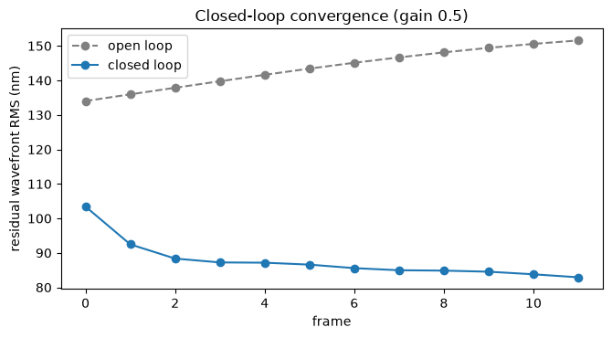

In this 1 m example, the loop ran at 500 Hz with gain 0.5 and detector noise
disabled. Over the final six frames of the same atmospheric sequence,
correction reduced the mean wavefront RMS from **148.6 to 84.4 nm**.
The short run shows the transient as the mirror begins to correct the wavefront.
[Recorded control experiment](https://github.com/xhvoid/Shack-Hartmann-AO-Simulation/blob/14611da9a92c6c4de59ee60de8fb2d23f2bbc7c3/notebooks/tutorials/04_closed_loop_control.ipynb)

### Science targets away from a natural guide star

The 2.2 m experiment in [PR #10](https://github.com/xhvoid/Shack-Hartmann-AO-Simulation/pull/10) holds the guide star fixed and samples four science
directions through the same atmospheric layers. Each target receives the
same mirror commands. The difference between panels shows how the
correction changes with separation from the guide star.

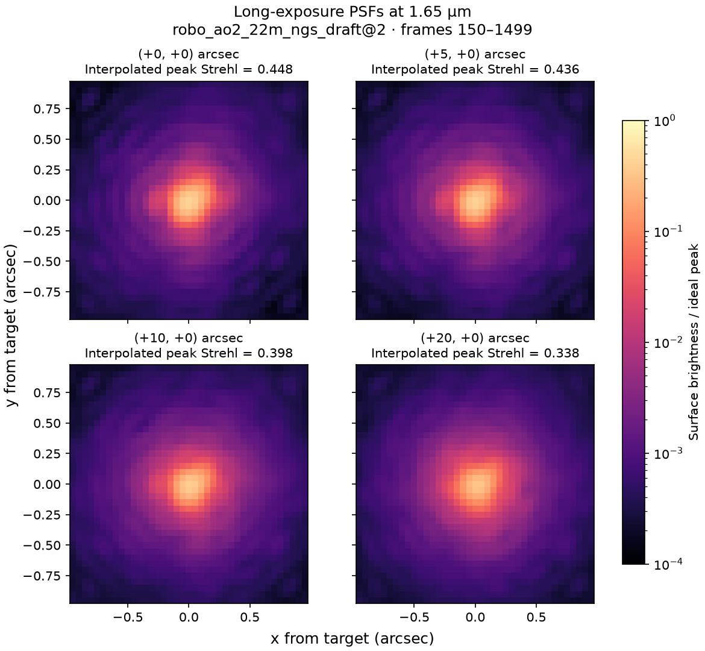

At **1.65 µm**, the interpolated long-exposure peak Strehl in the plotted
macOS repeat fell from **0.448** on axis to **0.436**, **0.398**, and
**0.338** at 5, 10, and 20 arcsec. Each panel averages the same 1,350
frames over 1.8 seconds and is centred on its target.

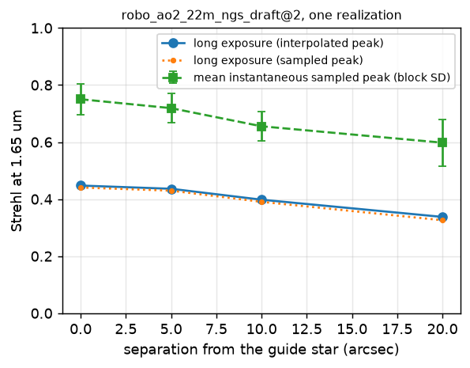

The mean instantaneous curve measures each frame at its own peak. The
long-exposure curves measure the peak after averaging the images on a fixed
grid, so motion of the image core during the exposure lowers that peak.
The accompanying study reports the Linux reference values and the difference
between platforms. [Study, definitions, and reproduction command](https://github.com/xhvoid/Shack-Hartmann-AO-Simulation/blob/7aca875e5e34265c3f9ead97ae99da55663bcce7/docs/scao_off_axis_science.md#reading-the-figures) · [PR #10](https://github.com/xhvoid/Shack-Hartmann-AO-Simulation/pull/10)

### Sensor calibration and photon noise

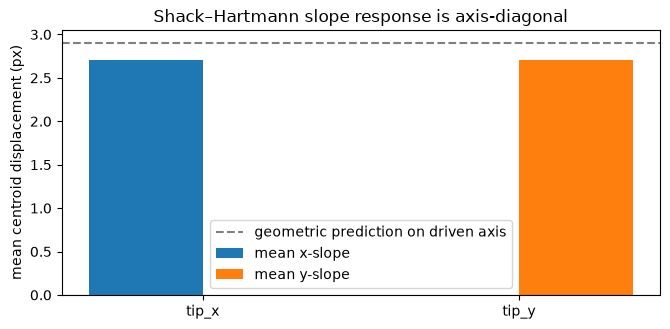

A 2 µrad tilt displaced the spot centroids by 2.701 pixels along the driven
axis, compared with the geometric prediction of 2.902 pixels. The response
on the perpendicular axis was negligible in this symmetric 8 × 8 lenslet
model. [Calibration experiment](https://github.com/xhvoid/Shack-Hartmann-AO-Simulation/blob/14611da9a92c6c4de59ee60de8fb2d23f2bbc7c3/notebooks/tutorials/01_geometric_shwfs.ipynb)

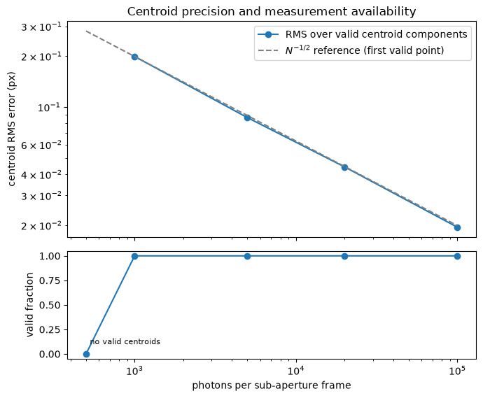

Across 12 realizations, the RMS error of accepted centroid components fell
from 0.199 pixels at 1,000 photons per sub-aperture per frame to 0.0194 at
100,000. At 500 photons every measurement failed the quality cuts, leaving
no RMS estimate at that point. [Detector experiment](https://github.com/xhvoid/Shack-Hartmann-AO-Simulation/blob/14611da9a92c6c4de59ee60de8fb2d23f2bbc7c3/notebooks/tutorials/02_detector_centroiding.ipynb)

### Reconstruction and control

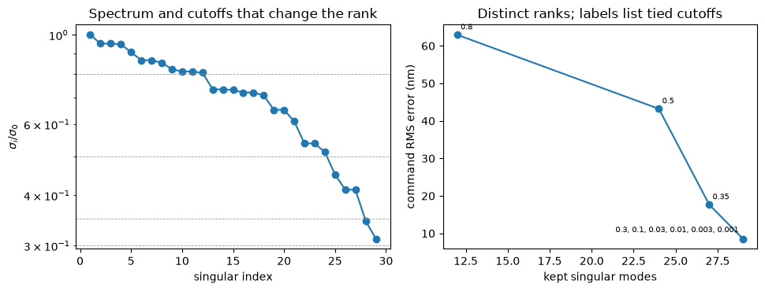

The reconstructor uses a truncated singular-value decomposition of the
measured interaction matrix. In this noisy example, increasing the number
of retained modes from 12 to 29 reduced the command RMS error from 62.94 to
8.58 nm. [Reconstruction experiment](https://github.com/xhvoid/Shack-Hartmann-AO-Simulation/blob/14611da9a92c6c4de59ee60de8fb2d23f2bbc7c3/notebooks/tutorials/03_tsvd_regularization.ipynb)

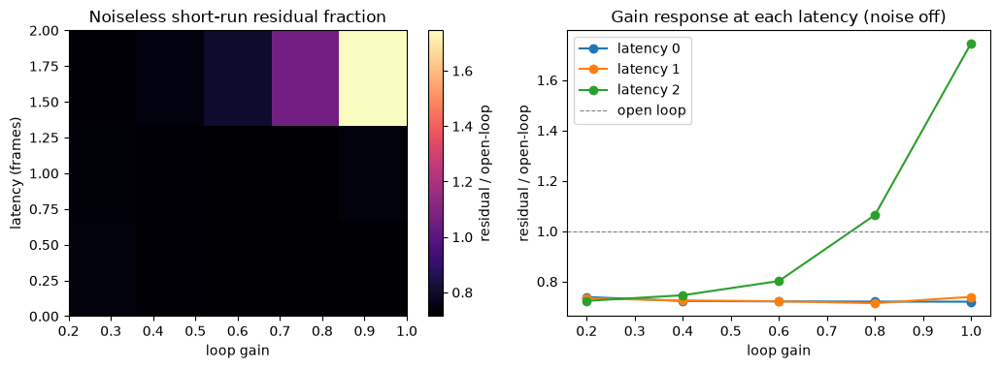

With a two-frame delay, increasing the gain from 0.2 to 1.0 increased
the corrected-to-open RMS ratio from 0.723 to 1.746. At the higher gain
the loop amplified the disturbance over the measurement window.
[Gain and delay experiment](https://github.com/xhvoid/Shack-Hartmann-AO-Simulation/blob/14611da9a92c6c4de59ee60de8fb2d23f2bbc7c3/notebooks/studies/noise_latency_gain.ipynb)

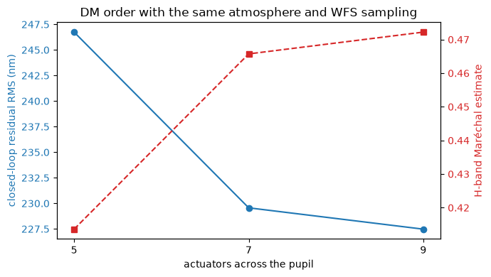

With the same atmosphere and sensor, 13, 29, and 49 active actuators gave
residuals of 246.7, 229.6, and 227.5 nm RMS. The plotted H-band Strehl is
a Maréchal estimate derived from residual RMS.
[Mirror-grid comparison](https://github.com/xhvoid/Shack-Hartmann-AO-Simulation/blob/14611da9a92c6c4de59ee60de8fb2d23f2bbc7c3/notebooks/studies/high_order_scao.ipynb)

### H-band PSFs and the MCAO error budget

The separate analytical multi-conjugate AO study models an 8 m-class
telescope, eight laser guide stars, and three deformable mirrors. It uses
TIPTOP/P3 with a continuous high-frequency fitting term and MASTSEL
propagation. The following three figures are from that configuration.
[Model and numerical checks](https://github.com/xhvoid/Shack-Hartmann-AO-Simulation/blob/14611da9a92c6c4de59ee60de8fb2d23f2bbc7c3/docs/notebook12_tiptop_portfolio_notes.md)

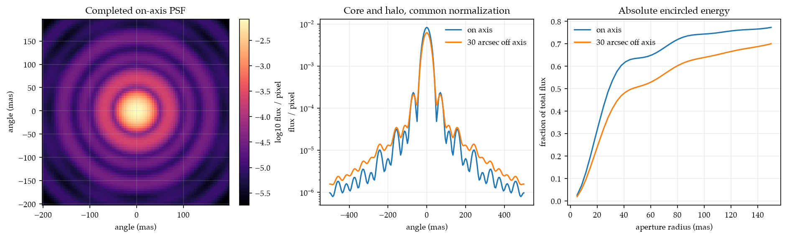

In the baseline at 1.65 µm the on-axis peak Strehl was 0.781, and 63.5% of
the energy fell within a 50 milliarcsecond radius. The energy fraction
uses the flux of the full computational field.

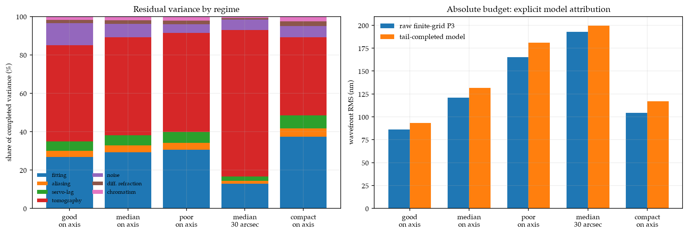

Tomography and fitting contributed 50.9% and 29.3% of the baseline
residual variance. Replacing the finite-grid fitting term with its
continuous high-frequency integral raised the total RMS from 120.8 to 131.7 nm.

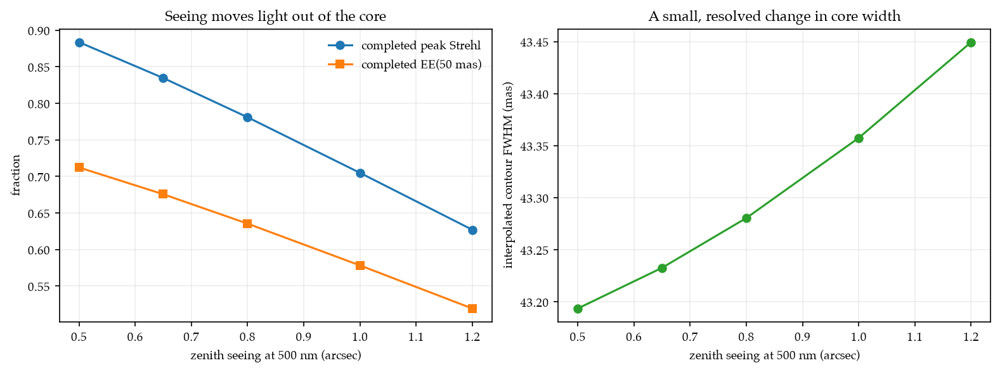

As seeing increased from 0.5 to 1.2 arcsec, energy inside the 50
milliarcsecond radius fell by 27.1% relative to the good-seeing case.
The sampled full width at half maximum changed only from 43.19 to 43.45
milliarcseconds. Much of the change appears in light outside the core.

### Layered atmospheric turbulence

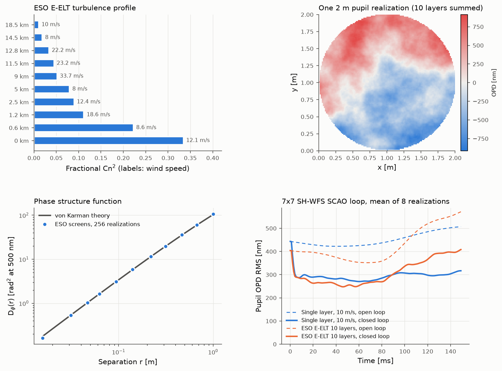

The 2 m detector model was run with the ESO E-ELT design reference
atmosphere and with a single frozen-flow layer. Across eight realizations
(frames 50–149), correction reduced RMS from 444 to 325 nm for the ten
layers and from 462 to 294 nm for the single layer.
[Layer parameters and experiment](https://github.com/xhvoid/Shack-Hartmann-AO-Simulation/blob/14611da9a92c6c4de59ee60de8fb2d23f2bbc7c3/docs/eso_elt_turbulence_model.md)

<details>
<summary>Earlier detector, calibration, and near-infrared imaging studies (14 figures)</summary>

These figures come from earlier versions of the detector and imaging experiments. The photometric inputs and their sources are listed in [Data licences and acknowledgements](DATA_LICENSES.md).

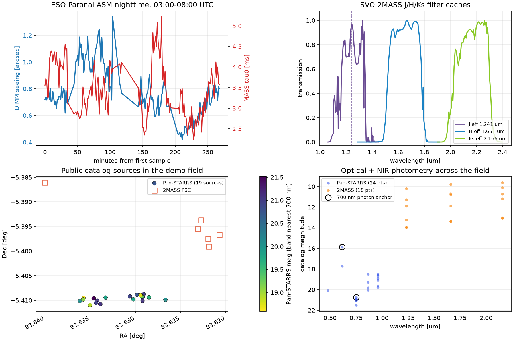

The detector study draws its seeing conditions from ESO Paranal measurements and its photometric inputs from the 2MASS and Pan-STARRS catalogues.

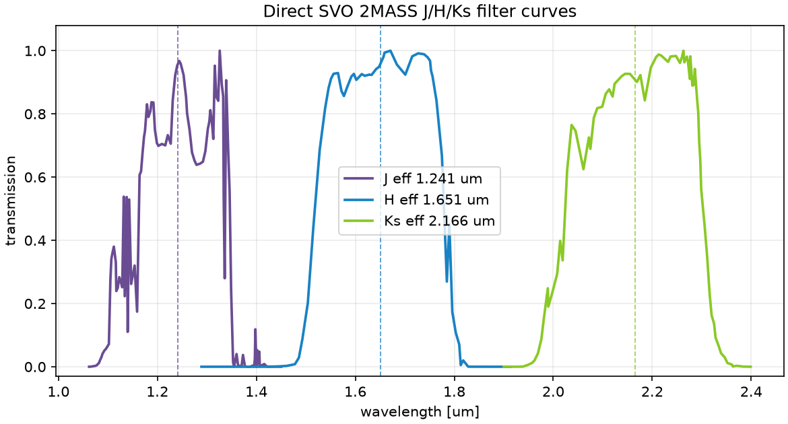

The SVO 2MASS J, H, and Ks transmission curves give the wavelength weights for the science bands.

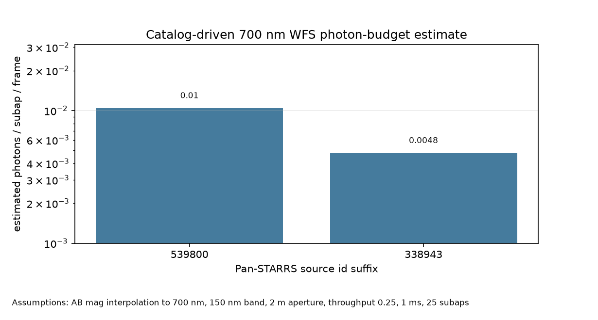

The guide-star photon budget at 700 nm is estimated from Pan-STARRS photometry and assumed throughput.

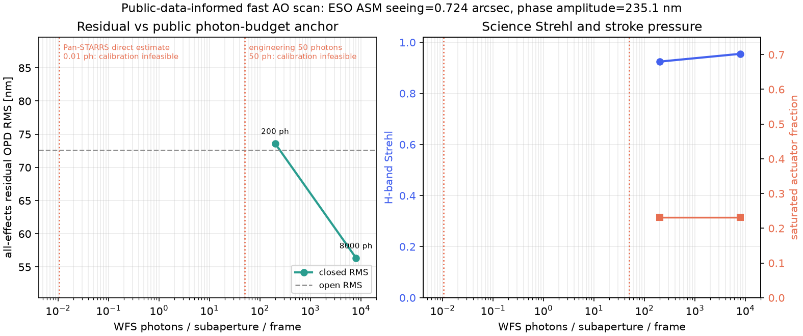

The scan varies the guide-star flux in the simulated detector loop while the measured seeing sets the amplitude of the synthetic phase sequence.

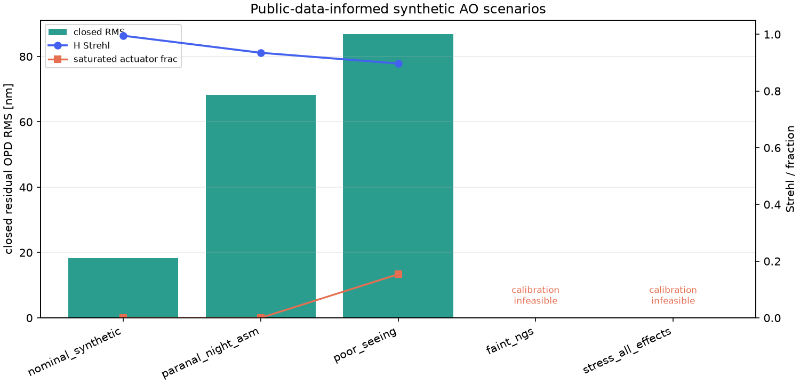

The five scenarios vary observing conditions and instrumental terms, including read noise, mirror stroke, and misregistration.

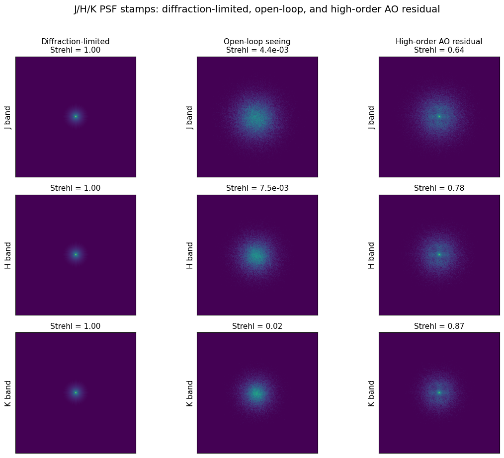

The diffraction-limited, uncorrected, and AO-corrected PSFs show how the residual wavefront redistributes light in J, H, and K.

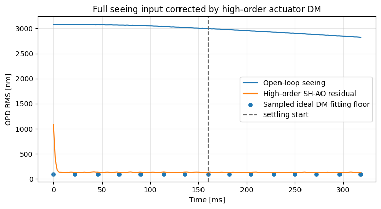

Open-loop and corrected optical path difference are tracked over the frozen-flow sequence. The post-settling interval is used for the residual RMS.

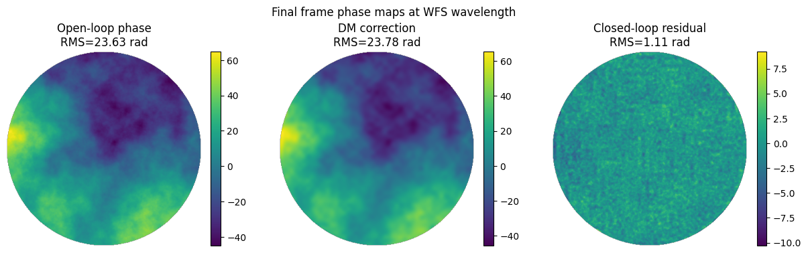

Maps of the atmospheric wavefront, applied mirror correction, and residual show which spatial features remain after correction.

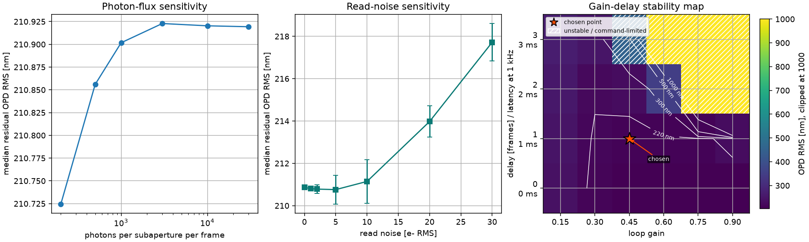

The operating-point scan varies photon flux, detector read noise, loop gain, and delay. Hatched cells identify unstable or command-limited cases in this scan.

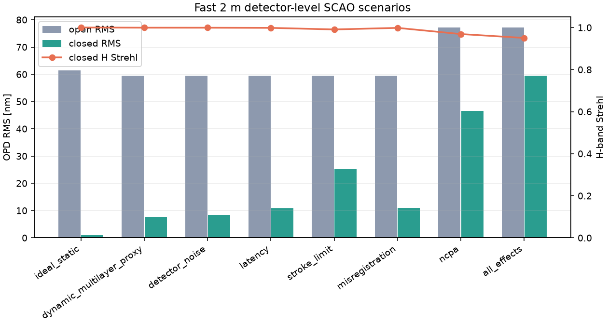

The synthetic 2 m scenario comparison uses a disturbance constructed in the mirror’s command space. The high Strehl in the ideal case reflects that choice.

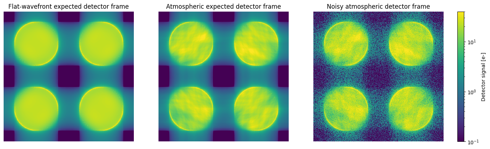

An exploratory pyramid wavefront sensor produces four pupil images on the detector. The panels compare the detector response to different input wavefronts.

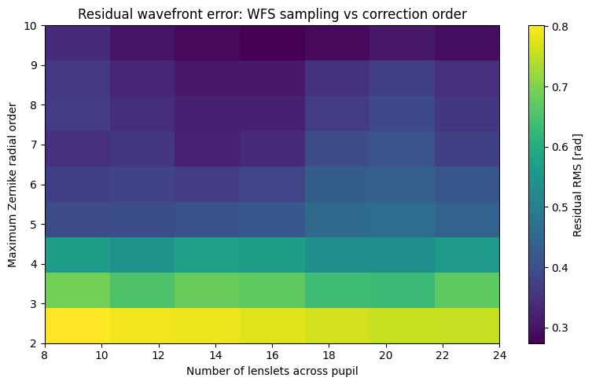

The comparison varies both wavefront-sensor sampling and the number of controlled modes to show their effect on reconstruction.

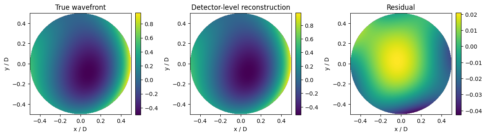

The panels show the input wavefront, its reconstruction from the lenslet spot centroids, and their difference. The residual panel uses a finer colour scale.

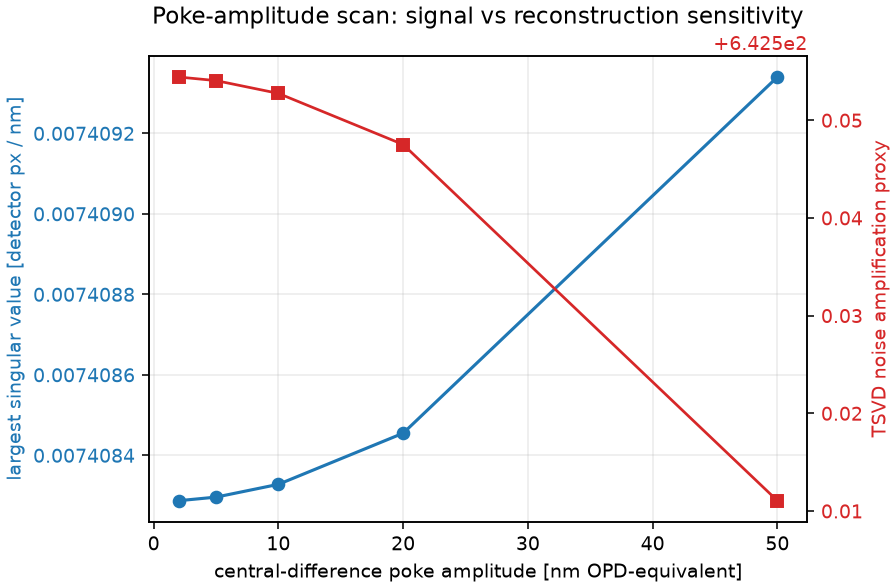

The calibration varies the amplitude of positive and negative actuator pokes when measuring the interaction matrix.

</details>

## Install

Requires Python 3.10 or later. From the repository directory:

```bash
python3 -m venv .venv
source .venv/bin/activate
python -m pip install .
```

On Windows, activate with `.venv\Scripts\activate`. For local editing, use
`python -m pip install -e .`. The native backend uses NumPy and SciPy;
`python -m pip install '.[hcipy]'` adds the optional HCIPy backend.

## Run an example

```bash
python examples/run_detector_level_demo.py
python examples/run_shwfs_centroid_demo.py
python examples/run_psf_strehl_demo.py
```

The first runs a synthetic 2 m loop and writes
`detector_level_demo_output/detector_level_demo.json`. The others write plots
under `outputs/examples/detector_level_SCAO/`. Set `AO_DEMO_OUTPUT_DIR` to
choose a destination. The PSF example compares a prescribed wavefront with a
scaled copy; it does not run a controller.

```python
from shwfs_ao.io.configs import load_system_profile
from shwfs_ao.experiments.scao import run_closed_loop

config = load_system_profile("det_emccd_2m_synthetic", 1)
history = run_closed_loop(config)
print("Residual after each update (nm):", history.post_update_residual_opd_rms_m * 1e9)
```

OPD and wavelengths use metres internally. Explorer image metrics use the
residual **before** an update, as labelled. The short example above does not
reproduce the site's longer recordings without their saved settings.

## Scope and evidence

The three runnable examples on this branch use simplified pupils, influence functions,
atmosphere and detector assumptions. The 42 m geometry comes from a historical
E-ELT reference; the current ELT has a 39 m primary. There is no segmented-mirror
phasing model or calibration against on-sky telemetry. A successful numerical
comparison applies to the component and conditions tested.

- [Model conventions and sources](docs/methods.md)
- [Component checks, numerical repairs and remaining limits](docs/verification-summary.md)
- [Reproducing examples and checking saved results](docs/reproducing.md)
- [Selected studies and their evidence](https://xhvoid.github.io/Shack-Hartmann-AO-Simulation/#studies)

`src/shwfs_ao/` holds the implementation and versioned resources. `examples/`
contains the three entry points; `tests/` contains small mathematical checks.
`build_support/` preserves compatibility resource imports. Website source,
compact records and publication tools live on the
[`website` branch](https://github.com/xhvoid/Shack-Hartmann-AO-Simulation/tree/website).

Code is under the [MIT licence](LICENSE). See [data licences](DATA_LICENSES.md)
for third-party attribution and terms.
