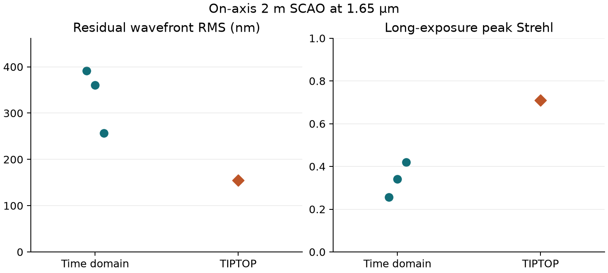

# Comparing the 2 m Shack–Hartmann loop with TIPTOP

I ran the same on-axis 2 m telescope geometry in the time-domain model and in TIPTOP. Both used a single atmospheric layer moving at 10 m/s, a 5 × 5 lenslet grid, a 0.5 m actuator pitch and a 1 kHz loop. I turned off detector noise and removed the stroke constraint in the time-domain model so neither would set the result.



| At 1.65 µm | Time domain, three atmospheres | TIPTOP |
|---|---:|---:|
| Residual RMS over the pupil | 257–391 nm | 154 nm |
| Peak Strehl of the mean image | 0.257–0.419 | 0.710 |

For each time-domain run I averaged 800 point-source images over 0.8 s, keeping their positions fixed. TIPTOP calculates the long-exposure image from the residual power spectrum. The time-domain loop gave a larger residual and a lower image peak in each of the three exposures.

I fitted a plane to the residual wavefront in the first exposure. Tilt accounted for 69% of its variance (325 nm out of 391 nm total RMS). The detector measures spot positions and the calibrated mirror fits those measurements, so the tilt left by that fit appears in the stellar image. TIPTOP uses a spatial-frequency correction filter and averages over atmospheric statistics. Doubling the TIPTOP image field changed its residual by 0.4 nm and its Strehl by 0.005. The field sampling accounts for little of the difference here.

## Experiment settings

The pupil was circular and unobstructed. I used a Fried length of 0.12634 m at 500 nm, an outer scale of 25 m, a 700 nm sensing wavelength and a loop gain of 0.2. The science grid sampled λ/D with three pixels. A command calculated at frame *k* first enters the measured wavefront at *k* + 3 in the time-domain code. The TIPTOP transfer function uses a delay of three frame periods. The time-domain reconstructor uses the calibrated actuator responses. TIPTOP represents the DM correction band analytically.

The first 0.2 s of each one-second time series was excluded. The RMS is the square root of the mean piston-removed pupil variance. Strehl uses the peak of the accumulated image relative to the ideal pupil. The table gives the range across the three exposures and the 384-pixel TIPTOP result.

[Inputs](matched.ini) · [Numerical results](results.json) · [Comparison script](compare.py) · [TIPTOP documentation](https://tiptop.readthedocs.io/)

Run from the repository root with the package and the three versions listed in the results file installed. The script writes the table data and figure beside the input file.

```sh
PYTHONPATH=src python docs/scao-comparison/compare.py
```
