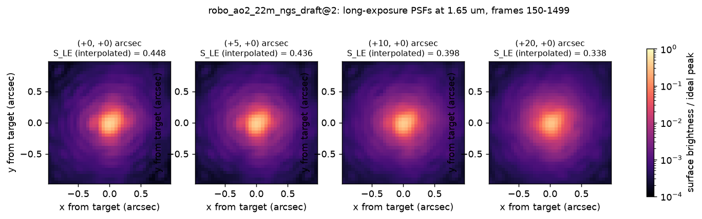
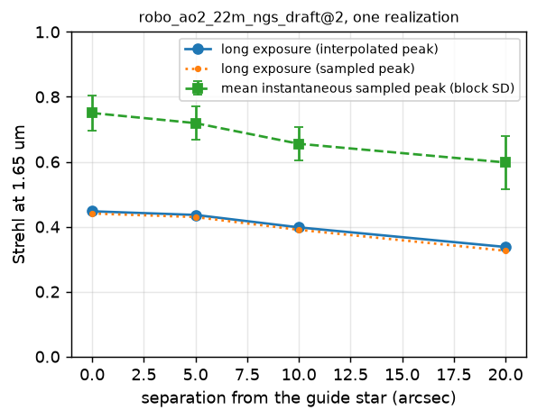

# Off-axis science targets in a single-NGS SCAO loop

The closed loop is driven by one natural guide star (NGS) on axis. A science
target at a sky offset from that star looks through a different column of
the layered atmosphere, so the deformable-mirror correction fitted to the
guide star only partly corrects it. This page states what the model
computes, how to run the 2.2 m example, and how to read its figures. The
checks behind it are in the [validation record](research/scao_off_axis_v1/VALIDATION.md).

## What the model computes

Layer `l` of the native layered atmosphere sits at altitude `h_l` and
moves with wind `v_l`. The guide star sees it at pupil coordinate
`r - v_l t`; a target at sky offset `theta` sees it at
`r + h_l theta - v_l t` (zenith, small angle, thin layers, no cone effect,
no diffraction between layers). Every frame of the closed loop samples the
same atmospheric realization at the same time along each requested
direction, after the wavefront sensor has measured, and subtracts the DM
correction that was applied while the frame was measured. The result is
propagated to a target-centred PSF with the system's science propagator;
instantaneous intensities are averaged with equal weights over the selected
frames into one long-exposure image per offset and wavelength.

The guide-star loop never sees a science direction: the wavefront sensor,
the noise draws, the reconstructor and the DM commands are the same for any
list of offsets, and so is the loop history and its `config_hash`. The
explicit `(0, 0)` offset reproduces the on-axis long exposure bit for bit.

The model has no separate tip-tilt loop. Science frames are averaged on a
fixed angular grid. When the core moves during the exposure, its light
spreads across the image and its long-exposure peak falls. The mean
instantaneous Strehl follows the peak in each frame.

## Run the example

From a clone of this repository, after `python -m pip install .`:

```bash
python examples/run_off_axis_science_demo.py --profile robo_ao2_22m_ngs_draft --version 2 --offsets "0,0;5,0;10,0;20,0" --wavelength-um 1.65 --burn-in 150 --block-frames 75 --output outputs/off_axis_science/22m
```

This runs one 1500-frame closed loop of the literature-inspired 2.2 m
profile `robo_ao2_22m_ngs_draft@2` (seed 1, realization 0, 750 Hz) with the
guide star on axis, and evaluates targets at 0, 5, 10 and 20 arcsec along
`+x` at 1.65 µm. Frames 150 to 1499 are averaged (1350 frames, 1.8 s of
exposure); the first 150 frames are the loop's settling time. The example
pins NumPy and SciPy to two threads and needs 6 to 25 minutes depending on
the machine (331 s on an Apple M1 Pro, 1373 s in the recorded run) and about
2 GB of memory. It writes to the output directory:

| File | Content |
| --- | --- |
| `psf_comparison.png` | Target-centred long-exposure PSFs on common angular axes and one common logarithmic scale |
| `strehl_vs_separation.png` | The three Strehl statistics against separation |
| `off_axis_strehl.csv`, `off_axis_science.json` | One row per offset, and the complete result record with the frame selection, identities and footprint report |
| `run_record.json` | The command, profile hashes, seed, realization identifier, frame selection and environment |
| `psfs.npz`, `history.npz` | The accumulated images, the ideal image, the angular axes and the guide-star loop history |

The same evaluation is available from Python:

```python
from shwfs_ao.experiments import run_off_axis_science
from shwfs_ao.io.configs import load_system_profile

config = load_system_profile("robo_ao2_22m_ngs_draft", 2)
run = run_off_axis_science(
    config,
    offsets_arcsec=[(0, 0), (5, 0), (10, 0), (20, 0)],   # default: ((0, 0),)
    wavelengths_m=(1.65e-6,),
    burn_in_frames=150,
    block_frames=75,
)
for row in run.science.table_rows():
    print(row["radial_arcsec"], row["long_exposure_interpolated_peak_strehl"])
```

`run.history` is the guide-star loop history, `run.science` the
`OffAxisScienceResult` (one `OffAxisImage` per offset and wavelength),
`run.footprint` the layer-footprint report and `run.record` the identities
needed to reproduce the run. A quick check on the small layered 2 m profile
takes a few seconds:

```bash
python examples/run_off_axis_science_demo.py --profile eso_turbulence_2m_detector --version 1 --offsets "0,0;10,0" --burn-in 30 --n-steps 60 --block-frames 10
```

Compatible profiles are those with `atmosphere_model = "native_layered"`,
because the layer altitudes are needed: `robo_ao2_22m_ngs_draft@2`,
`eso_turbulence_2m_detector@1` and `eso_drm_42m_scao_derived@2` among the
packaged profiles (`shwfs_ao.experiments.layered_profiles()` lists them).
Any other atmosphere backend keeps its on-axis behaviour: the default
offset runs unchanged, and a nonzero offset is refused by
`check_off_axis_support` and by the loop itself with a message naming a
supported profile. The 42 m profile is checked for compatibility only; no
42 m trajectory is part of this example.

## Reading the figures



Each panel of `psf_comparison.png` is centred on its own target's nominal
sky position and shows the long exposure as a fraction of the ideal image's
peak, on one logarithmic scale from 1e-4 to 1. The core stays at the
centre at every offset; the halo rises and the core weakens with
separation. The title of each panel gives the interpolated long-exposure
peak Strehl.



`strehl_vs_separation.png` plots three statistics of the same exposure:

| Statistic | Field | Meaning |
| --- | --- | --- |
| Interpolated long-exposure peak | `long_exposure_interpolated_peak_strehl` | Peak of the mean intensity image, located between samples, divided by the peak of the ideal image located the same way. The reference value for comparisons across focal samplings. |
| Sampled long-exposure peak | `long_exposure_peak_strehl` | Brightest sample of the mean intensity image divided by the brightest sample of the ideal image. Biased low when the true peak falls between samples (1.6 to 3.3 % here). |
| Mean instantaneous peak | `mean_instantaneous_peak_strehl` | Mean over the selected frames of each frame's sampled peak Strehl. Each frame contributes its own brightest sample. The error bars show the standard deviation of peak Strehls measured on 75-frame (0.1 s) block images within this realization. |

The recorded values of the original run of this example (Linux x86_64,
2026-11-04) are:

| Separation (arcsec) | Interpolated long-exposure peak | Sampled long-exposure peak | Mean instantaneous peak |
| ---: | ---: | ---: | ---: |
| 0 | 0.44441 | 0.43705 | 0.75038 |
| 5 | 0.43330 | 0.42641 | 0.71971 |
| 10 | 0.39569 | 0.38820 | 0.65664 |
| 20 | 0.33722 | 0.32605 | 0.59889 |

These four interpolated values describe one simulated 1.8 s exposure of one
turbulence realization. They are not a performance prediction for the
instrument the profile is modelled on; the profile's assumptions are listed
in [its parameter record](research/robo_ao2_ngs_v1/PARAMETERS.md). The
recorded run and its regenerated table are under
[`evidence/demo_22m/`](research/scao_off_axis_v1/evidence/demo_22m/). A
repeat of the command from a fresh clone on another platform, reported in
the last section, gives values that differ in the third decimal; the
figures above are from that repeat.

## Peak estimator and focal sampling

The interpolated peak comes from `shwfs_ao.science._psf_peak.interpolated_peak`.
A pad-factor 2 or larger FFT image is Nyquist sampled, so the trigonometric
interpolant of its samples is the continuous image. The estimator evaluates
that interpolant on the half-pixel grid, then refines at most 64 local
maxima of that grid whose values reach 85 % of its largest value (strongest
first) to 1/64 pixel and returns the best, so a core whose true peak falls
between samples can beat a fainter core that sits on a sample. The 85 %
fraction comes from one measured case: the unaberrated image of the
256-sample, unobstructed 2.2 m pupil at 1.65 µm tilted a quarter pixel in
both axes reads 0.9259 (pad 2), 0.9665 (pad 3) or 0.9915 (pad 6) of its
peak at the brightest sample. No bound for every aberrated PSF has been
derived, so a narrower core could be read below the fraction and skipped.
The refinement leaves a residual of about 1e-5. Interpolation requires a
uniform, uncropped, complete Fourier period sampled finely enough for the
pupil autocorrelation; other grids report `null` for the interpolated field
and the example labels their peaks as sampled.

The pre-registered focal-sampling check used the brightest sample. On the
150-frame on-axis exposure of the 2.2 m run, raising the PSF pad factor
from 3 to 6 changed that sampled peak Strehl by 0.06096, which exceeds the
registered 0.01 tolerance: the registered check failed. The cause is the
definition of the peak as the maximum sample of a nearly diffraction-limited
image whose true peak sits between samples, not the propagation. On the
same images the interpolated estimate differs by 1.45e-5 between the two
pad factors and by at most 1.6e-5 from direct propagation of every frame's
pupil field onto a fine focal grid. Both results are kept in the validation
record; the sampled definition remains available under its historical name.

## Conventions

| Item | Convention |
| --- | --- |
| Offset | `(x_arcsec, y_arcsec)` of the science target relative to the guide star; `theta_rad = arcsec * pi / 648000` (`shwfs_ao.science.ARCSEC_TO_RAD`). |
| Signs | Positive `x` displaces a layer's footprint toward larger pupil `x` (array columns); positive `y` toward larger pupil `y` (array rows). A ray reaching pupil coordinate `r` crosses the layer at altitude `h` at `r + h * theta`. |
| Geometry | Zenith, small angle, thin layers, no cone effect, no inter-layer diffraction (`directional_sampling = thin_layer_small_angle_zenith_v1` in the atmosphere metadata). |
| Time | Every direction is sampled at the frame time `t` from the same realization; layer `l` is read at `r + h_l theta - v_l t`, the same shift applied to the periodic Fourier band (phase ramp) and to the analytic low-frequency modes. |
| Correction | The direction's residual is its atmospheric sample minus the DM correction that was applied while the frame was measured (the pre-update convention of the on-axis long exposure). |
| Images | Each PSF is formed on the propagator's angular grid, centred on the target's nominal sky position; residual image motion of the target is kept. Instantaneous intensities are averaged with equal weights over the selected frames. |
| Loop neutrality | The WFS, noise draws, reconstructor and DM never see a science direction. The directional samples are taken after the WFS measurement, draw no random number and do not touch the atmosphere clock, so the history and its `config_hash` are identical for any list of offsets, including with WFS exposure sub-sampling. |

The periodic band of a layer screen repeats every `screen_period_m`
(4.42 m for the 256-sample 2.2 m profile). `footprint_report` flags an
offset whose displaced footprint can overlap the on-axis footprint through
that wrap (`pupil_diameter_m + max |h theta| >= screen_period_m`): for the
2.2 m profile this happens above about 31 arcsec with the default screen
(`screen_period_factor = 2`); larger separations need a larger factor.

## Where the physics is implemented

- `shwfs_ao.backends.native.layered_atmosphere.LayeredFrozenFlowAtmosphere.directional_opd_at`
- `shwfs_ao.control.loop.run_closed_loop(science_directions_rad=...)` and the
  observation field `science_residual_opd_m`
- `shwfs_ao.science.off_axis` (`ScienceOffset`, `OffAxisLongExposure`, `footprint_report`)
- `shwfs_ao.science._psf_peak` (`interpolated_peak`)
- `shwfs_ao.experiments.off_axis_science` (`run_off_axis_science`, `check_off_axis_support`)

The focused tests are `tests/backends/native/test_layered_directional_sampling.py`
(zero direction, ground layer, signed fractional shifts against analytic
patterns) and `tests/science/test_off_axis.py` (loop independence, the
exact zero offset, exposure sub-sampling, the backend contract, and the
competing-peak regression of the estimator against direct propagation):

```bash
python -m pip install '.[test]'
python -m pytest tests/science/test_off_axis.py tests/backends/native/test_layered_directional_sampling.py
```

## Validation record

The pre-registered plan, the validation note with every comparison, the
reference ledger and the evidence files are under
[`docs/research/scao_off_axis_v1/`](research/scao_off_axis_v1/VALIDATION.md).
The checks cover the exact on-axis identity and loop independence, the
ground-layer limit, signed fractional shifts of both spectral components
against analytic patterns, the anisoplanatic structure function and
long-exposure Strehl of an ideally corrected multi-layer atmosphere, and
numerical convergence in the screen period and the focal sampling. What has
been verified is agreement with theory for the sampled model; nothing here
is compared with on-sky measurements.

## Reproduction from a fresh clone

The command above was run once from a fresh clone of this repository at
the locally tested candidate revision `d335e48`, installed with `python -m pip install .`
into a new virtual environment (CPython 3.14.3, NumPy 2.5.4, SciPy 1.18.1,
matplotlib 3.11.2) on an Apple M1 Pro (macOS 26.5, arm64). It finished in
331 s and wrote the CSV, the JSON record, the PSF panel and the Strehl
curve. The acceptance tolerance was declared before the run
([`pre_run_tolerance.json`](research/scao_off_axis_v1/evidence/demo_22m/reproduction/pre_run_tolerance.json)):
each interpolated long-exposure peak Strehl within 1e-4 of the recorded
value. The run did not meet it.

| Separation (arcsec) | Recorded (Linux x86_64) | Fresh clone (macOS arm64) | Difference | Repeat on Linux x86_64 |
| ---: | ---: | ---: | ---: | ---: |
| 0 | 0.44441 | 0.44752 | +3.1e-3 | 0.44441 |
| 5 | 0.43330 | 0.43625 | +3.0e-3 | 0.43330 |
| 10 | 0.39569 | 0.39799 | +2.3e-3 | 0.39569 |
| 20 | 0.33722 | 0.33762 | +4.0e-4 | 0.33722 |

The sampled peaks differ by -1.1e-4 to +3.6e-3 and the mean instantaneous
peaks by -1.6e-4 to -1.2e-3 in the same comparison. The monotonic decrease,
the 1.6 to 3.3 % gap between sampled and interpolated peaks, and the ratio
of instantaneous to long-exposure Strehl are the same in both runs. The two runs share the profile hash, atmosphere hash and realization stream
identifier. Their `history_config_hash` values differ (Linux `fa1a0474…`,
macOS `3e6e8b54…`). This field identifies the loop configuration, including
the calibrated interaction matrix.

Comparison of the two runs:

- Repeating the command on the same machine reproduces every history array,
  every image and the table bit for bit.
- The residual maps of frames 150 to 299 of the repeat agree to 4e-21 m with
  an archived trajectory of the same profile computed on the same machine on
  2026-10-24 with the code that preceded this feature (archive hash
  `a7a73add…`, not part of this repository). The fresh clone therefore
  reproduces the earlier local trajectory exactly, and the feature did not
  change the guide-star loop.
- Round-off between processes does not grow in this loop: a 1500-frame
  run of the guide-star loop in a process with a different memory layout
  differs from the demonstration history by at most 1.6e-21 m in the
  residual RMS and in the DM commands (1e-15 relative) over all frames,
  with identical validity masks and row masks.
- A second repeat on Linux x86_64 (Intel Xeon with AVX-512, CPython
  3.13.18, the same NumPy and SciPy with OpenBLAS, 814 s), made from
  public main with the same code, gave 0.44441371, 0.43330049,
  0.39569352 and 0.33721896. Each is within 4e-6 of the five-decimal
  reference. The repeat matched the original Linux `history_config_hash`
  (`fa1a0474…`) and reproduced the first instantaneous Strehls bit for bit.
  Its open-loop OPD RMS agrees with the macOS run to 1e-13 nm for the
  three open-loop frames; the first difference is at the first
  closed-loop frame, where the pre-update residual RMS is 257.78 nm on
  Linux and 263.20 nm on macOS. The two platforms therefore separate at
  the first DM update, not by accumulation. The masked TSVD cutoff is not
  the reason: all 374 calibrated slope rows are valid at that frame, all
  197 modes are retained, and no masked singular-value ratio comes within
  0.012 of the 0.05 cutoff during the run.

Each platform is self-consistent and the Linux run reproduces the
recorded values; which part of the first measurement or command differs
between the two platforms has not been identified. Until it is, treat the
third decimal of the four values as platform dependent. The artifacts of
the macOS repeat, including its own closed-loop check (sampled peak change
0.05992 between pad 3 and pad 6 at zero separation, interpolated change
1.2e-5), are under
[`evidence/demo_22m/reproduction/`](research/scao_off_axis_v1/evidence/demo_22m/reproduction/).
