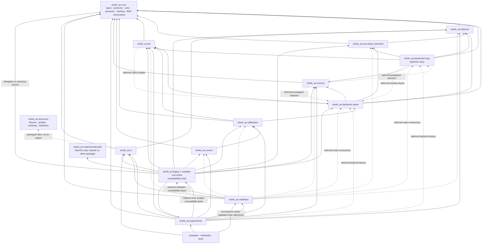

# Technical reference

This document explains the `shwfs_ao` simulation as it is implemented: its
purpose and scope, its architecture, the models and execution modes it
offers, how to choose between them, what each result does and does not
establish, and what each run costs. It is the single current account of the
implementation. The component notes, ticket records and execution records it
links to hold supporting detail and history; nothing here requires reading
them first.

- **Describes:** the tree of the 2026-10-18 consolidation
  ([execution record](refactor/CLEANUP_REFACTOR_STATUS.md)), entry revision
  `2312502` plus the recorded cleanup changes. A statement about a result
  names the record and, where it is recorded, the code that produced it.
- **Companion pages:** [roadmap](roadmap.md) (open work),
  [limitations register](current_limitations.md) (known boundaries, `LIM-xx`),
  [backends and contracts](backends.md) (field-level protocol tables),
  [detector model](detector_model.md), [ESO turbulence](eso_elt_turbulence_model.md),
  [ESO benchmark](eso_scao_benchmark.md), [validation](validation.md),
  [reproducibility](reproducibility.md), [artifact schemas](artifact_schemas.md).

## Contents

1. [Scope, purpose and non-goals](#1-scope-purpose-and-non-goals)
2. [Capabilities at a glance](#2-capabilities-at-a-glance)
3. [Architecture and dependency ownership](#3-architecture-and-dependency-ownership)
4. [Units, signs and time](#4-units-signs-and-time)
5. [Method families compared](#5-method-families-compared)
6. [Mode compatibility and representative runs](#6-mode-compatibility-and-representative-runs)
7. [Assumptions, provenance, limitations and evidence](#7-assumptions-provenance-limitations-and-evidence)
8. [References and source traceability](#8-references-and-source-traceability)
9. [Runtime, memory and execution guidance](#9-runtime-memory-and-execution-guidance)

## 1. Scope, purpose and non-goals

### 1.1 Scientific purpose

> Under declared atmosphere and instrument assumptions, characterize how
> Shack–Hartmann sensing, detector response, calibration, reconstruction,
> control and measurement failure propagate into residual wavefronts and
> science-image quality.

The repository simulates one natural guide star, on axis, sensed by a
Shack–Hartmann wavefront sensor (SH-WFS) and corrected by one
ground-conjugate deformable mirror (DM): single-conjugate adaptive optics
(SCAO). Every stage of the chain is explicit and replaceable: the
atmosphere's optical path difference (OPD), the lenslet optics, the detector
and its pixel processing, the centroid and its validity, the interaction
calibration, the reconstructor, the controller with its latency, the DM, and
the science point-spread function (PSF). A result is always the output of
declared inputs: a packaged, versioned profile, a root seed and a set of
recorded execution options.

This purpose is distinct from four other things the repository also does:

- **Software delivery.** A typed, tested, installable package with
  compatibility contracts. Passing its tests shows that the software meets
  its own contracts, not that the model is accurate.
- **Scale demonstrations.** The ESO-derived 42 m benchmark shows that the
  full 84×84 / 85×85 spatial scale runs on a desktop. It is not an ESO
  instrument model.
- **Analytical MCAO study.** The TIPTOP/P3/MASTSEL notebook is a separate,
  frequency-domain sensitivity study with its own environment, assumptions and
  validation. It does not run through the SCAO contracts.
- **Laboratory or on-sky validation.** None has been done. No camera preset,
  DM influence function, interaction matrix or controller setting is a
  measured hardware calibration.

### 1.2 Questions the implementation can answer

| Question | What answers it | Limit of the answer |
| --- | --- | --- |
| How do photon, read, dark, clock-induced-charge and excess noise propagate through a centroid into slopes, commands and residuals? | The physical camera chain, the `detector_covariance_v2` model, its Monte Carlo checks and the open-loop noise-propagation experiments (E1, E2) | Synthetic camera presets; the first-order model is supported only inside its declared domain (section 5.6) |
| How large is the detector-noise contribution to the closed-loop residual, isolated from everything else? | The paired noise study (`paired_noise_run`): a noise-on loop against its noiseless operating-expectation twin | Recorded at 2 m and 12 m; the 12 m faint-end slope fails a pure 1/N_e law, and part of the departure is unexplained (section 7.5) |
| How do the camera family (CCD, EMCCD, CMOS) and the guide-star magnitude limit closed-loop correction? | The 12 m magnitude scan and camera comparison (E3, E4) | The limit depends on the reconstruction and control settings as much as on the camera (profile versions @1–@3, section 7.6) |
| What do latency, gain, leak and dropout do to stability and residuals? | The shared loop with its single latency queue, the gain/delay study, the stability guards and the opt-in recovery supervisor | Integer frame latency only; no fractional delay or DM dynamics |
| How do calibration choices (probe amplitude, noise, repetition) and regularization (LS, TSVD, Tikhonov, LSMR damping) change reconstruction? | The dense and sparse calibration and reconstruction paths with explicit row masks and rank diagnostics | Synthetic DM influences and a synthetic calibration; no measured interaction matrix |
| How do pixel sampling, spectral bandwidth and finite exposure change the measurement? | MFT pixel integration, diffusion and coupling, polychromatic sensing, exposure sub-samples | Effect sizes recorded at 12 m for one camera and three seeds (E6, DET-08) |
| How does a residual wavefront translate into peak and on-axis Strehl, FWHM and encircled energy, instantaneously and over an exposure? | Native and HCIPy science propagation, the scalar metrics and the streamed long exposure | Monochromatic images; band summaries are weighted scalars, not broadband images |
| Does a second, independently implemented optical library agree with the native optics? | The native-versus-HCIPy comparison suite (13 groups, one small profile) | Agreement within declared tolerances on the tested quantities, not interchangeability; no physical-camera feature runs on HCIPy |

### 1.3 Non-goals and boundaries

The following are outside the implementation. Each is either a deliberate
boundary or future work; none is implied by any result:

- off-axis performance, anisoplanatism, laser guide stars, the cone effect,
  tomography, multi-conjugate correction (except in the separate analytical
  TIPTOP study) and sky coverage;
- scintillation and propagation between atmospheric layers (layer altitude
  is recorded, not used);
- a validated pyramid WFS: the PWFS module is a frozen experimental forward
  model;
- dynamic spot tracking, global spot-to-lenslet assignment or reacquisition
  after spot loss;
- light from neighbouring lenslets on the native physical camera
  (`isolated_lenslet_blocks.v1`);
- the physical camera path on the HCIPy backend (it fails closed);
- fractional-frame latency, DM temporal dynamics and real-time hardware
  timing; the runners advance a simulated clock;
- any digital twin of a commercial camera, an ESO instrument or an
  observatory.

### 1.4 Kinds of use

| Use | Where | Status |
| --- | --- | --- |
| Educational | `notebooks/tutorials/00`–`04`, `examples/` | Current; small configurations chosen for clarity, not performance |
| Research | `experiments.detector_level`, `experiments.detector_noise`, the physical camera profiles, `scripts/run_detector_level_evidence.py` | Current; results carry configuration, seed and code identities |
| Benchmark | `experiments.eso_scao_benchmark` and its four tiers | Current; ESO-derived, single realizations at 42 m |
| Compatibility | `shwfs_ao.legacy`, the 19 root shims, `experiments.error_budget`, early profile versions | Retained; frozen behavior, deprecation clock not yet satisfied |
| Experimental | `shwfs_ao.experimental.pwfs`, `notebooks/experimental/` | Not validated; kept as research history |
| Analytical | `notebooks/studies/12_TIPTOP_performance_modelling.ipynb` | Separate study with its own scope |

### 1.5 Levels of evidence

Three levels of evidence are kept apart throughout:

1. **Software correctness**: contracts, identities, invariants, seeded
   replay and regression.
2. **Agreement with a declared physical model**: analytic oracles, Monte
   Carlo against a noise model, convergence, and agreement between
   independent implementations.
3. **Agreement with independent measured data**: none exists.

Everything recorded so far sits at levels 1 and 2.

## 2. Capabilities at a glance

Each family distinguishes what is implemented now, what is retained only for
compatibility, what is experimental, what is deliberately unsupported (the
code refuses it), and what is future work. A method named in a paper but
absent from the code is not a mode of this repository.

| Family | Implemented (selector) | Retained for compatibility | Experimental | Refused | Future work |
| --- | --- | --- | --- | --- | --- |
| Atmosphere | `static`; `native_frozen_flow_v2` (physical amplitude, quadrature, subharmonics, exact sub-pixel flow); `native_layered` (absolutely normalized multi-layer, unbounded exact translation); `hcipy`, `hcipy_layered` (optional) | `native_frozen_flow` (RMS-rescaled, integer-pixel flow) | — | `static` and `native_*` atmospheres and RMS-normalized seeing on the HCIPy backend (so `native_layered` under `backend="hcipy"` is refused, not flattened); layered blocks with block-level wind or RMS rescaling | off-axis, propagation, scintillation |
| WFS model | `detector_level` SH (compatibility chain); `detector_level` SH with a schema-7 `detector_physics` block (physical camera chain); `geometric` SH | early profile versions with their frozen detector behavior | PWFS (`shwfs_ao.experimental.pwfs`, not a factory option) | `geometric` on HCIPy; physical camera on HCIPy | validated PWFS, global spot tracking |
| SH optics | native per-lenslet padded FFT; batched native FFT (compact geometry); native MFT with pixel quadrature; HCIPy microlens array with Fraunhofer propagation | — | — | HCIPy with a pupil that is not a whole number of block windows; physical camera on HCIPy | inter-lenslet contamination on the native physical camera |
| Sampling and integration | FFT point sampling; MFT `k×k` pixel quadrature; Gaussian charge diffusion; declared electronic coupling; Gauss–Legendre polychromatic WFS; exposure sub-samples | one atmosphere sample per frame (`exposure_subsamples=1`, the default) | — | polychromatic bands without MFT sampling; sub-samples with a static atmosphere | — |
| Detector and camera | compatibility detector (AO-REF-004); physical CCD, EMCCD (Gamma register, G ≥ 100), CMOS with maps | `per_frame_legacy` PRNU of early profiles | — | EMCCD gains 1 < G < 100; non-monotonic declared non-linearity | measured camera calibration |
| Pixel processing and centroid | estimated bias/dark/sky/flat masters; oracle products; raw readout; plain and thresholded centre of gravity; `detector_covariance_v2` with support gates | legacy spot-width/SNR uncertainty proxy (frozen facades); `detector_covariance_v1` results in historical records | — | covariance outside its supported domain (reported undefined, lenslet invalid) | estimators beyond the centre of gravity |
| DM | dense `gaussian`, `compact_gaussian`, `pyramid_like` influences; sparse local `linear_spline` operator (schema v5) | — | — | `linear_spline` with a coupling width other than one pitch; dense allocation above the 64 MiB compatibility guard | measured influence functions |
| Calibration and reconstruction | modal or actuator probes, central/forward differences, optional noisy repeated calibration; grouped local noiseless sparse calibration; LS, TSVD, dense Tikhonov, damped sparse LSMR; calibration from build, resource or supplied matrix; verified sparse cache | — | — | noisy scalable calibration; sparse matrices on dense profiles; unverified or mismatched supplied matrices | — |
| Control and recovery | leaky integrator, integer latency, stroke/dead/stuck policies, applied-command acknowledgement; opt-in `controller.recovery` (decay/reset, guarded subset fallback, gain schedule) | the default freeze-on-rejection behavior (no recovery block) | — | the subset fallback with a dense reconstructor | spot reacquisition, a full loss-of-lock state machine |
| Science | native FFT and HCIPy Fraunhofer monochromatic PSFs; peak/on-axis Strehl, Maréchal estimate, FWHM, EE50/EE80, halo fraction; weighted scalar band summaries; streamed long-exposure images | historical tail-median scalar summaries of the fast and physical baselines | — | no API coadds PSF arrays across wavelengths (band helpers average scalar metrics only) | broadband images on a common angular grid |
| Experiment approaches | control-space proxy (`fast_*`); physical von Kármán (`physical_*`); detector-level evidence runner; ESO benchmark tiers; paired noise study; native-versus-HCIPy suite; separate TIPTOP study | the fast error-budget workflow with historical result shapes | — | governed runs without explicit enablement; baseline acceptance by ordinary runs | multi-seed 42 m ensembles; measured-data comparisons |

## 3. Architecture and dependency ownership

### 3.1 Package dependencies

The diagram below is the package dependency graph of `src/shwfs_ao`. It is
copied from [architecture.md](architecture.md), where
`tests/docs/test_documentation_contract.py` derives the real import graph from
the source and fails if the diagram disagrees; another test in that file
checks that this copy is identical. A solid arrow is a module-level import, a dashed arrow an
import deferred to call time (an optional backend or a factory selected at
build time).

Permitted directions follow from the graph: `core` imports no other package;
backends import `core` and the repository-owned detector, WFS, DM and science
configuration they adapt; `calibration`, `control`, `science` and
`experiments` depend downward; `legacy` and the root shims delegate to
canonical owners and nothing canonical imports them except the two retained
compatibility workflows (`experiments.error_budget`, the validation adapter).
`shwfs_ao.runtime` (the desktop resource guard) imports only the standard
library and is not part of the graph. Two private leaf modules were added by
the consolidation: `io/_profile_schema.py` (record-schema history, imported by
`io/configs.py`) and `experiments/_component_configs.py` (profile-to-component
translations, imported by `experiments/scao.py` and
`experiments/detector_level.py`); neither adds a package edge.

### 3.2 Module ownership

| Package and responsibility | Public entry points | Inputs and outputs (units) | Depends on | Lifecycle and state | Limitations | Tests and evidence |
| --- | --- | --- | --- | --- | --- | --- |
| `core`: OPD/phase conversion, masked wavefront statistics, immutable result types, the nine component protocols, pupil geometry, provenance, canonical hashing, named random streams, spectral quadrature | `opd_to_phase`, `phase_to_opd`, `masked_rms`, `remove_piston`, `PupilGeometry`, `build_pupil_geometry`, `MeasurementVector`, `WfsMeasurement`, `PsfResult`, `DmCommandVector`, `ReconstructionEstimate`, `NamedRandomStreams`, `stable_hash`, `component_config_hash`, `Provenance` (54 exports) | OPD m, phase rad, wavelength m; IDs as ordered tuples; hashes as SHA-256 hex | NumPy only | stateless functions and frozen records (arrays copied read-only); `NamedRandomStreams` holds persistent generators per domain until `reset()` | NaN allowed only where a record defines it; infinities forbidden | `tests/core`, `tests/test_refactor_contract.py` |
| `backends.native`: transparent NumPy reference optics and atmosphere | `StaticOpdAtmosphere`, `FrozenFlowAtmosphere`, `NativeShackHartmannOptics`, `NativeDmBackend`, `NativeSciencePropagator` (package exports, 39 in all); module-level: `layered_atmosphere.LayeredFrozenFlowAtmosphere`, `shwfs_batched.BatchedNativeShackHartmannOptics`, `shwfs_mft.MftShackHartmannOptics`, `dm_operator.LinearSplineDmOperator`, `factory.NATIVE_SCAO_COMPONENT_FACTORY` | residual OPD m in; unit-sum spots with throughput, correction OPD m, unit-flux PSFs out | `core`, `detector`, `wfs`, `dm`, `science` | atmospheres hold their realization and travelled distance; optics and DM are memoryless after construction | on-axis geometric propagation; native physical camera omits inter-lenslet light | `tests/backends/native`, `tests/wfs`, `tests/dm` |
| `backends.hcipy`: optional independent optics (lazy import) | `HcipyVonKarmanAtmosphere`, `HcipyShackHartmannOptics`, `HcipyDmBackend`, `HcipySciencePropagator`, `HCIPY_SCAO_COMPONENT_FACTORY`, `require_hcipy` | the same repository contracts; HCIPy objects never cross the boundary | `core`, `detector`, `wfs`, `dm`, `science`; deferred `backends.native` (actuator layout) | HCIPy layers hold their extruded screens | no physical camera; pupils must hold whole block windows; Gaussian DM only | `tests/backends/hcipy`, `tests/cross_backend` (HCIPy lane) |
| `detector`: both detector chains, centroid estimators, validity and uncertainty | compatibility: `DetectorConfig`, `DetectorRealization`, `apply_detector_effects`, `CenterOfGravityEstimator`, `centroid_quality`; physical: `CameraConfig`, `apply_physical_camera`, `CameraMaps`, `PixelProcessingConfig`, `CalibrationProducts`, `noise_model.detector_covariance_quality` (`detector_covariance_v2`) | photons, input e⁻, output e⁻, ADU; pixel coordinates (x = column, y = row) | `core` | a realization holds persistent maps for its run; calibration products are fixed per run | synthetic presets; covariance supported only in its declared domain | `tests/detector` (16 slow Monte Carlo tests) |
| `wfs.shack_hartmann`: lenslet geometry and IDs, reference calibration, the three sensors | `build_shack_hartmann_geometry`, `CompactShackHartmannGeometry`, `DetectorShackHartmannSensor`, `PhysicalShackHartmannSensor`, `NativeGeometricShackHartmannSensor` | residual OPD m in; `WfsMeasurement` in `pixel` or `rad_wavefront_slope` out | `core`, `detector` | a sensor holds its geometry, optics, detector realization and reference centroids | fixed lenslet-to-window assignment; no spot tracking | `tests/wfs` |
| `dm`: actuator identity, OPD-equivalent command units, stroke and fault policy | `DMConfig`, `DeformableMirror`, `DmBackend`, `ScalableDmBackend`, `actuator_id` | commands m OPD-equivalent in; `DmSynthesisResult` (requested/applied, saturation) out | `core`; deferred `backends.native` | memoryless synthesis; policy only | synthetic influences | `tests/dm`, `tests/test_dm_response.py` |
| `calibration`: probe bases, interaction calibration, diagnostics, dense and sparse reconstructors | `DmActuatorProbeBasis`, `ModalProbeBasis`, `calibrate_interaction_matrix`, `InteractionMatrix`, `LeastSquaresReconstructor`, `TsvdReconstructor`, `TikhonovReconstructor`, `LocalDmProbeBasis`, `calibrate_sparse_interaction_matrix`, `SparseInteractionMatrix`, `SparseLsmrReconstructor` | probes m; matrices in measurement unit per m; estimates m | `core`, `dm`, `backends.native` | a reconstructor keeps a bounded LRU of per-mask operators | noiseless only for grouped sparse calibration | `tests/calibration` |
| `control`: command projection, leaky integrator with the sole latency queue, loop sequencing, observers, history, recovery supervisor, sweeps | `LoopConfig`, `LeakyIntegratorController`, `run_closed_loop` (component level), `LoopHistory`, `FrameObserver`, `ClosedLoopRecoveryPolicy`, projectors | commands m; history arrays per frame | `core`, `calibration` | controller queue and last-applied command per run; recovery streak counters | integer latency; no DM dynamics | `tests/control` |
| `science`: bandpasses, propagation selection, scalar metrics, streamed long exposures | `PsfSampling`, `monochromatic_psf`, `peak_strehl_from_discrete_flux`, `marechal_strehl_from_opd`, `fwhm_diameter_from_angular_surface_brightness`, `encircled_energy_radius_from_discrete_flux`, `StreamingLongExposure`, `ScienceBandpass` | OPD m and wavelength m in; unit-flux PSF on angular axes (rad) out | `core`; deferred `backends.native`/`hcipy` | an accumulator keeps one sum image per wavelength | monochromatic images; band summaries are scalars | `tests/science` |
| `experiments`: profile assembly, identity attestation, the shared SCAO runner, evidence experiments, the error-budget compatibility workflow | `build_scao_system`, `run_closed_loop`, `ScaoSystem`, `ScaoExecutionOptions`, `register_scao_backend_factory`, `detector_level.*`, `detector_noise.*`, `eso_scao_benchmark.*`, `run_error_budget_scenarios` | `SystemConfig` in; `ScaoSystem`, `LoopHistory`, result dicts out | `core`, `detector`, `dm`, `calibration`, `control`, `science`, `io`; deferred backends | one process-wide factory registry with per-backend epochs; attestations held weakly | factories are the only route that enforces unsupported combinations | `tests/experiments` |
| `validation`: physical estimators, cross-backend comparison, baseline contracts | `run_cross_backend_report`, `evaluate_report_against_baseline`, `load_cross_backend_baseline`, `validate_cross_backend_baseline` | report documents with 13 comparison kinds | `core`, `io`; deferred everything it compares | stateless | agreement is scoped to the compared quantities | `tests/cross_backend`, `tests/test_validation_checks.py` |
| `io`: strict profile loading and serialization, packaged resources, public data, turbulence profiles, camera presets, ledgers, artifacts | `load_system_profile`, `available_system_profiles`, `system_config_from_mapping`, `system_config_to_mapping`, `SystemConfig` and its block records, `eso_elt_turbulence_profile` (43 package exports); module-level: `camera_presets.load_camera_preset`, `artifacts.write_integration_artifacts`, `artifacts.read_v2`, `artifacts.read_v3`, `benchmark_ledgers.validate_benchmark_profiles` | JSON records in; frozen SI-valued configurations out | `core`, `detector` | stateless (resources read through `importlib.resources`) | strict: unknown or missing fields are errors | `tests/io`, `tests/test_wheel_install.py` |
| `experimental.pwfs`: frozen exploratory pyramid WFS | module functions only | phase in; four pupil images and slopes out | NumPy only | stateless | no protocol conformance, no validated closed loop | `tests/experimental` |
| `runtime.resource_guard`: desktop memory-budget preflight, thread limits, process-group supervision | `examples/run_eso_scao_benchmark.py` drives it | process and host memory snapshots | standard library only | supervisor per child process | macOS/Linux process groups; Linux subreaper path unverified on Linux | `tests/runtime/test_resource_guard.py` |
| `legacy` and 19 root shims: frozen compatibility surface | historical names (see `docs/migration.md`) | historical units (some nm) | canonical owners | as the historical APIs | deprecated; removal waits on the release clock | `tests/test_refactor_contract.py` |

### 3.3 End-to-end data flow and calibration identity

```mermaid
flowchart LR
    PROFILE["io.load_system_profile(name, version)<br/>or a programmatic SystemConfig"]
    BUILD["experiments.build_scao_system"]
    FACTORY["backend factory (native or hcipy)<br/>chosen by config.backend"]
    COMPONENTS["atmosphere · WFS · DM · science propagator"]
    CAL["interaction matrix<br/>build | resource | supplied<br/>(sparse: grouped probes, verified cache)"]
    CHECK["response-identity check<br/>(resource / supplied only)"]
    RECON["reconstructor · projector · controller · recovery"]
    SYSTEM["ScaoSystem + build attestation"]
    LOOP["control.run_closed_loop"]
    HISTORY["LoopHistory (SI telemetry)"]
    OBS["observers: streamed long exposure,<br/>residual recorders"]
    PROFILE --> BUILD --> FACTORY --> COMPONENTS --> CAL --> CHECK --> RECON --> SYSTEM --> LOOP --> HISTORY
    LOOP -. "immutable per-frame snapshots" .-> OBS
```

Identities travel with the data. `SystemConfig.config_hash` is the SHA-256 of
the canonical serialized profile record; each component reports its own
`config_hash`; the interaction matrix records `geometry_hash`, `dm_hash`,
`sensor_config_hash`, `sensor_response_hash` (and, for a noisy calibration,
`sensor_noisy_response_hash`) and its own `matrix_hash`; `ScaoSystem`
recomputes `component_hashes` from its live components and refuses to
construct if they disagree; `build_scao_system` mints an attestation so a
later `run_closed_loop(config, system=...)` verifies a supplied system by
comparison instead of a rebuild, and falls back to a rebuild whenever the
attestation is absent, replaced or stale against the factory registry.
`LoopHistory.config_hash` binds the component hashes, the random-stream
identities, the noise switch and the realization index.

### 3.4 Software dependencies and tested versions

| Kind | Packages | Where declared | Tested |
| --- | --- | --- | --- |
| Required runtime | NumPy ≥ 1.24, SciPy ≥ 1.10, Matplotlib ≥ 3.7, pandas ≥ 1.5 | `pyproject.toml` | CI: Python 3.10 and 3.14 against `constraints/py310.txt` and `constraints/py314.txt`; this consolidation: Python 3.14.3 with NumPy 2.5.0, SciPy 1.18.0 (not the lock, see section 7.4) |
| Optional optics | HCIPy ≥ 0.7, < 0.8 (lazy; `OptionalDependencyError` with an install hint when absent) | extra `hcipy` | CI: Python 3.11 against `constraints/hcipy-py311.txt`; this consolidation: HCIPy 0.7.0 on Python 3.14 |
| Separate analytical study | astro-tiptop 1.5.1, astro-p3 1.6.2, mastsel 1.5.2; Python ≥ 3.11 | extra `tiptop` | the study's own validation JSON records those versions; not part of any CI lane |
| Tests | pytest ≥ 8, jsonschema ≥ 4.21, setuptools, wheel | extra `test` | all lanes |
| Notebooks | jupyter, ipykernel; nbformat, nbclient for smoke execution | extras `notebooks`, `notebook-test` | fast tutorials from the wheel in CI |
| Lint and types | ruff ≥ 0.15, mypy ≥ 2.3 | extra `lint` | ruff and mypy over the whole package |
| PDF of the parameter inventory | reportlab ≥ 4 | extra `docs` | manual |

Packaged data (profiles, ledgers, schemas, public caches, accepted baselines)
is read through `shwfs_ao.io.resources` / `importlib.resources`, works from a
non-editable wheel without a repository root, and is listed with SHA-256 in
`resources/resource_manifest.json`.

## 4. Units, signs and time

### 4.1 Dictionary

| Quantity | Representation | Sign and convention | Owner |
| --- | --- | --- | --- |
| Wavefront (atmosphere, residual, DM correction) | OPD in metres; NaN outside the pupil; piston removed by the atmosphere | `residual_opd_m = atmosphere_opd_m − dm_correction_opd_m` | `core.wavefront`, `control.loop` |
| Phase | `phase_rad = 2π · OPD / λ`, always with an explicit wavelength | — | `core.wavefront` |
| DM command | metres of OPD-equivalent correction (`m_opd_equivalent`), not volts and not surface | a positive command makes a positive correction map | `dm.DeformableMirror` |
| Reflective factor of two | applied once, at the HCIPy DM boundary only: the adapter sends half the command as surface displacement and returns HCIPy's reflected OPD | — | `backends.hcipy.dm` |
| WFS measurement | `pixel` (detector-level sensors) or `rad_wavefront_slope` (geometric sensor) | positive x/y OPD tilt moves the spot to larger column/row, giving positive x/y rows | `wfs.shack_hartmann` |
| Row layout | for each retained lenslet `S`, rows `S:x` then `S:y`; invalid rows stay NaN with `valid_rows=False` | never compressed or zero-filled | `wfs.shack_hartmann` |
| Interaction matrix | measurement unit per metre of probe; columns are responses to a positive residual probe | calibration sign independent of loop bookkeeping | `calibration.interaction` |
| Detector signal | photons → input e⁻ (QE once, in photometry) → output e⁻ (× EM gain) → ADU (÷ output e⁻ per ADU); processed images and gates in input e⁻ | — | `detector` |
| Focal-plane angle | radians; detector pixels for sensor windows | x increases with column, y with row | `science`, `detector` |
| Science image | unit total flux as discrete pixel flux; surface brightness = flux ÷ pixel solid angle | peak Strehl uses surface brightness | `science.metrics` |
| Time | seconds; frame `k` is sampled at `t_k = k / frame_rate_hz` | absolute, non-decreasing | `control.loop` |
| Latency | integer frames of the controller queue (`latency_frames = d`) | `d = 0` releases this frame's increment | `control.controller` |

### 4.2 One frame, from measurement to applied command

For frame `k` the shared loop (`control.loop.run_closed_loop`) does, in order:

1. Sample the atmosphere at `t_k` and form `residual_before = atmosphere(t_k) − c_{k−1}`,
   where `c_{k−1}` is the correction applied at the end of the previous frame
   (flat at `k = 0`).
2. Measure it. With `exposure_subsamples = n > 1` (physical camera only), the
   atmosphere is also sampled at `t_k + j·τ/n`, `j = 1 … n−1`, against the
   same held correction; the optical intensities are averaged and detector
   noise is applied once. The effective quadrature (count and duration) enters
   the run's `config_hash` and its `wfs_exposure` metadata when `n > 1`, and
   overrides the WFS's configured count, which the metadata then records too;
   single-sample runs keep their identities (2026-10-18, GPT audit F-02). A
   WFS that declares `exposure_subsamples` must give an integer of at least 1;
   its configured duration is not in the metadata but stays in its own
   configuration hash.
3. Intersect the rows: calibration-valid ∩ runtime-valid ∩ finite.
4. Reconstruct. The reconstructor returns an estimate, or `None` when the
   usable fraction is below `min_valid_fraction` or the rank is below
   `min_rank`. With a recovery policy, a rejected frame may instead be
   reconstructed from its usable rows (sparse LSMR only).
5. Project the estimate to the full actuator layout (identity, controlled
   subset or modal mapping); with a gain schedule, scale it by
   `min(1, valid_fraction / gain_full_valid_fraction)`.
6. `Controller.update`: append the increment (or exact zeros for `None`) to
   the latency queue, release the oldest entry, and request
   `(1 − leak) · applied_{k−1} + gain · released`.
7. With a decay/reset policy, after more than `rejected_frames_before_decay`
   consecutive frames without a usable increment, multiply the request by
   `1 − decay_per_rejected_frame`. The queue is never cleared.
8. Synthesize the DM: stroke clipping, dead and stuck actuators, saturation
   flags; the applied command produces `c_k`.
9. `Controller.accept_applied_commands(applied)`: the next update starts from
   what the mirror actually did.
10. Record `open_loop_rms` (of the atmosphere), `pre_update_rms` (of
    `residual_before`) and `post_update_rms` (of `atmosphere(t_k) − c_k`), the
    command histories, the masks and the usable flag; notify observers with
    immutable snapshots.

Consequences: with `d` frames of queue latency an increment measured at frame
`k` is applied at the end of frame `k + d` and first seen by the sensor at
frame `k + d + 1`, so the ESO benchmark's `latency_frames = 2` realizes the
DRM's three-interval delay. The leak-free integrator is stable for gains below
2, 1 and (√5 − 1)/2 ≈ 0.618 at `d` = 0, 1 and 2 (characteristic polynomial
`z^(d+1) − z^d + g`). `post_update_rms` is a same-sample diagnostic of the
newly applied correction, not a later measurement. Frame RMS always refers to
the first exposure sample, and science is never computed inside the loop: a
caller propagates a chosen residual, or attaches an observer.

## 5. Method families compared

Each family has a model table (what the mode computes, under which
assumptions, where it is available) and an assessment table (advantages,
failure modes, cost, evidence, recommended use). "Retained" marks a mode kept
for compatibility, "refused" one the code rejects with an error. Evidence
names the tests or records that support the row; it is evidence of the
statement made, not of instrument accuracy.

### 5.1 Atmosphere

| Selector (`atmosphere_model`) | Model and assumptions | Backend, profiles | Supported domain |
| --- | --- | --- | --- |
| `static` | one fixed OPD map, scaled to `atmosphere.target_rms_opd_m`, realization-invariant | native; tests and fixtures | static aberration studies |
| `native_frozen_flow` (retained) | historical Fourier screen without absolute amplitude, no frequencies below `1/(Nδ)`, no subharmonics; rescaled to the infinite-L0 Noll target `1.03 (D/r0)^(5/3)` when `normalize_rms` is true; frozen flow by nearest-integer `numpy.roll` | native; `*_detector@1`, `@2`, `high_order_10m_geometric@1`/`@2` | historical replay only; at 2 m about 1.5× HCIPy's RMS and only 0.78 of the variance in the first 14 Zernike modes (backends.md) |
| `native_frozen_flow_v2` | absolutely normalized von Kármán phase PSD `Φ(f) = 0.023 r0^(−5/3) (f² + L0^(−2))^(−11/6)` [rad² m²], each cell resolved by 4×4 midpoint frequency quadrature, three nested 3×3 subharmonic levels; exact sub-pixel flow by spectral replay; screen 3× the pupil array, so travel is limited to about one pupil width | native; `fast_2m_detector@3/@4`, `portfolio_2m_detector@3/@4`, `research_2m_detector@3`, `det_*_2m_synthetic@1`, `high_order_10m_geometric@3` | single layer; a run that would move the wrap seam into the pupil is refused at that frame |
| `native_layered` | one independent, absolutely normalized von Kármán screen per layer with `r0ᵢ = r0 fᵢ^(−3/5)` and its own wind, summed on axis. Spectrum split: a periodic FFT band on a screen 2× the pupil (moved by an exact Fourier phase ramp, one inverse FFT per frame for all layers) plus analytic low frequencies (inner 9×9 cells with 4×4 quadrature, three subharmonic levels) evaluated at the translated coordinates | native; `eso_turbulence_2m_detector@1`, every ESO benchmark tier, `det_emccd_12m_medium_derived@*`, `det_ccd_42m_r3band_derived@1` | any travel; `periodic_band_repeated` flags a layer whose travel reaches one screen period, an advisory: an exact repeat needs both wind components times the elapsed time to be whole periods, as for the packaged axis-aligned winds (GPT audit F-12) |
| `hcipy` | one HCIPy `InfiniteAtmosphericLayer` (row extrusion from the exact von Kármán covariance, Assémat et al. 2006) with sub-pixel flow | HCIPy backend only; `high_order_10m_hcipy@*` | infinite layers on square or rectangular pupils |
| `hcipy_layered` | one HCIPy infinite layer per profile layer with `r0ᵢ = r0 fᵢ^(−3/5)` | HCIPy backend only | the same layered block as `native_layered`; its own `observing_conditions_hash` |

| Selector | Advantages | Disadvantages and failure modes | Cost | Evidence | Recommended use |
| --- | --- | --- | --- | --- | --- |
| `static` | exact, cheap, realization-invariant | no temporal dynamics | negligible | contract tests | unit and calibration fixtures |
| `native_frozen_flow` | byte-identical replay of published profiles and baselines | amplitude only through RMS rescaling; low-order deficit; integer flow leaves about ¾ of consecutive 1 kHz frames byte-identical at 10 m/s | one FFT per realization | `tests/backends/native/test_atmosphere_physics.py` (historical behaviour) | replaying results that cite it; never for new physics |
| `native_frozen_flow_v2` | physical amplitude and realization scatter; deterministic circular-pupil variance error below 0.5 % (was +19 % with cell-centre sampling); exact sub-pixel translation | travel budget of about one pupil width; 16 FFTs per translated frame (26 ms on 72 px, 810 ms on 384 px, ESO notes); single layer | `O(S² log S)` per frame with `S = 3N` | continuum and raster variances, structure functions, translation against direct sums, optional HCIPy statistics (`test_atmosphere_physics.py`) | single-layer 2 m studies |
| `native_layered` | multi-layer, unbounded exact flow; 3.1 ms per frame for ten layers on 72 px, 36 ms on 384 px; expected pupil variance within 0.5 % (piston-removed) and 1 % (tip/tilt-removed) of the von Kármán integral at 2 m and 10 m; D(r) over 256 screens within 2.5 % for 2 px–1 m | periodic-band repetition reduces long-run independence; no power above the grid Nyquist frequency (`D(1 px)` about 7 % low); altitude unused | coefficient storage `16·L·S²` bytes with `S = 2N` (materialized) or about `48·S²` (`regenerate`) | `tests/backends/native/test_layered_atmosphere.py`; HCIPy cross-check (ratios 0.97–1.01 for D(r) at 2–16 px) | all current multi-layer work |
| `hcipy` / `hcipy_layered` | independent generator: an external check of the native split, normalization and frozen flow | initial screens are a few percent weak until a layer has crossed the pupil grid (0.06–0.25 s for ESO winds at 2 m); low orders not resolved at this sample size; needs the optional dependency | HCIPy extrusion per frame | `tests/backends/hcipy/test_hcipy_layered_atmosphere.py` (slow tier: 512 vs 1024 realizations) | cross-checks; HCIPy-only studies |

Status: implemented as listed; `native_frozen_flow` retained; refused: the
`static`/`native_*` models on HCIPy and layered blocks with a block-level wind,
`normalize_rms` or a target RMS. Future: anisoplanatism, scintillation and
propagation between layers (layer altitude is metadata only).

Fixed-physics pairing (ticket T2, 2026-10-21). `LayeredFrozenFlowAtmosphereConfig`
has three optional, identity-bearing fields that all default to the model
above (the default draw, hash and metadata are unchanged; the canonical
identity payload omits them while they are unset): `band_draw_reference_screen_size`
draws the periodic band on a reference grid that a smaller screen reads at its
own signed FFT indices, so the low-frequency draws follow from the same
generator state on every paired setting; `band_limit_screen_size` keeps the
common band `|k| ≤ (B−1)//2` of the coarsest screen (an even `B` excludes its
own Nyquist row and column, so the band is one real trigonometric polynomial on
every grid); `screen_period_rule = "pupil_diameter"` makes the screen
`factor·(N−1)` samples so that its period is `factor·D` on every grid and equal
indices are equal physical frequencies. Under the default rule the period is
`factor·D·N/(N−1)`, so equal indices differ in frequency by `N/(N−1)` between
two samplings (0.087 % for 288 → 384 samples; the coarse band-edge mode's phase
error at the pupil edge is `π(1 − N_c/N_f)`, π/4 for 12 → 16 samples per
lenslet) and the common-band fields of two settings differ by 5–12 % RMS in
physical coordinates; under the `pupil_diameter` rule they agree to rounding
(`shwfs_ao.validation.atmosphere_pairing`). The S3 driver keeps its own
equal-index monkeypatch unchanged; the construction route is
`experiments.scao.LayeredAtmosphereOptions` through
`build_scao_system(atmosphere_options=...)`, recorded on the system and in its
build attestation.

### 5.2 Wavefront sensing

| Mode | Model and assumptions | Backend, profiles | Measurement unit |
| --- | --- | --- | --- |
| Geometric SH (`wfs_model="geometric"`) | masked finite-difference OPD gradients averaged over each lenslet's illuminated samples, minus a zero-OPD reference; no optics, detector or noise | native only; `high_order_10m_geometric@*` | `rad_wavefront_slope` |
| Compatibility detector SH (`detector_level`, no `detector_physics`) | lenslet spots from the optics backend, the AO-REF-004 detector (photons × QE, PRNU after background, Poisson and read noise, full well after read noise, bad pixels), optional negative clipping, centroid, four validity gates | native or HCIPy; every profile up to schema 6, schema-7 profiles without the block | `pixel` |
| Physical-camera SH (`detector_level` with schema-7 `detector_physics`) | photometry → MFT or FFT optics → camera chain `physical_camera.v1` → RTC processing with fixed products → centre of gravity on the window → `detector_covariance_v2` gates | native only (dense or compact geometry); `det_*` profiles | `pixel` (input-referred electrons upstream) |
| Pyramid WFS (experimental) | stateless Fourier model: focal pyramid mask, four pupil images, normalized slopes; the modulation amplitude `t` enters as the tilt phase `2π t x` with `x = 2r/D`, so `t` corresponds to `2t λ/D` in angle (GPT audit F-11), not a physical modulation radius without conversion | `shwfs_ao.experimental.pwfs`; not a factory option | slope maps |

| Mode | Advantages | Disadvantages and failure modes | Cost | Evidence | Recommended use |
| --- | --- | --- | --- | --- | --- |
| Geometric | exact local slope, cheapest, no detector assumptions | no diffraction, sampling, noise, saturation or spot truncation; response scale differs from an imaging sensor (the README's 0.93 measured/geometric gain on a finite window) | negligible | `tests/wfs/test_calibration_measurement.py` (geometric calibration and sign) | high-order control and fitting studies where sensing physics is out of scope |
| Compatibility detector | frozen, fast, identity-stable; explicit invalid rows; first-order uncertainty | idealized detector chain; first-order sigma is not a bound under thresholding, clipping or defects; validity derived from optical capture (LIM-14) | about 5–7 ms per 2 m measurement (det10, CLN-07) | AO-REF-004/005 contract tests; detector trend tests | published profiles and most tutorials |
| Physical camera | photometry in physical units, three camera families, estimated calibration products, covariance with a declared support domain | native only; isolated blocks (no neighbour light, LIM-03); synthetic presets; higher cost | about 7 ms (FFT) to 13–21 ms (MFT, 1–7 wavelengths) per 2 m measurement | DET-01…DET-07 tests; Monte Carlo within 2.4 % (E1 review rerun; 2.15 % before the review); E2 noise propagation 0.996–1.004 | detector-noise, camera and photon-budget studies |
| PWFS | conceptual exploration | no protocol conformance, calibration identity or validated closed loop | — | `tests/experimental` | notebooks only |

Units: geometric rows are dimensionless small-angle slopes; detector rows are
centroid displacements in pixels relative to the zero-phase reference. An
interaction matrix records the unit it was calibrated in, and the loop refuses
a measurement whose unit differs. The physical path's "calibrated transfer" is
the interaction matrix itself (measured through the full chain), not the
geometric slope.

### 5.3 Shack–Hartmann optical implementations

| Implementation | Model | Sampling and windows | Geometry, axis and contamination | Cost and memory |
| --- | --- | --- | --- | --- |
| Native per-lenslet FFT (`backends.native.shwfs`) | local piston removal over the lenslet's illuminated samples, field on a `pad_factor × nominal` canvas, centred FFT, unit normalization over the canvas, centred detector window, window capture reported as `relative_throughput` | pixel = `λ/(pad · n_s · δ)`; fixed centred window `detector_window_px` | each lenslet transformed alone: no light from other lenslets; spot axis at the window centre | one small FFT per lenslet; dense geometry holds full-pupil lenslet masks |
| Native batched FFT (`shwfs_batched`) | the same arithmetic lenslet by lenslet, read from compact cell bounds | identical | identical; `measurement_locality = lenslet_pixels_v1` | bounded batches (`lenslet_batch_size`, identity-neutral); no full-pupil masks |
| Native MFT (`shwfs_mft`) | matrix Fourier transform at `k × k` Gauss–Legendre nodes inside every pixel of the block (window plus guard) and a margin; intensity integrated against `rect ⊗ G_σ` (diffusion truncated at ±5σ, renormalized) as `R_y I R_xᵀ`; polychromatic by summing wavelength nodes on a common angular grid | declared `pixel_scale_rad`; block `w + 2g`; refuses a represented extent reaching one far-field period `λ/δ` at the shortest wavelength | isolated blocks; field loss and diffusion outflow reported, never renormalized | 10.18 ms per 2 m measurement at `k = 4` and one wavelength against 6.83 ms for the FFT; 9.48/10.29/13.82/23.64 ms for `k` = 1/2/4/8 at three wavelengths (det10); `k = 1` reproduces the FFT spots to 1e-12 |
| HCIPy microlens array (`backends.hcipy.shwfs`) | one parabolic lens per nominal cell (including rejected cells), Fresnel propagation of the shared pupil field to the focal plane, fixed pixel blocks per retained lenslet | block = `pupil_pixels / lenslets_across` (must divide exactly); `pad_factor` realized as lens f-number | shared field: neighbouring light can enter a block; no tracking; `lenslet_axis` = `geometry_cell_center` (published) or `pixel_block_center` (schema ≥ 6, required for new schema-7 HCIPy records) | one HCIPy propagation per frame |

| Implementation | Advantages | Disadvantages | Evidence | Use |
| --- | --- | --- | --- | --- |
| Native FFT | transparent, frozen, matches published results | nominal-canvas sampling only; periodic canvas aliases far wings; no contamination | AO-REF-005 tests; cross-backend groups 4–5 | compatibility profiles |
| Batched FFT | identical results without dense masks; scales to 84×84 | as above | `test_batched_spots_equal_the_dense_backend` | scalable profiles |
| MFT | pixel integration, diffusion, polychromatic; explicit loss accounting | cost; isolated blocks; R3-band configurations are 0.857× Nyquist at 600 nm (LIM-07) | erf pixel integrals to 1e-6; FFT equality at `k = 1` (DET-03) | physical camera profiles |
| HCIPy | independent optics; shared focal field | fixed blocks; cell-centred axes bias broadened spots (AO-REF-016A); physical camera refused | cross-backend suite; lenslet-axis tests | cross-checks |

### 5.4 Sampling and integration modes

| Choice | Physical meaning | Selector | Effect | Evidence |
| --- | --- | --- | --- | --- |
| FFT point sampling vs pixel quadrature | spot value at pixel centres vs the integral over each pixel | `detector_physics.sampling.kind` (`legacy_fft`, `mft_pixel_integrated`), `oversampling = k` | at 12 m, m_AB 8, `@3` (E6, seeds 41–43): point sampling without diffusion moved the residual by 0.0, −0.11 and −0.13 nm and cost 25 % less per frame (0.123 against 0.163 s); on `@2` the strong-turbulence seed moved by up to ±11 nm for every arm | DET-03; `det09_e6_effect_sizes_12m_v3.json`, `_v2.json` |
| Diffusion vs electronic coupling | charge spreading before collection (flux-conserving, part of the optics) vs a declared 3×3 kernel `K` on the realized signal after the register (correlates noise as `K diag(μ) Kᵀ`) | `sampling.diffusion_sigma_px`; camera preset (`synthetic_emccd_coupled@1`) | both need a guard ring; coupling needs `guard_px ≥ 1` | partition-of-unity and covariance tests |
| Monochromatic vs polychromatic WFS | one wavelength vs Gauss–Legendre (or midpoint) nodes across a band with detected-electron weights | `detector_physics.bandpass` | polychromatic needs MFT sampling; cost linear in nodes (10.18/13.51/17.14/20.69 ms per 2 m measurement for 1/3/5/7 nodes, det10); at 12 m, `@3`, 700 nm optics with matched photometry changed the residual by −0.30, −0.75 and −0.79 nm (E6) | DET-04 quadrature convergence (2e-3 px between 5 and 7 nodes) |
| One atmosphere sample vs exposure sub-samples | snapshot at the start of the exposure vs `n` samples at `t + jτ/n` with intensities averaged and noise applied once | `detector_physics.exposure_subsamples` | `n = 2, 4` changed the 12 m residual by −3.4 and −4.5 nm paired, within seed scatter (DET-08) | `tests/control/test_exposure_subsamples.py` |
| Left-point vs midpoint exposure samples (T2, 2026-10-21) | left point: `n` samples at `t + jτ/n`, the first the frame-start sample, mean sample time `t + τ(n−1)/(2n)`; midpoint: `t + (j+½)τ/n` for every `n` (`n = 1` is one sample at `t + τ/2`, a changed measurement, not the frame-start snapshot), mean sample time `t + τ/2`; for a centroid drifting at slope `v` the midpoint mean leads the left mean by `vτ/(2n)` | `run_closed_loop(exposure_sample_rule=...)`; `experiments.ExposureOverride` through `scao.run_closed_loop(exposure=...)`; default `left_point` | the midpoint rule carries the scheme `midpoint_uniform_held_dm.v1` in the run identity and in `wfs_exposure` (sample-time offsets, mean offset `τ/2`, frame-start convention of the residual metrics); every left-point identity and metadata entry is unchanged; the DM is held and camera noise is applied once per frame under both rules; the science observer still samples the frame start (G3 deferred) | `tests/control/test_exposure_subsamples.py` (sample times, linear drift, one noise application, static atmosphere, validation, identities) |
| Identity-neutral execution options | how a run is computed, not what | `ScaoExecutionOptions`: `lenslet_batch_size`, `atmosphere_band_storage`, `telemetry_level`, `calibration_cache` | bit-identical results; memory and time change | witness `sparse_ci_smoke@2_batch7_regenerate` equals the default; `physical_emccd_summary_telemetry_20f` |

The defaults are not the low-memory settings used for the 42 m E5 run
(summary telemetry, regenerated bands): a profile chooses physics, the
execution options choose cost, and only the former enters an identity.

### 5.5 Detector paths and camera families

| Path or camera | Signal chain | Noise and saturation | Selector | Synthetic preset values |
| --- | --- | --- | --- | --- |
| Compatibility detector (AO-REF-004) | photons per subaperture × QE → PRNU (after background) → Poisson + read noise → full well (after read noise) → optional negative clipping | shot, read, dark, background; one full-well clip; PRNU `persistent` or `per_frame_legacy` | `detector` block; any profile without `detector_physics` | profile values (for example `read_noise_e`, `full_well_e`, `qe`) |
| Physical CCD | photometry (QE applied once) → PRNU·live on source and sky → `+ dark·t` (hot pixels, not PRNU) → Poisson → pixel full well → read noise → non-linearity → conversion gain, bias, offsets → ADC rounding and digital clip | shot, dark, read, quantization; pixel and digital saturation | `detector_physics.camera` = `synthetic_ccd@1` | QE 0.80, read 3 e⁻, 1.6 e⁻/ADU, 16 bit, full well 1e5 e⁻, dark 0.1 e⁻/s |
| Physical EMCCD | as CCD plus a separately drawn pre-register CIC count and a Gamma register: `Gamma(n, G)` for `n > 0`, exactly 0 for `n = 0` | adds CIC and excess noise (`F² = 2` in the Gamma high-gain regime); register-capacity saturation | `synthetic_emccd@1`, `synthetic_emccd_coupled@1` (adds coupling 1 % nearest, 0.2 % diagonal) | QE 0.90, G = 300, read 60 e⁻ output (0.2 e⁻ input-referred), 15 e⁻/ADU, CIC 0.005 e⁻/px/read, register 8e5 e⁻ |
| Physical CMOS | as CCD with per-pixel gain, offset and read-noise maps tied to physical pixel IDs | mapped read noise; non-linearity checked against the realized map's largest read noise | `synthetic_cmos@1` | QE 0.70, read 1.6 e⁻ median (lognormal σ_ln 0.3), 0.5 e⁻/ADU × (1 ± 0.02 map), offset map 3 ADU rms |

Units: incident photons (after throughput, before QE) → `input_e` →
`output_e` (× EM gain) → `adu` (÷ output e⁻ per ADU); `output_e_equivalent`
when the ADC is disabled. Processed images and every gate are in input-referred
electrons. Three saturation stages stay separate and are each flagged
(`pixel_saturated_mask`, `register_saturated_mask`, `digital_saturated_mask`;
`saturated_mask` is their union).

| Path or camera | Advantages | Disadvantages and failure modes | Evidence | Use |
| --- | --- | --- | --- | --- |
| Compatibility | frozen behaviour of every published profile; cheap | not a camera model: one generic chain, no multiplication, no ADC, no maps beyond PRNU/bad pixels | AO-REF-004 tests; seeded regressions | compatibility profiles |
| CCD | simple linear model with a physical ADC | read-noise limited at faint flux (no valid 12 m lenslet at m_AB 10 on `@2`) | DET-05 Monte Carlo moments and saturation ordering | bright to moderate guide stars |
| EMCCD | sub-electron effective read noise; correct high-gain statistics | the Gamma model is valid only for `G ≥ 100`, so `1 < G < 100` is refused; excess noise doubles the shot-noise variance; serial (in-register) CIC not modelled | E1 Monte Carlo within 2.4 % (review rerun); Basden et al. (2003) | faint guide stars |
| CMOS | per-pixel gain, offset and read-noise maps | maps make acceptance of a non-linear configuration realization-dependent | DET-05 map tests; re-review S3 | low read noise with pixel structure |

All presets are `synthetic_assumed` engineering values; none is a
datasheet, a named commercial camera or a measured calibration (LIM-01).

### 5.6 Pixel processing and centroid quality

| Choice | Meaning | Selector | Notes |
| --- | --- | --- | --- |
| `estimated` products | masters from simulated calibration frames drawn from `detector.calibration_frames`: `B̂` bias (contains the CIC mean), `D̂` dark − `B̂`, `Ŝ` sky − `B̂` − `D̂`, flat (minus `B̂ + D̂`, normalized over valid pixels); processing `Y = P[(X − B̂ − D̂ − Ŝ) c / F̂]` | `detector_physics.processing.mode = "estimated"`, frame counts `n_*_frames` | `B̂ + D̂ + Ŝ` telescopes to the mean of the sky frames, so nothing is subtracted twice; products are fixed per run; every `det_*` profile uses them |
| `oracle` products | the deterministic reference products (no estimation noise) | `mode = "oracle"` | isolates the calibration-error contribution (E6: −0.12 to +0.16 nm at 12 m, `@3`) |
| `raw_readout` | centroids the raw codes; shows the pedestal's gain loss | `mode = "raw_readout"` | the gain-map pedestal case was fixed in `62c0092` (pedestal not divided by the gain map) |
| Gain treatment | `known_per_pixel` applies the CMOS gain map as conversion gain; `flat_absorbs_gain_map` leaves it in the flat | `processing.gain_treatment` | no gain estimation is modelled |
| Bad pixels | `zero_weight` or `interpolate_mean4` | `processing.bad_pixel_policy` | profiles use `zero_weight` |
| Internal calibration source | a bright source observed without sky for references and interaction probes; its frames subtract bias and dark only (`without_sky_master`) | `detector_physics.calibration_source_detected_e_per_full_subap_frame` | `measure_operating_expectation` (star and sky through the operating products, noiseless) differs from `measure(include_noise=False)` (the calibration observation) |
| Estimators | plain centre of gravity; thresholded centre of gravity (fraction of the processed maximum); optional minimum subtraction | `wfs.centroid_estimator`, `threshold_fraction`, `subtract_minimum` | the first-order noise models do not cover thresholding or minimum subtraction: a repository support rule (`detector.noise_model` reports such blocks unsupported), not a result of Thomas et al. (2006), whose section 4.1 evaluates the thresholded estimator's noise approximately with their equations 11–12 (N_s² the mean number of pixels above threshold) and requires subtracting the threshold for unit response |
| Negative pixels | compatibility path: `wfs.clip_negative_pixels` (schema ≥ 3; earlier schemas clip); physical path: `processing.clip_negative` | — | clipping rectifies read noise into a pedestal that pulls faint spots toward the window centre (backends.md) |

| Uncertainty model | Definition | Supported domain | Use |
| --- | --- | --- | --- |
| Compatibility first order | `Var(c_x) = Σ (x_i − c_x)² (S_i + B + RN²) / (Σ S_i)²`, the larger axis reported | plain centre of gravity; not a bound under thresholding, clipping, PRNU, saturation or defects | compatibility validity gate `max_centroid_sigma_px` |
| Legacy spot-width proxy | spot width over SNR | frozen facades only | historical adapters |
| `detector_covariance_v2` | temporal variance conditional on the realized masters: `Var_t(c) = Σ w_k² (σ_k² + q_k²/12) + G² F² Σ μ_l (Kᵀw)_l²` with `w = Pᵀ j / (f G m')`, evaluated by local correlations; the calibration-ensemble variance (master errors, shared dark/flat covariance) is reported separately as `centroid_calibration_sigma_px` | supported only for a plain centre of gravity without negative clipping or non-linearity, no expected saturation above 90 % of any capacity, every expected ADC code at least 5 temporal sigmas inside both limits, read noise of at least half an ADC step on every pixel that enters the centroid (its own read-noise and gain maps; corrected 2026-10-18, GPT audit F-01, the gate had used the scalar read noise; Widrow et al. 1996 give σ > q as the rule of thumb for Gaussian inputs, and at the half-step cut the exact per-pixel white-model variance error is at most 2.4 %) and `SNR_T ≥ 7`; elsewhere sigma is undefined and the lenslet invalid | physical-path validity gates; Monte Carlo agreement within 2.4 % (E1 review rerun; 2.15 % before the review); first-order sigma about `4/SNR_T²` low near the floor |

The temporal sigma describes frame-to-frame scatter given fixed masters; the
calibration-ensemble sigma is a persistent per-run bias. Neither is a total
error bound, and the support flags must be read with them (LIM-04).

### 5.7 Deformable mirrors

| Implementation | Basis | Support and coupling | Boundaries and active set | Storage | Selector |
| --- | --- | --- | --- | --- | --- |
| Dense Gaussian | `exp(−r²/2σ²)`, `σ = coupling_width_pitch × pitch` | infinite support; coupling set by the width (0.35–0.40 pitch in the profiles; 0.40 gives 4.4 % adjacent coupling) | `include_edge_actuators`, `actuator_margin_fraction`; dead (zero) and stuck (fixed) actuators | `(A, N, N)` float64 cube, `8·A·N²` bytes | `dm.influence_model = "gaussian"` |
| Dense compact Gaussian | Gaussian truncated at `3σ` | finite support | as above | as above | `"compact_gaussian"` |
| Dense pyramid-like | linear cone `max(0, 1 − r/(2σ))` | radius `2σ` | as above | as above | `"pyramid_like"` |
| Sparse linear spline (schema v5) | separable bilinear tent `L((x−x_i)/p) L((y−y_i)/p)`, `L(t) = max(0, 1 − |t|)`, unit continuous centre, partition of unity on a full grid | one pitch; coupling width fixed at 1.0 | actuators on lenslet corners; zero-support actuators stay in the layout but are excluded from calibration with a recorded reason | CSR and CSC copies of the pixel-by-actuator matrix (int32 indices), about `2 × 12·Z` bytes for `Z` nonzeros; a dense cube only through a 64 MiB-guarded compatibility method | `"linear_spline"` with `scalable.dm_operator = "linear_spline_local_sparse"` |
| HCIPy Gaussian | matched Gaussian basis in `hcipy.DeformableMirror`; the adapter sends half the command as surface and returns the reflected OPD | as Gaussian | as above | HCIPy mode basis | `backend = "hcipy"` |

| Implementation | Advantages | Disadvantages | Evidence | Use |
| --- | --- | --- | --- | --- |
| Gaussian families | smooth synthetic influences; HCIPy match for the Gaussian | dense cube does not scale (47.7 GB at the 42 m scale); influence shape changes fitting error, so the families are different models, not interchangeable optimizations (Berdeu et al. 2023 study the shape dependence) | cross-backend groups 6–7; DM linearity and fitting-trend tests | 2 m and 10 m dense profiles |
| Linear spline | ESO DRM influence family (as interpreted); scales to 85×85 | coarse one-pitch support; an engineering interpretation, not ESO's implementation | `tests/dm`, sparse operator tests | scalable profiles |

Stroke is a symmetric OPD-equivalent clip in the repository `DeformableMirror`;
dead actuators apply zero, stuck ones a fixed command; requested and applied
commands, the saturation mask and fraction are reported every frame, and the
controller continues from the applied command.

### 5.8 Calibration and reconstruction

| Method | Definition | Applicability and refusals | Identity and checks |
| --- | --- | --- | --- |
| Dense actuator calibration | `DmActuatorProbeBasis`: each controllable actuator's positive correction influence presented as a positive residual probe; central `(m(+a) − m(−a))/2a` or forward `(m(+a) − m(0))/a`; optional noise with `repeats` and `matrix_standard_error` | the only probe kind the SCAO factories build; the calibration API also offers `ModalProbeBasis` (piston-free modes at unit pupil RMS) | sensor configuration and response hashes, geometry, detector and DM hashes, full row layout with `row_valid` |
| Grouped local sparse calibration | actuators coloured into groups with disjoint affected-lenslet sets; one noiseless zero reference and one `±a` pair per group; equals per-actuator central differences column by column | needs a local sensor (`measurement_locality = lenslet_pixels_v1`, the native batched or MFT optics) and a finite-support DM; noise-on calibration is refused before any measurement | `SparseInteractionMatrix` with exclusions by ID and reason; verified reuse through `SparseCalibrationCache` (content hash re-derived; any mismatch fails closed) |
| Calibration source | `build` calibrates; `resource` loads a packaged matrix; `supplied` takes a caller's matrix | `resource`/`supplied` must match the WFS `response_hash`; a noise-calibrated matrix must also match `noisy_response_hash`; a matrix without a recorded identity is refused | `_validate_matrix_response` in `experiments.scao` |
| Least squares | minimum-norm pseudo-inverse on the usable rows (calibration-valid ∩ runtime-valid ∩ finite) | returns `None` below `min_valid_fraction` or `min_rank` | per-mask SVD in a bounded LRU (`max_cached_masks`) |
| TSVD | keep singular values `s ≥ rcond · s_max` | `rcond` relative and dimensionless | as above |
| Dense Tikhonov | filter `s / (s² + α²)` on each retained singular value: `min ‖Ax − b‖² + α²‖x‖²` | **α is absolute, in the matrix's units** (measurement unit per metre) | as above |
| Sparse LSMR | `min ‖A_u x − b_u‖² + damp² ‖x‖²` from `x0 = 0` with `damp = α_rel × rms(column norms)`; stops at `atol`, `btol` or `max_iterations` | **α is relative and dimensionless**; a non-converged solve is rejected (`nonconverged_policy = "reject"`) | solver telemetry per solve (stop code, iterations, residual norms) |

| Method | Advantages | Disadvantages | Evidence | Use |
| --- | --- | --- | --- | --- |
| Dense calibration and SVD reconstructors | exact rank and singular-spectrum diagnostics; all regularizers | `O(R·A)` dense storage and SVD per row mask | AO-REF-007/008 tests; TSVD tutorial | 2 m and 10 m dense profiles |
| Grouped sparse calibration with LSMR | 5328 eligible 42 m actuators in 11 grouped measurements (ESO notes); memory linear in nonzeros | noiseless only; damping is relative, so `α = 0.001` and `0.1` mean different absolute penalties for different matrices; under-damping leaves waffle unregularized (12 m `@2`) | sparse calibration equality tests; ESO tiers; excursion study | scalable and physical-camera profiles |

Equal numeric `alpha` values in a dense Tikhonov and a sparse LSMR profile do
not define the same objective. Grouped calibration is inapplicable to the
HCIPy shared-field optics, to noise-on calibration and to any sensor whose
lenslet measurement depends on light outside its own samples.

### 5.9 Control and recovery

| Mode | Definition | Selector | Applies to |
| --- | --- | --- | --- |
| Leaky integrator with integer latency (default) | `requested = (1 − leak) · applied_{k−1} + gain · released`, where `released` is the increment queued `latency_frames` frames earlier; the controller is the sole owner of the queue | `controller.gain`, `leak`, `latency_frames`, `frame_rate_hz` | every profile |
| Default rejection | a rejected frame (`None`) enqueues exact zeros; queued increments still execute and leak still applies; with zero leak the DM holds its last applied shape once the queue drains | no `controller.recovery` block | every profile without the block (all but `det_emccd_12m_medium_derived@3`) |
| Decay/reset (opt-in) | after more than `rejected_frames_before_decay` consecutive frames without a usable increment, the request is multiplied by `1 − decay_per_rejected_frame` (1 = reset to flat); acts after the controller update, never clears the queue | `controller.recovery.rejected_frames_before_decay`, `decay_per_rejected_frame` (schema 7) | any reconstructor; `@3` uses 2 frames and 1.0 |
| Guarded subset fallback (opt-in) | a rejected frame is reconstructed from its usable rows when their fraction is at least `fallback_min_valid_fraction`; with `fallback_min_actuator_coverage`, only actuators whose usable rows keep that fraction of their calibrated response energy are solved for; that is response-energy coverage, not a rank or observability test (GPT audit F-05: a two-column response keeps 99.99 % of each column's energy and still loses rank; LSMR then returns the minimum-norm estimate) | `recovery.fallback_min_valid_fraction`, `fallback_min_actuator_coverage` | sparse LSMR only; refused with a dense reconstructor |
| Gain schedule (opt-in) | every used increment scaled by `min(1, valid_fraction / gain_full_valid_fraction)` | `recovery.gain_full_valid_fraction` | any reconstructor |

| Mode | Advantages | Disadvantages and failure modes | Evidence | Use |
| --- | --- | --- | --- | --- |
| Default integrator | exact integer-delay semantics; applied-command acknowledgement keeps the state physical under stroke and faults | leak-free stability limits 2, 1 and 0.618 for 0, 1 and 2 frames of latency (`high_order_10m_*@3` at gain 0.65, two frames, max pole 1.0147, are strict expected failures); no fractional delay or DM dynamics | `tests/control/test_profile_stability.py`, frame-semantics tests | all profiles |
| Default rejection | never reinterprets invalid rows as zeros | a held shape that keeps spots outside the validity domain never recovers (12 m `@2` at m_AB 11: 1897 nm, all five seeds lose lock) | E3 dynamics diagnostic | where measurements stay usable |
| Decay/reset | re-closes from flat after an excursion | excursions can recur; a reset costs about 20 frames of re-closing; at m_AB 11 (`@2` base) reset alone gave 376.5 ± 88.3 nm | `det_recovery_e3_12m_v2.json` | a safety net |
| Subset fallback, gain schedule | use partial measurements | at m_AB 11 on `@2` neither prevented loss of lock (1867 and 1927 nm) | same record | not recommended for that regime |

The `@3` improvement comes from damping, not from the reset: in the
predeclared m_AB 11 evaluation (seeds 21–25, `@2` base), Tikhonov damping 0.1
alone gave 195.3 ± 4.8 nm, bit-identical to damping plus reset (the reset never
fired), against 376.5 ± 88.3 nm for the reset alone and 1897 nm with neither (damping
arms: `det_excursion_e3_12m_v2.json`; the reset-only and no-policy arms `reset
m11` and `off m11`: `det_recovery_e3_12m_v2.json`; the excursion record has no
plain arm, and its `strict` arm, with a 0.7 validity gate and no reset, gives
1871 nm). The records' `lost_lock` flag (final residual
above the final open-loop residual) is a heuristic; lock and reacquisition are
judged from the validity and usable-fraction telemetry. None of these policies
reacquires a lost spot (LIM-13, LIM-16).

### 5.10 Science propagation and metrics

| Choice | Definition | Normalization and grid | Selector |
| --- | --- | --- | --- |
| Native FFT PSF | centred, zero-padded FFT of the pupil field at one wavelength | unit total flux over the full uncropped grid; angular pixel `λ/(pad · N · δ)` | `science.psf_pad_factor`; `backend = "native"` |
| HCIPy Fraunhofer PSF | perfect-lens propagation to an explicit angular grid rebuilt per wavelength | unit sum over the finite focal window; `captured_flux_fraction` would be needed to recover the full-field denominator. A long exposure averages these per-frame unit-sum images with equal weights, so it is conditional on capture: a finite window can give a peak ratio above one (GPT audit F-04: 1.188 for a 2.5 λ/D tilt in a 3 λ/D window), and an equal-source-flux exposure would weight each frame by its captured fraction before one final normalization | `backend = "hcipy"`; `HcipyFocalSampling` |
| Peak Strehl | image maximum (wherever it is) of angular surface brightness over the ideal image's peak from the same propagator | follows a displaced core; finite sampling can lower it | `peak_strehl_from_discrete_flux`; long exposure `peak_strehl` |
| On-axis Strehl | final long-exposure image at the optical axis over the ideal peak | sensitive to static tilt (the v1 42 m run: peak 0.78, on-axis 0.20) | long exposure `on_axis_strehl` |
| Maréchal estimate | `exp(−(2π σ_OPD/λ)²)` from piston-removed RMS (tilt retained) | an estimate from RMS, not an image metric | `marechal_strehl_from_opd` |
| FWHM | diameter at half maximum of an area-weighted radial profile of surface brightness about the metric centre | sampled estimate; coarse sampling biases it (TIPTOP study: −0.50 % and −0.12 % at 5 and 2.5 mas) | `fwhm_diameter_from_angular_surface_brightness` |
| Encircled energy, halo | EE50/EE80 radii and flux outside a radius, from discrete pixel flux with whole equal-radius rings | the denominator is the full computational field, also after a crop | `encircled_energy_radius_from_discrete_flux`, `halo_fraction_from_discrete_flux` |
| Fourier encircled-energy reference (validation only, T2, 2026-10-21) | the sampled PSF read as point values of its trigonometric interpolant (the Nyquist coefficient of an even axis split half and half), integrated over a disc in closed form (`r J1(2π|q| r)/|q|` per Fourier mode); for `pad ≥ 2` the interpolant is the raster model's continuous-angle intensity, so the reference does not depend on the pad (pads 2, 3, 4 agree to 1e-13) | the same whole-field flux denominator (one periodic cell); the disc must lie inside one periodic cell; negative lobes of the interpolant are reported, never clipped; continuous Airy and 0.28-annulus references beside it. Measured on diffraction-limited raster pupils at 60, 120 and 240 samples across (`oracle/ee_budgets.json` of the T2 record): for the unobstructed pupil the production ring-merged EE50 reads +5.5 to +6.0 % (pad 2), +0.9 to +1.6 % (pad 3) and −0.3 to +0.4 % (pad 4) of the reference, for the 0.28-obstructed annulus +4.3 to +4.9 % (pad 2), +5.9 to +6.3 % (pad 3) and −0.5 to −1.0 % (pad 4); the raster model's EE50 is within 1.8e-3, 1.2e-3 and 6.1e-4 of the continuous Airy value at 60, 120 and 240 samples across the pupil | `shwfs_ao.validation.encircled_energy.fourier_encircled_energy`; never used by `science.metrics`, whose EE50 definition is unchanged |
| Band summaries | weighted average of monochromatic scalar metrics (`aggregation = "weighted_scalar_average"`) | never a broadband image | `science.bandpass.ScienceBandpass` |
| Streamed long exposure | `Σ a_k I_k / Σ a_k` of instantaneous unit-flux intensities per wavelength from frame `k ≥ burn_in`, every `stride` frames; the mean OPD is never propagated and frames are never recentred | memory: one sum image per wavelength, independent of frame count | `science.long_exposure.StreamingLongExposure` (an observer) |

| Choice | Advantages | Disadvantages | Evidence | Use |
| --- | --- | --- | --- | --- |
| Native FFT | transparent, full-field normalization | grid fixed by the pad factor; square sampled pupils for exact lattice matching with HCIPy | AO-REF-010 tests; cross-backend groups 10–11 | all native runs |
| HCIPy Fraunhofer | independent, physical-resolution sampling per wavelength | in-window (conditional) fractions; not used by the benchmark | AO-REF-017 tests | cross-checks |
| Instantaneous scalar metrics | cheap per frame | a median of instantaneous peak ratios is not an exposure image (the fast/physical baselines) | `docs/validation.md` | historical baselines |
| Streamed long exposure | the exposure a detector would record; peak and on-axis both reported | instantaneous-snapshot sampling at the frame rate (rectangle quadrature); periodic-band repetition limits independence in long runs | `tests/science/test_long_exposure*`; ESO tiers | science-image claims |

Tip/tilt: RMS removes piston but keeps tilt; peak Strehl follows the displaced
peak; on-axis Strehl and long exposures include image motion. Finite-grid
bias: FWHM and EE are sampled estimates whose bias must be checked against an
analytic reference at the claimed sampling.

### 5.11 Experiment approaches

| Approach | What it is | Evidence class | What it can support | What it cannot |
| --- | --- | --- | --- | --- |
| Control-space proxy (`fast_*`) | disturbance synthesized by the DM itself, so it lies in the controllable span (residual about 1e-13 nm when perfectly corrected) | seeded regression | temporal, noise, stroke, misregistration and NCPA terms isolated from fitting error | atmospheric performance; no `r0` |
| Physical integration (`physical_*`) | the same instrument against a calibrated von Kármán screen (`subharmonic_von_karman_v2`), two frames of latency | seeded regression | real fitting error, servo lag and aliasing on a constrained 13-actuator case | an optimized design |
| Detector-level evidence (`scripts/run_detector_level_evidence.py`) | predeclared experiments over profiles and seeds with protocol identities; each run names its code (the imported package and the runner script, with Git where it tracks the package; series protocol 4, 2026-10-20, OBS-07) and its producing environment (Python version, NumPy, SciPy and machine; not the BLAS backend, threads or OS; series protocol 3, 2026-10-18, GPT audit F-03), and version-2 and version-3 records cannot be continued | model-versus-Monte-Carlo and closed-loop simulation evidence | detector-noise propagation, magnitude limits under declared control settings | camera or instrument validation |
| Paired noise isolation (`paired_noise_run`) | two identical systems, one measuring with noise and one the noiseless operating expectation; the per-frame difference of residual maps | isolated temporal detector-noise variance with block-averaged errors | the scaling of the noise contribution | separating calibration-master errors (they are common to both arms) |
| Traced paired noise isolation (`paired_noise_run_traced`, `paired_noise_run_mask_locked`; runner `noise-isolation-*-traced`, `-masklocked`; S4 contract, T1, 2026-10-20) | the same two arms observed per frame through two passive observable fields (effective row mask, detached deeply immutable sensor telemetry): per-frame ΔV_t, the difference of mean squares and their cross term, both arms' masks, gate activity, saturation and recovery, the per-lenslet model sigma, measured and expected centroids (E0 on the noisy arm's own operating state), the fixed reconstructor's propagation weights; one allow-pickle-free sidecar per run beside a series-protocol-4 record, bound by a separate diagnostic protocol; the mask-locked arm replays the twin's effective rows through a separately identified wrapper (twin first) | the recorded scalars bit for bit, plus per-frame and per-lenslet diagnostics analysed by `scripts/analyze_noise_isolation_traces.py` (NumPy only: blocking plateau, autocorrelation time, gate-quiet domain, per-seed paired slopes with Student t intervals, excursion flags, cross-term statistics, replay comparison; no verdict asserted) | separating sensor-model behaviour at the operating spots (E0) from the loop's response (E1), and localizing mask divergence in time | closing LIM-18 by itself; the first-order bias band of the contract is a hypothesis, not an acceptance criterion; no 12 m arm has run (governed) |
| Fixed-physics convergence study (`scripts/detector_level_convergence_study.py`, `experiments.convergence_study`; ticket T2, 2026-10-21) | one numerical axis at a time around a detector-level profile with every physical input fixed: pupil samples per lenslet with paired turbulence input (`LayeredAtmosphereOptions`: reference-grid band draw, common band, one physical period; a growing-band reading recorded apart), detector-plane oversampling, spectral nodes (declared non-power-law), the centred midpoint exposure family (the legacy left-point rule compared apart, never fitted with it), science pad; twin and noise-on arms in fresh child processes with two native threads; streaming reductions (the paired ΔV from a disk-backed record of the twin arm's pupil samples); immutable resumable run protocols bound to the imported package, the driver, the helper modules and the numerical environment; Richardson analysis with declared refinement parameters, an observed order only from three resolved, same-sign, shrinking differences | the ci self-check (5 m smoke geometry with the 12 m @3 detector physics, 36 frames, burn-in 12, one realization; 11 paired runs) is machinery evidence; the medium (12 m) and full (42 m) scales are governed and have not run | per axis at a governed scale: converged at a quoted precision, unconverged, or not expressible, each with a change table and, with three settings, an observed order and extrapolated limit | the continuum limit; exposure-integrated science imaging (G3 deferred: the science observer samples the frame start); any scientific claim from the ci scale |
| ESO-derived benchmark (`experiments.eso_scao_benchmark`) | four tiers from historical DRM parameters with source and assumption ledgers | capability and single-realization performance | that the full 84×84 / 85×85 scale runs and what it costs | comparison with an ESO result (none exists for SCAO in the DRM database) |
| Native versus HCIPy suite | thirteen comparison groups on one small deterministic profile | cross-implementation agreement within declared tolerances | the tested conventions and quantities | backend interchangeability in general |
| Component oracles and Monte Carlo | analytic or statistical references for one component | numerical verification | the component's implementation | system performance |
| TIPTOP/P3/MASTSEL study | frequency-domain analytical MCAO PSF prediction for an 8 m-class, eight-LGS, three-DM system, with an explicit continuous von Kármán fitting tail replacing P3's finite-grid fitting term | analytical sensitivity study with its own convergence checks | sensitivity of budgets and PSFs to seeing, outer scale, profile and asterism | time-domain controller stability; an unmodified TIPTOP prediction; an instrument design |
| Measured data | — | — | — | nothing in this repository is compared with laboratory or on-sky data |

The TIPTOP fitting-tail completion integrates the same atmospheric PSD above
the circular correction cutoff to infinity (71.30 nm at the baseline, against
47.90 nm on P3's original grid and 64.92 nm on a doubled field); it replaces
the finite fitting term and is kept separate from the correction-band terms.
The validated adapter branch is CPU, single-wavelength and high-order-only,
with a generated annular pupil and circular cutoff
([notes](notebook12_tiptop_portfolio_notes.md),
[validation JSON](../notebooks/studies/tiptop_validation.json)).

## 6. Mode compatibility and representative runs

### 6.1 Compatibility matrix

Status values: `SUPPORTED` (built and run by the factories and tests),
`REJECTED` (the configuration or the factory raises), `EXPERIMENTAL` (exists,
not validated), `NOT_VALIDATED` (runs, but no evidence covers the
combination). Every `REJECTED` entry below was attempted on this tree by
`harness/combination_probe.py`, and the stage and message are recorded in
`outputs/cleanup_refactor/2026-10-18-claude-2312502/cln08/combination_probe.json`
(29 cases) and `cln10_final/combination_probe_after_review.json` (31 cases:
the review found the HCIPy `pyramid_like` DM and the schema-7 HCIPy
cell-centred-axis rows unprobed, and the two cases were added).
The table lists the important routes and the explicit refusals; it does not
promise that every Cartesian combination of the remaining options is valid.

| Route or combination | Status | Selector | Reason or refusal (stage) |
| --- | --- | --- | --- |
| Native dense compatibility SH | SUPPORTED | `backend="native"`, `wfs_model="detector_level"`, no `detector_physics`, no `scalable` | published 2 m profiles |
| Native geometric SH | SUPPORTED | `wfs_model="geometric"` with a disabled detector and null pad/window | `high_order_10m_geometric@*` |
| Native physical camera, dense geometry | SUPPORTED | schema 7 `detector_physics` | `det_*_2m_synthetic@1` |
| Native physical camera, scalable geometry | SUPPORTED | schema 7 `detector_physics` + schema 5 `scalable` | `det_emccd_12m_medium_derived@*`, `det_ccd_42m_r3band_derived@1` |
| Native scalable compatibility SH | SUPPORTED | `scalable` block (native, detector-level, linear spline, noiseless actuator probes from `build` or `supplied`, sparse LSMR, controlled-subset projector) | ESO benchmark tiers |
| HCIPy detector-level SH, `hcipy` or `hcipy_layered` | SUPPORTED | `backend="hcipy"`, window = `pupil_pixels // lenslets_across`, Gaussian DM, absolute normalization | `high_order_10m_hcipy@*`; the ESO notes' 70-pixel example |
| HCIPy + geometric WFS | REJECTED | — | "the HCIPy backend has no geometric sensor" (build) |
| HCIPy + `static`, `native_frozen_flow_v2` or `native_layered` atmosphere | REJECTED | — | "HCIPy atmosphere model … is not registered" (build); `native_layered` is refused, never flattened |
| HCIPy + RMS-normalized seeing | REJECTED | `normalize_rms=true` | "the HCIPy atmosphere adapter has no RMS normalization" (build) |
| HCIPy + compact-Gaussian or pyramid-like DM | REJECTED | `dm.influence_model` | "The HCIPy DM backend represents only the 'gaussian' influence model" (build) |
| HCIPy + window different from the block | REJECTED | `wfs.detector_window_px` | "measures on fixed block windows of pupil_pixels // lenslets_across" (build) |
| HCIPy + physical camera | REJECTED | `detector_physics` | "requires backend='native' (HCIPy fails closed for the physical camera path)" (configuration) |
| New schema-7 HCIPy record with cell-centred lens axes | REJECTED | `wfs.lenslet_axis` | schema 7 needs `pixel_block_center` (configuration); schema ≤ 6 records keep `geometry_cell_center` |
| Native + `hcipy_layered` | REJECTED | — | "native atmosphere model 'hcipy_layered' is not registered" (build) |
| Scalable + HCIPy, + noisy calibration, + calibration from a resource | REJECTED | — | "the scalable path requires backend='native' / calibration.include_noise=false / calibration.source build or supplied" (configuration) |
| Linear-spline DM or sparse LSMR without `scalable` | REJECTED | — | "require the scalable block" (configuration) |
| Recovery subset fallback with a dense reconstructor | REJECTED | `controller.recovery.fallback_*` | "needs reconstructor.kind='sparse_lsmr_tikhonov'" (configuration) |
| Recovery subset fallback with sparse LSMR | SUPPORTED | | built on the `ci` geometry with 12 m @3 physics |
| Polychromatic WFS with FFT sampling | REJECTED | `bandpass.kind`, `sampling.kind` | "a polychromatic bandpass needs mft_pixel_integrated sampling" (configuration) |
| Exposure sub-samples with a static atmosphere | REJECTED | `exposure_subsamples` | "need a time-dependent atmosphere" (configuration) |
| Schema-7 native record with an even window | REJECTED | `wfs.detector_window_px` | "needs an odd wfs.detector_window_px" (configuration); schema ≤ 6 records keep their windows |
| Physical camera with a non-neutral compatibility detector block | REJECTED | `detector.*` | "the detector_physics block requires detector.read_noise_e=0" and the other neutral values (configuration) |
| Modal probe basis through the SCAO factories | REJECTED | `calibration.probe_kind="modal"` | "builds only explicit dm_actuator probe bases" (build); modal calibration remains available through the calibration API |
| `native_frozen_flow_v2` past its travel budget | REJECTED at the frame | run length | "pupil window travelled 52.0 px at t=0.204 s, beyond the 52.0 px this screen supports" (run); use `native_layered` for long runs |
| `atmosphere_band_storage="regenerate"` with a non-layered atmosphere | REJECTED | `ScaoExecutionOptions` | "applies to the native_layered atmosphere only" (build) |
| EMCCD with `1 < G < 100` | REJECTED | camera preset (`em_gain`) | "em_gain=50 lies outside the supported regime: unity (deterministic) or the declared Gamma high-gain range [100, 10000]" (camera configuration) |
| Physical camera + HCIPy-like shared focal field | NOT_VALIDATED (not implemented) | — | LIM-03; roadmap S9 |
| Pyramid WFS | EXPERIMENTAL | `shwfs_ao.experimental.pwfs` | not a factory option |
| Exposure sub-samples on the compatibility path | not expressible | — | `exposure_subsamples` is a field of the schema-7 `detector_physics` block only |

### 6.2 Representative runs

Costs follow the roadmap categories (C1 bounded, C2 one governed 12 m study,
C3 one governed 42 m realization). Outputs go to caller-owned directories;
none of these commands writes into packaged resources.

| Route | Profile and version | Command or API (seed, output) | Cost |
| --- | --- | --- | --- |
| Introductory native (compatibility proxy and physical baselines) | `fast_2m_detector@4` | `AO_DEMO_OUTPUT_DIR=out python examples/run_fast_integration.py`, or `run_closed_loop(load_system_profile("fast_2m_detector", 4))`; the seed is the profile's `random.root_seed` unless replaced with `replace(config, random=RandomSeedConfig(root_seed=11))` | C1: about 1.4 s end to end (CLN-07) |
| Physical camera, 2 m | `det_emccd_2m_synthetic@1` | `AO_DEMO_OUTPUT_DIR=out python examples/run_detector_level_demo.py`, or `science_run(load_system_profile("det_emccd_2m_synthetic", 1), root_seed=11, burn_in_frames=10)` from `experiments.detector_level` | C1: about 1.8 s for 60 frames |
| CI sparse path | `eso_scao_smoke_5m_software@2` | `AO_DEMO_OUTPUT_DIR=out python examples/run_eso_scao_benchmark.py` (supervised child, two threads) | C1: about 2.6 s, 130 MiB (historical), 0.94 s in-process here |
| Current 12 m detector profile | `det_emccd_12m_medium_derived@3` | `python scripts/run_detector_level_evidence.py --output-dir runs/e3 --enabled-by-user "<date and wording of the go-ahead>" e3-v3` (30 runs, 400 frames, summary telemetry, seeds 21–25) | C2, governed: about 30 × (400 × 0.16 s + build) ≈ 35–40 min serial (EXTRAPOLATED from the E6 per-frame time) |
| Historical 42 m benchmark | `eso_drm_42m_scao_derived@2` | `python examples/run_eso_scao_benchmark.py --tier reference --dry-run`, then `python examples/run_eso_scao_benchmark.py --tier reference --enable-large-run --authorized-budget-mib 4600 --authorization-note "<date and wording of the go-ahead>" --output-dir runs/ref` (add `--calibration-cache DIR` to reuse a verified calibration). The estimate with its ×2 margin, 3980 MiB, exceeds the desktop budget (at most 2 GiB), so without an authorized budget the runner refuses the run (`NOT_RUN_RESOURCE_POLICY`); the recorded run was authorized at 4600 MiB | C3, governed: 62 min and 1.64 GiB on the recorded run (MEASURED_HISTORICAL) |
| 42 m physical camera | `det_ccd_42m_r3band_derived@1` | `python scripts/run_detector_level_evidence.py --output-dir runs/e5 --output det09_e5_42m_noise_on_current.json --enabled-by-user "<…>" e5` | C3, governed: 3541 s and 1.61 GiB on the recorded pre-review run |
| Optional HCIPy | the cross-backend fixture; the ESO 70-pixel example | `python examples/run_native_hcipy_validation.py`; `replace(load_system_profile("eso_turbulence_2m_detector", 1), backend="hcipy", atmosphere_model="hcipy_layered", pupil_pixels=70, wfs=replace(…, detector_window_px=10))` | C1: seconds |

A profile is always loaded by explicit name and version. Overrides through
`dataclasses.replace` produce a new configuration with its own
`config_hash`; a programmatic configuration takes the newest record schema
unless `record_schema_version` is set, and the schema-specific rules above
apply to it.

### 6.3 Physical-model choices versus execution options

| Kind | Examples | Enters `config_hash` | Changes results |
| --- | --- | --- | --- |
| Physical model | atmosphere model and layers, pupil and lenslet sampling, `pad_factor`, window, detector and camera preset, bandpass, oversampling, diffusion, processing mode and frame counts, exposure sub-samples, DM family, calibration method and amplitude, reconstructor and damping, controller gain, leak and latency, recovery policy | yes | yes |
| Realization | `random.root_seed`, `realization_index` | the seed yes; the realization index is recorded in the loop hash | yes, by design |
| Execution option | `lenslet_batch_size`, `atmosphere_band_storage`, `telemetry_level`, `calibration_cache` | no | no (bit-identical; witnesses in CLN-00) |
| Audit metadata | output directory, timestamps, runtime, source revision | no | no |

The defaults (`lenslet_batch_size=512`, `materialized` bands, `full`
telemetry) are not the low-memory settings of the 42 m runs (`regenerate`
bands, `summary` telemetry); the benchmark runner selects `regenerate` for its
full and reference tiers by default.

## 7. Assumptions, provenance, limitations and evidence

### 7.1 Assumption ledger

Source categories: **external method** (a published method the code
implements), **repository derivation** (derived in this repository, with its
own checks), **engineering assumption** (a chosen value with a stated
reason), **declared experiment choice** (defines an experiment, declared
before running), **direct public input** (a value read from a named public
source), **measured hardware calibration** (none in this repository: every
camera, DM and controller value is synthetic). Packaged ledgers hold the
row-level detail and are checked against every profile they cover:
[`eso_drm_42m_scao_derived.assumptions.v2.json`](../src/shwfs_ao/resources/benchmarks/eso_drm_42m_scao_derived.assumptions.v2.json)
(ESO rows S/A/T/P) and
[`detector_level.assumptions.v2.json`](../src/shwfs_ao/resources/benchmarks/detector_level.assumptions.v2.json)
(B01–B21) with its source ledger
[`detector_source_ledger.v2.json`](../src/shwfs_ao/resources/benchmarks/detector_source_ledger.v2.json),
validated by `shwfs_ao.io.benchmark_ledgers`. Version 2 of the detector
ledgers (roadmap G11) corrects descriptions only: B14 states the current
`detector_covariance_v2` domain, B18 separates its historical producer from
the current gating, and source D4 states what Thomas et al. (2006) cover,
checked against the paper's full text. No
value, gate or profile changed. Version 1 of both files, which every
detector-level profile references, is kept byte-identical as history.

| ID | Assumption | Category | Implementation and configuration | Affected results | Tested domain | Unresolved uncertainty |
| --- | --- | --- | --- | --- | --- | --- |
| ATM-1 | Von Kármán phase PSD `0.023 r0^(−5/3) (f² + L0^(−2))^(−11/6)`, inner scale at the grid's Nyquist frequency | external method (Roddier 1981) + repository derivation (quadrature, band split) | `backends.native.atmosphere._von_karman_psd`; layered model | every native atmosphere result | variance within 0.5–1 % at 2 m and 10 m, L0 = 25 m | deeper subharmonics needed for very large L0; no sub-pixel turbulence |
| ATM-2 | ESO E-ELT DRM ten-layer profile, fractions renormalized from 1.001, zenith, every wind toward +x | direct public input (R1) + engineering assumption (directions, ESO A02) | `literature_profiles/eso_elt_drm_ten_layer.json`; `eso_elt_turbulence_profile()` | ESO benchmark, `eso_turbulence_2m_detector@1`, 12 m and 42 m detector profiles | on-axis statistics depend on speeds, not azimuths | layer altitude unused; no anisoplanatism |
| ATM-3 | One instantaneous atmosphere sample per frame unless `exposure_subsamples > 1` | engineering assumption (ESO A10, detector B10) | `control.loop` | all frame metrics | sub-samples changed the 12 m residual by −3.4 and −4.5 nm (DET-08) | WFS temporal averaging omitted by default |
| SH-1 | Isolated lenslet blocks: no light from other lenslets on the native physical camera | engineering assumption (B12) | `detector.layout` `isolated_lenslet_blocks.v1` | physical-camera results | — | inter-lenslet contamination untested (LIM-03, S9) |
| SH-2 | Sampling: 12 pupil samples per lenslet, Nyquist canvas (pad 2, 24 px), 23 px window for the ESO tiers; 15 px windows and R3-band MFT sampling for the 12 m and 42 m detector profiles | engineering assumption (ESO A05a–A05c; B02, B03) | profiles | ESO and detector results | ESO smoke-tier sampling scan missed its 2 % criterion (LIM-07); paired finite scans (S3, §7.5) on the 12 m `medium` and 42 m `full` ESO tiers, three realizations of 200 frames per setting: the two finest settings agree within the declared 2 % in peak Strehl in every scan (largest change 0.25 %, 12 m pupil), and in EE50 in pupil and WFS sampling at both scales (largest 0.55 %) and in science sampling at 42 m (1.05 ± 0.26 %) | EE50 failed the 2 % criterion in science sampling at 12 m (pads 3 → 4: 4.3 %, paired 4.27 ± 0.11 %), and at the default pad 2 it reads 7.3 % (12 m) and 3.6 % (42 m) above pad 4; agreement of the two finest settings of a finite scan, not an estimate of the convergence order or the continuum limit; spatial sampling of the ESO tiers only: not the detector profiles' window and MFT sampling, not exposure sub-sampling, not 42 m pupil sampling above 16 per lenslet; R1's own 6-pixel sampling is not reproduced (recorded in A05c) |
| DET-1 | Camera presets (CCD, EMCCD, CMOS, coupled EMCCD) | engineering assumption (B01) | `benchmarks/detector_camera_presets.v1.json` | every physical-camera result | Monte Carlo against the declared model | no datasheet, no measured camera |
| DET-2 | Gamma register for `G ≥ 100`, `F² = 2` | external method (Basden et al. 2003; Robbins & Hadwen 2003) | `detector.physical` | EMCCD results | finite-stage `F²` within 2 % at G ≥ 100 (decision D00-13) | serial CIC not modelled |
| DET-3 | AB photometry with throughput excluding QE, QE applied once; sky 20.5 mag/arcsec² | external method (Oke & Gunn 1983) + declared experiment choice (B06, B07) | `detector.photometry`, `detector_physics.source` | photon budgets, magnitude scans | photometry oracles to 1e-12 (DET-02) | the throughput is a declared number, not an instrument model |
| DET-4 | Estimated calibration products with declared frame counts, fixed per run | engineering assumption (B08) | `detector.processing` | estimated-products results | E6 oracle arm within 0.16 nm at 12 m `@3` | one calibration realization per run |
| DET-5 | `detector_covariance_v2` and its validity domain | repository derivation, method references Thomas et al. 2006, Janesick 2007, Kannawadi et al. 2016 | `detector.noise_model` | validity gates, uncertainty reports | Monte Carlo within 2.4 % (E1 rerun) | first order; low by about `4/SNR_T²` near the floor |
| DM-1 | Synthetic Gaussian influences, width 0.35–0.40 pitch; linear-spline tents for scalable profiles | engineering assumption (ESO A06; profile values); literature context Berdeu et al. 2023 | `backends.native.dm`, `dm_operator` | fitting error of every result | DM linearity and fitting-trend tests | not measured influences |
| CAL-1 | Noiseless synthetic interaction calibration (20 nm probes at 42 m) | engineering assumption (ESO A07) | `calibration` | every closed-loop result | — | no measured interaction matrix |
| CTL-1 | Controller settings: gains selected on three realizations (B11), ESO gain 0.4, leak 0, integer latency | declared experiment choice | profiles | every closed-loop result | stability guards | fractional delay and DM dynamics absent |
| CTL-2 | Reconstructor damping: ESO and 42 m 0.001 relative; 12 m `@3` 0.1 (post hoc, B20) | engineering assumption | profiles | faint-end behaviour | 12 m `@3` evaluation (seeds 21–25) | 42 m damping untested for waffle (S6) |
| SCI-1 | Monochromatic science images; the ESO science at 2.2 µm (smoke tier 1.65 and 2.2 µm) | declared experiment choice (ESO A04, A11) | `science` | Strehl, FWHM, EE | — | no broadband images |
| PUB-1 | ESO ASM, SVO filter curves, 2MASS and Pan-STARRS rows as small cached inputs | direct public input | `resources/public` | conditioned scenarios and photon estimates | — | small caches, not archives ([provenance](provenance.md)) |

### 7.2 Claims and their evidence

Classes: **prediction** (predeclared criterion then tested), **observation**
(a simulated result under declared settings), **numerical verification**
(model against an oracle or Monte Carlo), **cross-implementation**,
**regression**, **reproducibility**. None is physical validation against
measured data.

| Claim | Configuration | Producing code | Seeds | Estimator and tolerance | Result | Class | Limitation |
| --- | --- | --- | --- | --- | --- | --- | --- |
| Centroid scatter follows `detector_covariance_v2` | E1 fixture, three cameras, plain and background variants | review rerun (`det07_e1_centroid_noise_review.json`) | 10⁴ trials per point | max \|measured/model − 1\| over supported points | ≤ 2.38 % (≤ 2.15 % in the pre-review record) | numerical verification | supported domain only |
| Calibration-ensemble sigma | E1, 200 regenerated masters | same record | 200 | ratio | within 4.41 % | numerical verification | three flux levels |
| Open-loop noise propagation | `det_*_2m_synthetic@1`; `det_emccd_12m_medium_derived@1` | DET-09 records and their 2026-10-16 review reruns (`*_review.json`, values unchanged to four digits) | 4000 trials | measured/predicted slope covariance | 0.996–1.004 (2 m), 0.999 (12 m); reconstruction covariance 0.984–0.998 and 1.008 | numerical verification | linear regime |
| Isolated detector noise ∝ 1/N_e at 2 m | `det_emccd_2m_synthetic@1`, m_AB 5–8 | `det09_noise_isolation_2m.json` (code identity recorded) | 61–68 | log-log slope within 2 SE of −1 (predeclared) | −0.978 ± 0.014 (weighted log–log fit, unscaled fit SE, χ²/dof 2.46), 1.6 SE: **pass** | prediction | normalized drift of 9 % |
| Isolated detector noise ∝ 1/N_e at 12 m | `det_emccd_12m_medium_derived@3`, m_AB 8–11 | `det09_noise_isolation_12m_v3.json` | 71–75 | same | −1.028 ± 0.010 (same fit, χ²/dof 2.50), 2.7 SE: **fail**; with the SE scaled by √(χ²/dof) the departure is 1.7 SE, but the predeclared rule fixed no SE convention and the recorded verdict stands | prediction | model predicts −1.097; 6.7 % dip at m_AB 10 unexplained (LIM-18) |
| 12 m faint-end limit between m_AB 11 and 12 | `@3` | `det09_e3_magnitude_scan_12m_v3*.json` | 21–25 | mean post-update RMS, K-band Strehl | m_AB 11: 195 nm, Strehl 0.71; no lenslet in the domain at m_AB 12 | observation (post-hoc profile, predeclared evaluation) | the limit depends on control settings |
| 42 m physical camera | `det_ccd_42m_r3band_derived@1`, 2000 frames | an uncommitted pre-review development tree (code identity not recorded; the record was first committed in `a31099b`, four hours after the run); rerun on 2026-10-18 at `2312502` with a clean code identity (S1, `det09_e5_42m_noise_on_current_2312502.json`): every scientific value bit-identical; ten further realizations on the same code (S2, `det09_s2_42m_seed2.json` … `seed11.json`) | 1–11 | mean post-update RMS after burn-in 200; long-exposure Strehl at 2.2 µm | seed 1: 173.2 nm, 0.753; seeds 2–11: 173.6 ± 0.9 nm, 0.751 ± 0.002 (sample SD), none lost lock | observation, eleven-seed ensemble of one configuration | LIM-17 |
| ESO-derived 42 m benchmark (noiseless) | `eso_drm_42m_scao_derived@2`, 2000 frames | ESO v2 records (calibration reused from the verified cache) | realization 0 | as above | 1683 → 173 nm, Strehl 0.78 | observation, single realization | periodic-band repetition; not an ESO comparison |
| Layered atmosphere statistics | ESO profile, 2 m / 72 px and 10 m / 384 px | `tests/backends/native/test_layered_atmosphere.py` (runs every regression) | deterministic expectation; 160 and 256 realizations | expected variance against the von Kármán integral; D(r) | within 0.5 % and 1 %; D(r) within 2.5 % for 2 px–1 m | numerical verification | finite band |
| Native and HCIPy agree on 13 comparison groups | one small deterministic profile | accepted cross-backend baseline v2 | fixed | exact, tight-numerical and physical-tolerance criteria | all gating metrics pass (CLN-05 rerun identical) | cross-implementation | not interchangeability |
| Fast and physical seeded baselines | `fast_*`, `physical_*` fixtures | accepted baselines with acceptance records | fixed | metric-specific tolerances | as accepted | regression | constrained fixtures, not designs |
| Structural cleanup preserved behaviour | 33 witnesses, 34 profiles, 4362 negative cases | this consolidation (entry `2312502`, cleanup tree) | as recorded | bit identity | 0 differences | reproducibility | within one host environment |
| TIPTOP baseline | 8 m-class MCAO, eight LGS, three DMs, H band | the study notebook (TIPTOP 1.5.1, P3 1.6.2, MASTSEL 1.5.2) | — | completed on-axis budget | 131.7 nm, Strehl 0.781, EE(50 mas) 0.635 | analytical model output with convergence checks | adapter modification; not time-domain |

### 7.3 The author's engineering concerns

| Concern | What the implementation does | Boundary |
| --- | --- | --- |
| Real detectors have a fixed pixel count and ROI | windows are profile parameters; the physical layout's block pitch is `window + 2·guard`, so changing the window changes the synthetic detector | LIM-12: a numerical window or crop is not a fixed-hardware result |
| Moving an optical axis versus realigning hardware | HCIPy `lenslet_axis` moves the modelled lens vertices; detector coordinates are not redefined | LIM-12: an optical realignment is a separate design change |
| A spot leaves its window; which lenslet owns which pixels | native optics compute each lenslet alone (window loss only); HCIPy assigns fixed blocks of a shared field; no tracking or global assignment | LIM-13: neighbouring light can produce a plausible but wrongly assigned measurement on HCIPy; none is modelled natively |
| Clipping rejection | the compatibility path uses the optics' `relative_throughput`; the physical path uses noiseless window capture | LIM-14: simulator truth, not an estimate from the detected frame |
| Zero optical flux versus an invalid centroid | a zero or non-finite optical window total raises in the native FFT, batched FFT, MFT and HCIPy optics; a faint or unusable centroid becomes NaN with an invalid row | LIM-15: spot disappearance is not yet a recoverable missing measurement |
| Losing and regaining lock | default rejection enqueues zeros; the opt-in supervisor decays/resets, falls back or schedules gain | LIM-16: none of these reacquires spots; `lost_lock` is a heuristic |

### 7.4 Preserved scope boundaries

- On-axis single-NGS SCAO with frozen-flow phase screens; altitude recorded
  but unused; no scintillation, tomography, LGS propagation or cone effect
  (LIM-02).
- Synthetic hardware throughout (LIM-01): presets, influences, calibration,
  controller settings.
- Experimental PWFS; physical camera native only (LIM-03); HCIPy agreement is
  scoped to the compared quantities.
- Finite sampling: in the ESO tiers peak Strehl is converged in pupil, WFS and
  science sampling at 12 m and 42 m, but EE50 at the default science sampling
  is pixel-limited, and the detector profiles' sampling is not covered (LIM-07);
  limited statistical independence of short runs and of long runs with
  periodic-band repetition (LIM-08).
- Environment: exact replay holds within one frozen environment (LIM-11). The
  consolidation's own checks ran on Python 3.14.3 with NumPy 2.5.0, which is
  not the CI lock, and the local commits since `origin/main` have not run in CI.

### 7.5 Recorded negative results and departures

- **12 m pure inverse-photon law: failed** (−1.028 ± 0.010, 2.7 SE with the
  unscaled weighted-fit SE; the fit's χ²/dof is 2.50, so with a scaled SE the
  departure is 1.7 SE; the verdict is recorded as predeclared). Read
  noise and CIC over the 15 × 15 window steepen the faint end; the model
  predicts −1.097; the measurement lies between. ΔV follows the model variance
  to the power 0.960 ± 0.010 (12 m) and 0.950 ± 0.013 (2 m); a 6.7 % dip at
  12 m (m_AB 10) and a 9 % drift at 2 m (m_AB 5–7) are unexplained. The README
  states these departures; a new study (S4) adds a record and never rewrites
  this one. A five-seed paired bootstrap of the saved 12 m records (GPT
  pre-refactor audit, a historical-input reanalysis with a different,
  unweighted estimator) gives a slope of −1.086 with bootstrap SD 0.028; with
  five clusters it is exploratory and does not validate an interval.
- **12 m profile versions.** `@1` (predeclared) collapsed at m_AB 10 through
  a peak-pixel SNR gate inherited from the point-sampled 2 m profiles and had
  no calibratable rows from m_AB 11. `@2` (post hoc: internal calibration
  source, gating on the covariance domain) held 186–189 nm to m_AB 10 and lost
  lock at 11. `@3` (post hoc: damping 0.1 and the reset) holds 195 nm at
  m_AB 11. Each version's results stand with their own parameters; `@2` and
  `@3` are recorded revisions, not predictions.
- **ESO benchmark windows.** Version 1 used a 24-pixel even window that read
  a false slope and left the 42 m long exposure half a λ/D off axis (peak 0.78,
  on-axis 0.20); version 2 changed only the window to 23 pixels.
- **Spatial convergence.** The smoke-tier pupil-sampling scan missed the
  declared 2 % criterion (12 → 16 samples per lenslet changed Strehl by 2.8 %
  and EE50 by 5.6 %, with a changed WFS field of view and unpaired draws).
  The paired study (S3, `scripts/eso_scao_paired_convergence_study.py`, fixed
  WFS field of view and paired atmospheric draws; three realizations, 200
  frames) on the 12 m `medium` tier, produced 2026-10-18 by `2312502`: peak
  Strehl converged in pupil (12 → 16 → 20 samples: 0.7618 → 0.7603 → 0.7584,
  finest two 0.25 %), WFS (pad 2 → 3 → 4: 0.00 %) and science sampling
  (identical); EE50 converged in pupil (0.55 %) and WFS sampling but **not in
  science sampling** (32.56 → 31.65 → 30.35 mas, finest two 4.3 %, paired
  4.27 ± 0.11 %). On the 42 m `full` tier (also 2026-10-18, the same protocol,
  12 → 16 samples): peak Strehl converged in pupil (0.7832 → 0.7832,
  0.01 % ± 0.04 %), WFS (0.04 %) and science sampling (identical); EE50
  converged in pupil (0.01 %) and WFS sampling (0.12 %) and within 2 % between
  science pads 3 and 4 (8.684 → 8.473 → 8.384 mas, 1.05 % ± 0.26 %). The quoted
  Strehl values of the ESO tiers are therefore converged in sampling, while
  EE50 at the default science sampling (pad 2) is an upper estimate, 7.3 %
  (12 m) and 3.6 % (42 m) above the pad-4 value. Every 42 m run: no rejected
  solve, every frame usable, no DM saturation. Records:
  [`paired_convergence_medium.json`](refactor/eso_scao_evidence/paired_convergence_medium.json),
  [`paired_convergence_full.json`](refactor/eso_scao_evidence/paired_convergence_full.json).
  Not covered: the 12 m detector profiles (their sampling knobs are MFT
  oversampling and window size) and pupil sampling above 16 at 42 m. Both
  records are schema v1: their `code_identity` names the invocation that
  wrote the summary, and their runs carry no producer of their own. Each was
  one invocation, in an output directory of its own, that launched every one
  of its runs, so none was reused (run logs and file times, checked
  2026-10-20 for GPT independent review AR-014). The driver now gives each
  run its own protocol and producer and refuses to reuse a run that is not
  its planned run.

### 7.6 Historical 42 m results

| Result | Producing code | Status for the current tree |
| --- | --- | --- |
| E5 physical camera, `det_ccd_42m_r3band_derived@1`: 173.2 nm, Strehl 0.753, 1.749 s/frame, 1.61 GiB | ran 2026-10-16 02:51–03:50 CEST on an uncommitted development tree whose code identity was not recorded (the record was first committed in `a31099b` at 07:50); before the review fixes (`573f875`, `580e83f`, `62c0092`); its configuration hash equals the current profile's | rerun on current code (S1, `2312502`, 2026-10-18): bit-identical; ten further realizations (S2, 2026-10-19): 173.6 ± 0.9 nm, Strehl 0.751 ± 0.002 |
| ESO reference v2, `eso_drm_42m_scao_derived@2`: 1683 → 173 nm, Strehl 0.78, 62 min, 1.64 GiB | ESO benchmark development (records in `docs/refactor/eso_scao_evidence`); noiseless; calibration reused from the verified cache | historical; not rerun |
| ESO full tier v2, 20 frames: 1624 → 372 nm, 110 s, 1.41 GiB | same | capability evidence only; 20 frames do not settle the loop |

The historical 42 m design (R1, R2) differs from the current 39 m ELT; these
runs are ESO-derived SCAO adaptations, not an ESO instrument or the present
telescope specification.

## 8. References and source traceability

### 8.1 Bibliography

Verification states, as checked on 2026-10-18 in this consolidation:
**record** (the bibliographic record was confirmed against Crossref or the
publisher listing), **abstract** (the abstract or landing page was read and
supports the stated claim), **page** (the cited web page was read and contains
the stated values), **listing** (confirmed only through a search listing or
package index), **ledger** (as recorded in a packaged source ledger, not
re-fetched here), **not verified**. A record check confirms that the source
exists and is correctly cited; it does not confirm an equation locator unless
the entry says so. No paywalled text was copied into the repository. Added
2026-10-20 (roadmap G11): **full text** (the cited sections, equations and
appendices were read in the publisher's PDF).

| ID | Source | DOI or URL | Locator | Supports | Used in | Verification |
| --- | --- | --- | --- | --- | --- | --- |
| [Fri66] | D. L. Fried, "Optical resolution through a randomly inhomogeneous medium for very long and very short exposures", JOSA 56(10), 1372 (1966) | [10.1364/JOSA.56.001372](https://doi.org/10.1364/JOSA.56.001372) | definition of r0 | r0 and its `λ^(6/5)` scaling | `io.turbulence_profiles`, `legacy.atmosphere_profiles` | record |
| [Nol76] | R. J. Noll, "Zernike polynomials and atmospheric turbulence", JOSA 66(3), 207 (1976) | [10.1364/JOSA.66.000207](https://doi.org/10.1364/JOSA.66.000207) | piston-removed Kolmogorov variance `1.0299 (D/r0)^(5/3)` | the historical RMS target `1.03 (D/r0)^(5/3)` | `backends.native.atmosphere` (`native_frozen_flow`) | record; this consolidation's independent quadrature gives 1.026 |
| [Rod81] | F. Roddier, "The effects of atmospheric turbulence in optical astronomy", Progress in Optics 19, 281–376 (1981) | [10.1016/S0079-6638(08)70204-X](https://doi.org/10.1016/S0079-6638(08)70204-X) | phase PSD; τ0 and θ0 definitions | `Φ(f) = 0.023 r0^(−5/3) f^(−11/3)` (von Kármán form with L0); `τ0 = 0.314 r0/v̄`, `θ0 = 0.314 r0/h̄` | atmospheres; `io.turbulence_profiles` | record; locators not read |
| [Gre77] | D. P. Greenwood, "Bandwidth specification for adaptive optics systems", JOSA 67(3), 390 (1977) | [10.1364/JOSA.67.000390](https://doi.org/10.1364/JOSA.67.000390) | Greenwood frequency | `f_G = 0.4265 v̄/r0` | `io.turbulence_profiles` | record |
| [Tok02] | A. Tokovinin, "From differential image motion to seeing", PASP 114, 1156–1166 (2002) | [10.1086/342683](https://doi.org/10.1086/342683) | outer-scale correction of the seeing FWHM | long-exposure FWHM with L0 (0.63″ for the ESO profile) | `io.turbulence_profiles` | record; formula locator not read |
| [Lan92] | R. G. Lane, A. Glindemann, J. C. Dainty, "Simulation of a Kolmogorov phase screen", Waves in Random Media 2(3), 209–224 (1992) | [10.1088/0959-7174/2/3/003](https://doi.org/10.1088/0959-7174/2/3/003) | subharmonic addition of low frequencies | the technique behind the v2 and layered screens' subharmonic levels (the code itself cites no paper; the cell quadrature and band split are repository derivations) | `backends.native.atmosphere`, `layered_atmosphere` | record |
| [Ass06] | F. Assémat, R. W. Wilson, E. Gendron, "Method for simulating infinitely long and non stationary phase screens with optimized memory storage", Opt. Express 14(3), 988 (2006) | [10.1364/OE.14.000988](https://doi.org/10.1364/OE.14.000988) | row extrusion from the covariance | HCIPy's `InfiniteAtmosphericLayer` (via HCIPy) | `backends.hcipy.atmosphere` | record; HCIPy's implementation not audited |
| [Por18] | E. H. Por et al., "High Contrast Imaging for Python (HCIPy): an open-source adaptive optics and coronagraph simulator", Proc. SPIE 10703, Adaptive Optics Systems VI (2018) | [10.1117/12.2314407](https://doi.org/10.1117/12.2314407) | — | the optional optical library (HCIPy 0.7.x) | `backends.hcipy` | record (volume from the DOI landing URL) |
| [Sou07] | R. Soummer, L. Pueyo, A. Sivaramakrishnan, R. J. Vanderbei, "Fast computation of Lyot-style coronagraph propagation", Opt. Express 15(24), 15935 (2007) | [10.1364/OE.15.015935](https://doi.org/10.1364/OE.15.015935) | the matrix Fourier transform | MFT evaluation of the focal field on an arbitrary pixel grid | `backends.native.shwfs_mft` (a repository implementation; the code cites no paper) | record |
| [Fon11] | D. C.-L. Fong, M. Saunders, "LSMR: an iterative algorithm for sparse least-squares problems", SIAM J. Sci. Comput. 33(5), 2950–2971 (2011) | [10.1137/10079687X](https://doi.org/10.1137/10079687X) | — | the LSMR algorithm | `calibration.sparse` through `scipy.sparse.linalg.lsmr` | record |
| [SciPy] | SciPy documentation, `scipy.sparse.linalg.lsmr` | [docs.scipy.org](https://docs.scipy.org/doc/scipy/reference/generated/scipy.sparse.linalg.lsmr.html) | parameters `damp`, `atol`, `btol`, `maxiter` | objective `min ‖b − Ax‖² + damp²‖x‖²` and the stopping rules | `SparseLsmrReconstructor` | page |
| [Mah82] | V. N. Mahajan, "Strehl ratio for primary aberrations: some analytical results for circular and annular pupils", JOSA 72(9), 1258 (1982) | [10.1364/JOSA.72.001258](https://doi.org/10.1364/JOSA.72.001258) | small-aberration Strehl approximations | context for the Maréchal estimate `exp(−(2πσ/λ)²)` | `science.metrics.marechal_strehl_from_opd` | record; the exact `exp(−σ²)` locator not verified |
| [Bas03] | A. G. Basden, C. A. Haniff, C. D. Mackay, "Photon counting strategies with low-light-level CCDs", MNRAS 345(3), 985–991 (2003) | [10.1046/j.1365-8711.2003.07020.x](https://doi.org/10.1046/j.1365-8711.2003.07020.x) | multiplication-register output distribution (ledger D1) | `Gamma(n, G)` register output for `n > 0` | `detector.physical` | record (claim confirmed in the detector work, ledger D1) |
| [Rob03] | M. S. Robbins, B. J. Hadwen, "The noise performance of electron multiplying charge-coupled devices", IEEE Trans. Electron Devices 50(5), 1227–1232 (2003) | [10.1109/TED.2003.813462](https://doi.org/10.1109/TED.2003.813462) | excess noise factor (ledger D2) | `F² → 2` at high gain | `detector.physical`, `detector.noise_model` | record (the ledger's open DOI question is now confirmed); full text not read |
| [Tut12] | J. H. Tutt et al., "The noise performance of electron-multiplying charge-coupled devices at X-ray energies", IEEE Trans. Electron Devices 59(1), 167–175 (2012) | [10.1109/TED.2011.2172611](https://doi.org/10.1109/TED.2011.2172611) | abstract | independent statement that the excess noise factor tends to √2 at gains above 100 | corroborates DET-2 | abstract |
| [Jan07] | J. R. Janesick, *Photon Transfer*, SPIE Press (2007), ISBN 9780819478382 | [10.1117/3.725073](https://doi.org/10.1117/3.725073) | photon-transfer definitions (ledger D3) | conversion gain, read noise, PRNU, fixed pattern | `detector.camera`, `detector.processing` | record |
| [Tho06] | S. Thomas et al., "Comparison of centroid computation algorithms in a Shack–Hartmann sensor", MNRAS 371(1), 323–336 (2006) | [10.1111/j.1365-2966.2006.10661.x](https://doi.org/10.1111/j.1365-2966.2006.10661.x) | §3.1 (eqs 11–13), §3.2 (eq. 14), §4.1, App. A and B (ledger D4, version 2) | photon and read-noise CoG terms for a Gaussian spot (§3.1, eqs 11–12); photon noise of a diffraction-limited spot growing linearly with the lenslet field of view (eq. 13, App. A); CoG response non-linearity on a finite window (§3.2, eq. 14, App. B); the thresholded CoG's noise approximated with eqs 11–12 (§4.1). The implementation uses none of these closed forms | `detector.validity`, `detector.noise_model` | full text |
| [Oke83] | J. B. Oke, J. E. Gunn, "Secondary standard stars for absolute spectrophotometry", ApJ 266, 713 (1983) | [10.1086/160817](https://doi.org/10.1086/160817) | AB system (ledger D5) | `m_AB = −2.5 log₁₀ f_ν − 48.60` (cgs) | `detector.photometry`, the parameter-source inventory | record; the inventory's earlier `10.1086/113325` resolved to an unrelated paper and was corrected (status U5) |
| [EMVA] | EMVA Standard 1288, Release 4.0 (in effect since June 2021) | [emva.org](https://www.emva.org/standards-technology/emva-1288/) | linear-camera definitions (ledger D7) | separate pixel and digital saturation; PRNU/DSNU definitions | `detector.camera` | page (release confirmed; the release PDF was not re-fetched) |
| [Kan16] | A. Kannawadi et al., "The impact of interpixel capacitance in CMOS detectors on PSF shapes and implications for WFIRST", PASP 128(967), 095001 (2016) | [10.1088/1538-3873/128/967/095001](https://doi.org/10.1088/1538-3873/128/967/095001), arXiv:1512.01570 | IPC (ledger D8) | a 3×3 coupling kernel and its covariance | electronic coupling in `detector.physical` | abstract; equation locator not read |
| [STScI] | STScI STIS Data Handbook ch. 3.4; Astropy CCD reduction guide | [hst-docs.stsci.edu](https://hst-docs.stsci.edu/stisdhb/chapter-3-stis-calibration/3-4-descriptions-of-calibration-steps) | calibration steps (ledger D9) | bias, dark, flat products | `detector.processing` | ledger |
| [R1] | ESO E-ELT DRM, "AO performance and PSFs" technical data (last update 25.05.11) | [eso.org/…/tech_data/ao](https://www.eso.org/sci/facilities/eelt/science/drm/tech_data/ao/) | atmosphere, layer table, ESO simulation parameters | r0 = 0.13 m at 0.5 µm, L0 = 25 m, ten layers, 84×84 SH, 85×85 linear-spline DM, 500 Hz, 2000 iterations, 3-iteration delay, no noise (and 6 CCD pixels per sub-aperture, not reproduced) | ESO turbulence and benchmark | page (values match the packaged table) |
| [R2] | ESO E-ELT DRM telescope technical data (last update 20.03.13) | [eso.org/…/tech_data/telescope](https://www.eso.org/sci/facilities/eelt/science/drm/tech_data/telescope/) | photon collecting area | D = 42 m, obstruction 0.28 D | ESO benchmark | page |
| [R3] | S. Gladysz, R. Rebolo, DRM report S3 (2010) | [eso.org S3 report](https://www.eso.org/sci/facilities/eelt/science/drm/S3/S3_1_report.pdf#page=17) | Table 1, p. 17 | a separate PAOLA SCAO reference case (not merged) | source ledger only | ledger |
| [R4] | C. Bechet, M. Tallon, FRiM slides, ESO RTC workshop (2012) | [eso.org slides](https://www.eso.org/sci/meetings/2012/RTCWorkshop/6_1_bechet.pdf#page=7) | slides 7, 15–16 | a separate nine-layer OCTOPUS case (not reproduced) | source ledger only | ledger |
| [LeL] | M. Le Louarn et al., OCTOPUS simulations: Proc. SPIE 5490 (2004); "Simulation of MCAO on (extremely) large telescopes", C. R. Physique (2005) | 2005: [10.1016/j.crhy.2005.10.004](https://doi.org/10.1016/j.crhy.2005.10.004) | cited by R1 | origin of R1's simulation set-up | ESO turbulence notes | listing (2005); not verified (2004 DOI not found) |
| [Ber23] | A. Berdeu, M. Tallon, É. Thiébaut, M. Langlois, "Analytical modelling of adaptive optics systems: role of the influence function", A&A 674, A112 (2023) | arXiv:2306.10803 | abstract | fitting error depends on the influence-function shape (piston, pyramid, Gaussian) | context for the DM families; cited by the parameter inventory | abstract |
| [Nei21] | B. Neichel et al., "TIPTOP: a new tool to efficiently predict your favorite AO PSF", Proc. SPIE 11448, 114482T (2021) | [10.1117/12.2561533](https://doi.org/10.1117/12.2561533), arXiv:2101.06486 | — | the TIPTOP method used by the analytical study | `notebooks/studies/12_TIPTOP_performance_modelling.ipynb` | listing (SPIE and arXiv) |
| [MAST] | MASTSEL (astro-tiptop), Python package | [pypi.org/project/mastsel](https://pypi.org/project/mastsel/) | package description | asterism selection and tip/tilt jitter used by TIPTOP; method in [Nei21] section 5 | the analytical study | listing |
| [P3] | P3 (astro-tiptop), Python package | [github.com/astro-tiptop/P3](https://github.com/astro-tiptop/P3) | — | the correction-band residual PSD model inside TIPTOP | the analytical study | not verified (no method paper confirmed) |

### 8.2 Source-to-model traceability

| Model element | Implementation | Source | Category | Link verified |
| --- | --- | --- | --- | --- |
| Phase PSD and r0 | `atmosphere._von_karman_psd`, layered model | [Rod81], [Fri66] | external method | record |
| Subharmonics and cell quadrature | `subharmonic_von_karman_phase_realization`, layered inner cells | [Lan92] (subharmonics); quadrature and band split derived here | external method + repository derivation | record; expected-variance tests |
| Frozen flow by phase ramp and spectral replay | spectral replay (`native_frozen_flow_v2`), layered band, `atmosphere._fourier_translate` (legacy spectrum with `fourier_subpixel_v2`, programmatic only: it shifts a real screen, so on an even grid it attenuates the Nyquist row and column, GPT audit F-10) | standard Fourier shift theorem | repository derivation | translation tests to 1e-12 rad |
| Historical RMS target | `native_frozen_flow` | [Nol76] | external method (retained) | record + quadrature check |
| ESO atmosphere and system scales | ESO profiles and ledgers | [R1], [R2] | direct public input | page |
| Wind directions, sampling, gains, probe amplitude, stroke, electron scale | ESO ledger A02–A12 | — | engineering assumption | ledger validation tests |
| HCIPy atmosphere | `backends.hcipy.atmosphere` | [Por18], [Ass06] | external method (library) | record |
| SH lenslet FFT optics | `backends.native.shwfs`, `shwfs_batched` | Fourier optics (textbook) | repository derivation | FFT equality and sign tests |
| MFT pixel integration and diffusion | `backends.native.shwfs_mft` | [Sou07] (MFT); pixel-response integration derived here | external method + repository derivation | erf integrals to 1e-6; FFT equality at `k = 1` |
| Camera chain units and saturation | `detector.camera`, `detector.physical` | [Jan07], [EMVA] | external method | record, page |
| EM register and excess noise | `detector.physical`, `noise_model` | [Bas03], [Rob03], [Tut12] | external method | record, abstract |
| Electronic coupling | `detector.physical` | [Kan16] | external method (placement after an EM register is an engineering assumption) | abstract |
| Calibration products | `detector.processing` | [STScI], [Jan07] | external method | ledger |
| AB photometry | `detector.photometry` | [Oke83] | external method | record |
| Centroid noise and `detector_covariance_v2` | `detector.validity`, `detector.noise_model` | [Tho06] (CoG noise); the conditional-mean Jacobian, support gates and ensemble split are derived here | repository derivation | Monte Carlo (E1) |
| Camera preset values | `benchmarks/detector_camera_presets.v1.json` | — | engineering assumption (no datasheet; no measured hardware calibration) | — |
| DM influence families | `backends.native.dm`, `dm_operator` | [R1] names the linear-spline family; Gaussian widths chosen; [Ber23] for shape context | engineering assumption | linearity and fitting tests |
| Interaction calibration and dense regularizers | `calibration.interaction`, `reconstructors` | finite differences; LS/TSVD/Tikhonov (standard inverse-problem methods) | repository derivation | AO-REF-007/008 tests |
| Sparse LSMR | `calibration.sparse` | [Fon11], [SciPy] | external method | record, page |
| Integrator stability limit 0.618 | `experiments.detector_level.max_pole_modulus` | root locus of `z^(d+1) − z^d + g` | repository derivation | this consolidation's independent root check |
| τ0, θ0, f_G, FWHM with L0 | `io.turbulence_profiles` | [Rod81], [Gre77], [Tok02] | external method | record; values recomputed here |
| Maréchal estimate | `science.metrics` | [Mah82] | external method | record |
| Streamed long exposure | `science.long_exposure` | intensity averaging (definition) | repository derivation | observer-neutrality and accumulation tests |
| TIPTOP study | notebook and `tiptop_support.py` | [Nei21], [MAST], [P3]; fitting-tail completion derived here | external method + repository derivation | listing; the study's own convergence JSON |

A citation supports the method it names, not the repository's parameter
values: no camera, DM, calibration or controller value acquires the status
of a measured hardware calibration through a reference.

## 9. Runtime, memory and execution guidance

### 9.1 Labels and method

Every number below carries one label: `MEASURED_CURRENT` (measured in the
consolidation on the tree it describes), `MEASURED_HISTORICAL` (from a saved
record of earlier code; the producing configuration is named),
`ANALYTIC_ESTIMATE` (from shapes and dtypes), `EXTRAPOLATED` (scaled from a
measurement) or `NOT_MEASURED`.

Current measurements (CLN-07) use one discarded warm-up and five timed
repetitions per case, each a fresh process with two native threads. Peak
memory is that process's `ru_maxrss`: a process-lifetime high-water mark, so
it is a per-run peak only in a fresh process, and later runs of a series in
one process report the series peak (as `science_run`'s
`process_peak_rss_bytes` does). The ESO runner's supervisor samples the
aggregate RSS of the whole process group at intervals, so short peaks between
samples are not observed. RSS counts resident native and Python allocations
together; virtual memory is not reported. A missing value is unknown, not
zero. The host (Apple M1 Pro, 8 cores, 16 GiB) carried a background load
average of 2.6–4.1 during every current measurement.

Timing boundaries do not overlap: `build` includes the interaction calibration
(or its verified reuse); `loop` is `run_closed_loop` and includes any attached
observer, so science is counted once; sensor-only timings (the `cost`
command) are not loop timings.

### 9.2 Measured current costs (`2312502` and the cleanup tree)

| Case | Build incl. calibration | Per frame | End to end | Peak RSS | Label |
| --- | --- | --- | --- | --- | --- |
| `fast_2m_detector@4`, 60 frames | 0.19 s | 21.4 ms | 1.48 s | 120 MiB | MEASURED_CURRENT |
| `det_emccd_2m_synthetic@1`, 60 frames | 0.51 s | 22.5 ms | 1.86 s | 121 MiB | MEASURED_CURRENT |
| `det_emccd_2m_plane_synthetic@1`, 60 frames | 0.71 s | 29.2 ms | 2.46 s | 132 MiB | MEASURED_CURRENT |
| `eso_scao_smoke_5m_software@2`, 32 frames | 0.21 s | 22.9 ms | 0.94 s | 128 MiB | MEASURED_CURRENT |
| same with the streamed science observer | 0.20 s | 24.8 ms | 1.08 s | 130 MiB | MEASURED_CURRENT |
| `ci` geometry with 12 m @3 physics, summary telemetry, 32 frames | 1.30 s | 33.0 ms | 2.36 s | 155 MiB | MEASURED_CURRENT |
| T2 convergence self-check at `ci` scale (`scripts/detector_level_convergence_study.py --scale ci`): 11 paired runs × 2 arms × 36 frames, one fresh child process per run, two native threads, streamed science and disk-backed paired ΔV | 1.3–1.6 s per build, two builds per run | 31–37 ms at the baseline; up to about 1.8× at 16 samples per lenslet or `k = 8` | 89.3 s driver wall; 79.4 s summed child wall; 6.1–8.2 s per paired run | 222–307 MiB per child (`ru_maxrss`, each child's own peak; the largest at 16 samples per lenslet) | MEASURED_CURRENT (2026-10-21, commit `229fb6a` plus the uncommitted review repairs; the resource guard refused the job on warn memory pressure at the first three preflights (the fourth to sixth, before the round-3 and round-4 self-checks, admitted the job); the user directed that the guard be ignored for this task, and it ran serially as a bounded check under the T2 evidence supervise wrapper) |

Per-frame component probe (means of three calls after the run): the
`native_frozen_flow_v2` atmosphere costs about 15 ms of the 2 m frames and
the ten-layer `native_layered` atmosphere 5.9 ms on the `ci` grid; the WFS
measurement costs 5.4 ms (compatibility), 6.8 ms (physical, FFT), 13.3 ms
(physical, MFT, three wavelengths), 14.5 ms (`ci`) and 24 ms (`ci` with 12 m
physics); reconstruction 0.08–0.09 ms dense, 1.5–1.7 ms sparse LSMR; DM
synthesis about 0.1 ms. Sensor-only times from the `cost` command
(MEASURED_CURRENT, one process, 20-frame medians): 7.31 ms compatibility,
6.95 ms physical EMCCD, 6.51 ms with oracle products, against the historical
7.25, 6.83 and 6.48 ms.

### 9.3 Historical anchors, verified against their records

| Path and configuration | Recorded cost | Record and qualification | Label |
| --- | --- | --- | --- |
| 2 m sensor-only feature costs, 20-frame medians | compatibility 7.25 ms; physical EMCCD FFT 6.83 ms; oracle 6.48 ms; MFT `k = 4` with diffusion and coupling 10.18/13.51/17.14/20.69 ms for 1/3/5/7 wavelengths; `k` = 1/2/4/8 at three wavelengths 9.48/10.29/13.82/23.64 ms; `ci` 18.37 ms, `ci` with 12 m physics 29.75 ms | `det10_feature_costs.json` (2026-10-15 development tree; the record names no revision). Sensor only, not loop time. | MEASURED_HISTORICAL |
| ESO `ci` tier v2, 32 frames, noiseless | 2.60 s wall, 129 MiB supervised peak (131 MiB `ru_maxrss`) | `ci_tier_v2_manifest.json`, `_supervisor.json` | MEASURED_HISTORICAL |
| ESO `medium` tier v2, 200 frames | 46.5 s, 301 MiB; 0.112 s/frame | `medium_tier_v2_*` | MEASURED_HISTORICAL |
| ESO `full` tier v2, 20 frames | 110.4 s, 1.41 GiB (1,511,997,440 B supervised; the benchmark notes said 1.44 GiB, corrected in this consolidation); build with cold calibration 13.0 s; 1.84 s/frame (atmosphere 0.74, WFS 0.97, reconstruction 0.027, DM 0.004, science 0.091 s) | `full_tier_v2_*`; regenerated bands | MEASURED_HISTORICAL |
| ESO `reference` tier v2, 2000 frames | 3729 s (62 min), 1.64 GiB; build 2.2 s with verified calibration reuse; 1.85 s/frame | `reference_tier_v2_*`; single realization | MEASURED_HISTORICAL |
| Physical-camera 42 m E5, `det_ccd_42m_r3band_derived@1` | 3541 s total, 27.4 s build, 1.749 s/frame, 1.61 GiB (1,729,118,208 B `ru_maxrss`) | `det09_e5_42m_noise_on.json`; seed 1, 1008-pixel pupil, R3 band with three nodes, MFT `k = 2`, 15-pixel windows with a one-pixel guard, summary telemetry, regenerated bands, one 2.2 µm science wavelength; pre-review code | MEASURED_HISTORICAL |
| Physical-camera 42 m S1 rerun, same configuration | 3640 s total, 27.5 s build, 1.797 s/frame, 1.60 GiB (1,718,272,000 B `ru_maxrss`) | `det09_e5_42m_noise_on_current_2312502.json`; revision `2312502`; run on a shared machine (load average about 4.6) | MEASURED_CURRENT |
| Physical-camera 42 m S2, ten realizations (root seeds 2–11), a fresh process each | 3498–3661 s each, 35 231 s (9.8 h) in all; 1.73–1.81 s/frame; 1.68–1.97 GiB `ru_maxrss` (2.20–2.28 GB peak footprint) | `det09_s2_42m_seed2.json` … `seed11.json`; revision `2312502`; machine shared at times | MEASURED_CURRENT |
| Paired sampling-convergence study (S3) | 12 m: 21 runs, 24–35 s each, 0.32–0.55 GiB; 42 m: 18 runs, 285–576 s each (113 min in all), 1.57–3.16 GiB, the science pad-4 runs highest | `paired_convergence_medium.json`, `paired_convergence_full.json`; one fresh process per run; revision `2312502` | MEASURED_CURRENT |
| 12 m E3 on `@3`, review rerun, 30 runs × 400 frames | 2120 s; build median 7.2 s; 0.158 s/frame median; cumulative `ru_maxrss` 0.44 GiB | `det09_e3_magnitude_scan_12m_v3_review.json` | MEASURED_HISTORICAL |
| 12 m E6 on `@3`, three seeds per arm, means | baseline 0.163 s/frame; point sampling without diffusion 0.123; photometry-matched monochromatic 0.122; oracle products 0.147 | `det09_e6_effect_sizes_12m_v3.json`; each arm's changed settings in the record | MEASURED_HISTORICAL |
| Paired 12 m noise isolation, 20 runs | 2638 s; peak 1.11 GiB (two built systems plus residual-map samples; the earlier 0.5 GiB estimate was too low) | the peak is in the detector status table, not in `det09_noise_isolation_12m_v3.json` | MEASURED_HISTORICAL |
| TIPTOP study, 15 model-plus-completion evaluations | 84.0 s summed timed calls (84.03 s in the JSON; the notes' 84.1 s was corrected) | `tiptop_validation.json`; not notebook wall time and not a time-domain comparison | MEASURED_HISTORICAL |

The existing analytic estimator of the ESO runner
(`experiments.eso_scao_benchmark.estimate_tier`, used by `--dry-run`) is an
upper estimate for the noiseless ESO path. It is not a calibrated estimator
for physical-camera or paired workflows. Its raw totals are 214 MiB (`ci`),
353 MiB (`medium`) and 1.72 GiB (1765 MiB; `full`, 20 frames, regenerated bands), against
recorded peaks of 129 MiB, 301 MiB and 1.41 GiB.

### 9.4 Memory inventory and scaling

Symbols: pupil side `N`, screen side `S` (`2N` layered, `3N` for
`native_frozen_flow_v2`), layers `L`, laid-out actuators `A`, retained
lenslets `Q`, measurement rows `R = 2Q`, frames `F`, detector block side `W`
(window plus guard), batch size `B`, nonzeros `Z`, science image side
`H = pad · N`, science wavelengths `K`. Arrays are float64 (8 bytes),
complex128 (16 bytes) or bool (1 byte); sparse indices are int32.

| Term | Formula | 12 m tier (N = 288, A = 533, Q = 416, F = 200) | 42 m (N = 1008, A = 5873, Q = 5112, F = 2000) | Allocated? |
| --- | --- | --- | --- | --- |
| One real pupil plane | `8N²` | 0.6 MiB | 7.8 MiB | yes, a few live copies |
| One complex pupil plane | `16N²` | 1.3 MiB | 15.5 MiB | yes, transient |
| Dense DM influence cube | `8AN²` | 337 MiB | 44.5 GiB | **no** on the scalable path (64 MiB-guarded compatibility method only); yes on dense profiles |
| Dense full-pupil lenslet masks | `Q·N²` | 33 MiB | 4.8 GiB | **no** on the compact geometry |
| Sparse DM operator (CSR + CSC) | `2·12·Z + 4(N² + 1) + 4(A + 1)`, `Z ≈ eligible actuators × (2p/δ)²` | about 7 MiB (`Z ≈ 0.27 M`) | about 74 MiB (`Z ≈ 3.1 M`) | yes; the runner's estimator also counts identity hashing and construction transients |
| Sparse interaction matrix | `12·nnz + 4(R + 1)`, about 8 nonzeros per actuator | < 0.1 MiB | about 0.5 MiB | yes |
| Layered band coefficients | `16·L·S²` materialized; about `48·S²` with `regenerate` | 51 MiB or 15 MiB | 620 MiB or 186 MiB | one of the two |
| Detector blocks and maps | about `8·Q·W²` per live array (spots, expectations, maps, raw and processed frames) | `W = 17`: 0.9 MiB per array | `W = 17`: 11.3 MiB per array | yes; `summary` telemetry drops per-lenslet frames |
| Batched FFT and MFT scratch | `B × canvas² × 56` bytes, capped at 64 MiB per batch | bounded | bounded | yes; wavelengths are processed one after another, so more quadrature or spectral nodes add time, not proportional memory |
| Streamed science | one sum image `8H²` per wavelength plus transient fields | 2.5 MiB per wavelength | 31 MiB per wavelength | yes; independent of `F` |
| Command histories | `16·F·A` (requested and applied) while the loop runs; `40·F·A` for a moment at the end of the run, when `LoopHistory` copies both while the loop still holds them (below) | 1.6 MiB; 4.1 MiB at the end | 179 MiB; 448 MiB at the end | yes; grows with `F` |
| Row masks | `F·R`; copied like the commands at the end of the run | 0.2 MiB | 19.5 MiB | yes |
| Full OPD cube | `8·F·N²` | 127 MiB | 15.1 GiB | **no** |
| Retained PSF cube | `8·F·K·H²` | 506 MiB | 60.6 GiB | **no** |
| Paired-study residual samples | `2 arms × (F − burn-in) × pupil samples × 4` bytes, plus a second built system | about 0.14 GiB at 400 frames with 100 burn-in (12 m `@3`) | not run | yes in `paired_noise_run` |

A peak is the sum of what is live at one time, not of every array ever
allocated. For the 42 m full tier the runner's analytic estimator attributes
its largest terms to the science FFT fields (403 MiB), the WFS measurement
working set (310 MiB), the atmosphere temporaries (240 MiB) and the DM operator
with its identity hashing (160 MiB) in a 1.72 GiB raw total, against a
recorded 1.41 GiB peak; no measured per-term breakdown exists. Its ×2 margin
(3.45 GiB) is engineering headroom, not a measured RSS. Streaming keeps the
science images constant in `F`, but the loop is not constant-memory: the
command histories and masks grow linearly while the loop runs (about 100 KiB
per frame at 42 m: `16·A + R` bytes). At the end of the run `LoopHistory`
validates each history and stores an immutable copy (`control/history.py`: a
full copy, then a second through `tobytes`, which becomes the stored buffer)
while `run_closed_loop` still holds its own arrays. The history data therefore
peaks at about `40·F·A + F·R` bytes during the second command copy (2.5× the
command term), stays at `32·F·A + 2·F·R` until `run_closed_loop` returns, and
falls back to `16·F·A + F·R` in the returned result; the review measured this
structure with tracemalloc (4.0× one command matrix live after the copies,
5.0× at the peak). At 42 m with 2000 frames that is about 468 MiB for a
moment, and a measured peak includes it like any other transient. Generic serial
ensembles may briefly hold an old and a newly built system at once; the
paired study holds two systems by design. 1 GiB = 1024³ bytes; 1 GB = 10⁹.

### 9.5 Runtime decomposition

`T_total = T_build+calibration + F · (T_atmosphere + T_WFS + T_reconstruct + T_DM + T_observers) + T_output`.

The build term already contains the calibration: about 11 grouped
measurements at 42 m, or a verified cache read (13.0 s cold against 2.2 s
reused at full scale). The per-frame terms are the component probe above. The
recorded 42 m frames split as WFS 53 %, atmosphere 40 %, science 5 %,
reconstruction 1.5 % (full tier). Scaling: the atmosphere and science FFTs
grow as `S² log S` and `H² log H`, so doubling `N` costs a little over 4×. The
WFS grows with `Q` and, on the MFT path, with `W²·k²` per wavelength node.
LSMR cost grows with the nonzeros times the iteration count, and the
iterations depend on the damping. Master-frame generation adds to the
physical build. An asymptotic law is not a calibrated prediction: use a
measured per-frame time at the target scale.

### 9.6 Scenarios

| Scenario | Serial estimate | Parallel considerations | Label |
| --- | --- | --- | --- |
| One small validation run (2 m, 60 frames) | 1.5–2.5 s, about 120–130 MiB | trivially parallel; memory is negligible | MEASURED_CURRENT |
| A 12 m study (E3 on `@3`: 30 runs × 400 frames) | about 35 min, peak about 0.45 GiB per process | 2–3 workers fit the memory, but CPU and memory bandwidth contention prevent proportional speed-up (NOT_MEASURED) | MEASURED_HISTORICAL |
| One 42 m reference realization | about 1 h; 1.6–2.0 GiB peak in a fresh process (eleven physical-camera realizations: 1.60–1.97 GiB; the ESO reference tier's 1.64 GiB is historical) | — | MEASURED_CURRENT |
| Five / ten serial 42 m realizations (fresh processes) | ten took 9.8 h (58–61 min each); every process peaked at 1.68–1.97 GiB, never cumulatively, not ×5 or ×10 | — | MEASURED_CURRENT (S2) |
| Simultaneous 42 m workers | RAM ≈ shared overhead + n × 2.0 GiB + headroom; on a 16 GiB desktop with about 3.4 GiB available under memory pressure (the 2026-10-15 observation), one worker is the safe count | the runner's supervisor refuses runs under warn/critical memory pressure | EXTRAPOLATED |
| Longer histories (42 m, 20 000 frames) | about 10 h. History data take 1.94 GiB while the loop runs (commands 1.75 GiB, masks 0.19 GiB) and about 4.6 GiB for a moment at the end of the run (`40·F·A + F·R`), against about 0.46 GiB at 2000 frames. Swapping that transient into the 1.64 GiB 2000-frame peak gives an upper estimate of about 5.8 GiB, above the about 3.4 GiB available under memory pressure on the 16 GiB desktop | measure the peak at this length and set an explicit budget before a desktop run | ANALYTIC_ESTIMATE |
| Finer pupil sampling (42 m, `N` = 2016) | per-frame FFT terms about 4.4× (`S² log S`); bands and science about 4× in memory (about 2.4 GiB of materialized bands) | likely needs more than a 16 GiB desktop | ANALYTIC_ESTIMATE |
| Finer detector sampling (MFT `k` 2 → 4 at 42 m) | WFS term grows with `k²` (det10 at 2 m: 10.29 → 13.82 ms per measurement for `k` 2 → 4) | — | EXTRAPOLATED |

A 16 GiB desktop completed the recorded optimized native 42 m runs. That does
not make 1.61 GiB a universal minimum, nor does it validate an 8 GiB host;
suitability depends on the options, the free memory, the supervision policy
and a measurement at the target configuration. A big-memory machine is not
needed for serial replay of this workload. It becomes relevant for parallel
ensembles or finer sampling.

### 9.7 Practical guidance

- Use the identity-neutral options for memory: `atmosphere_band_storage =
  "regenerate"` replaces `16·L·S²` by about `48·S²` (434 MiB between the two
  estimator terms at 42 m; the ESO notes report about 600 MiB less at full
  scale), `telemetry_level
  = "summary"` drops per-lenslet frames, and a verified
  `SparseCalibrationCache` removes the calibration from repeated builds.
  Results are bit-identical.
- Run governed tiers through `examples/run_eso_scao_benchmark.py` (supervised,
  thread-limited, `--dry-run` first) or through the evidence runner with an
  explicit `--output-dir` and enablement note; measure per-run peaks in fresh
  processes.
- Keep two native threads per process and one numerical job at a time unless a
  measurement shows that more workers help.
